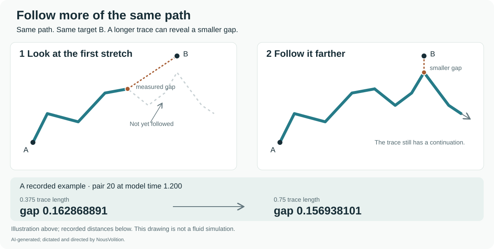
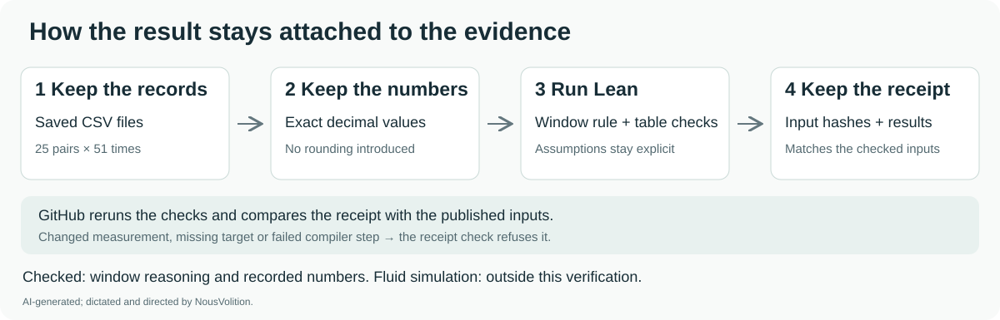
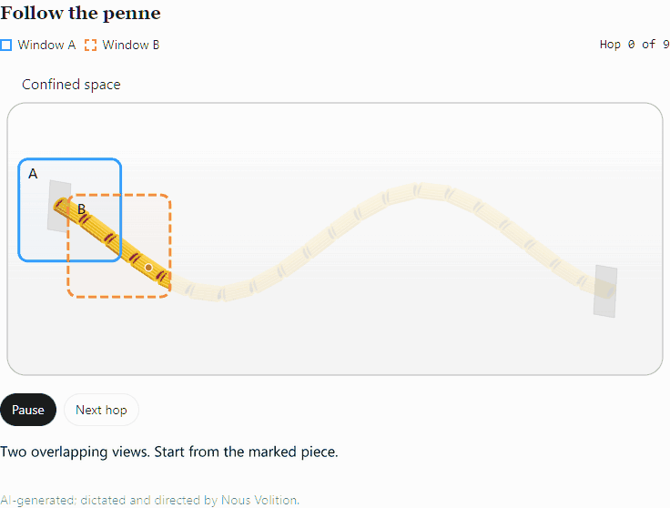

# Hug and SIMS: Lean 4 proofs and numerical studies

This project asks how a record can persist while its carrier, context and later use change. This repository contains Hug and SIMS models, language-model trials, numerical simulations, Lean 4 proofs and the records needed to inspect their claims. **The work is AI-generated, dictated and directed by NousVolition, an independent researcher.**

**Scope:** Yang–Mills and Navier–Stokes name comparison and audit topics here; this repository does not claim a solution to either Clay Millennium Prize problem.

The collection is also called **Correct and Lean**. Each result retains its own definitions and hypotheses, with successful checks, failed attempts and open claims recorded together.

A file ending in `Challenge.lean` states or collects the claims a solution must prove. The word `sorry` marks the space where a proof would go in that reference. To read the proof, look for `solution_module` in the package’s `comparator.json`. The automated checks reject proof placeholders in that module and its local imports, and check which axioms each listed theorem uses. [Read the challenges in everyday language](docs/comparator/README.md) · [Sources and credits](docs/comparator/CREDITS.md).

[Browse the Hug and SIMS proof and study index](hug-sims-proof-index.md) for all 32 README guides, including the plain-language theorem reader.

## Words used here

| Term | Meaning in these studies |
| --- | --- |
| **Traveller B** | A language model instructed to play a listener in a fictional restaurant scene. B’s answers are generated text. The one-continuing-B run records **`gpt-6-astra`**; the earlier restaurant trials used a default actor whose model version was **not pinned**. [Recorded model](lean/sims-mentor-first-thought-lean/one-traveller/reports.json) · [Earlier actor disclosure](lean/sims-mentor-first-thought-lean/reports.json) |
| **Pager** | The restaurant’s order buzzer, one possible source of the vibration in B’s pocket; the phone is another candidate. |
| **Witness** | Another character who has firsthand information about pressing the pager’s test button and seeing it respond. B receives that character’s account. |
| **Mentor** | The name used for the witness, “Other B,” in the later interviews. It identifies a role in the simulation. |
| **Basin refills** | Repeated stages of the circular-basin fluid simulation. Each stage starts from the preceding stage’s saved ending state. |

The **water particle B** in the separate Hug closest-point study is a tracked fluid-particle label, separate from the restaurant listener.

## Find a specific study

| Question | Where to start |
| --- | --- |
| How is Green strain objectivity proved in Lean 4? | [Green strain proof and verification receipt](provenance/green-objective-2026-11-08/README.md) |
| How do SIMS memory and witness accounts affect Traveller B? | [SIMS memory, witness and cue replay studies](lean/sims-meeting-thread-lean/README.md) |
| What changes in the Hug model at threshold 1? | [Hug threshold-1 trajectory and closest-point exchanges](research/hug-v3/threshold-one-follow-up/README.md) |
| How do viewing windows affect a measured gap? | [Lean window rule and exact recorded-number checks](research/hug-v3/finite-window-lean/README.md) |
| How were the matched-stretch fluid runs checked for convergence? | [Matched-stretch numerical study and convergence results](research/matched-stretch/final-matrix/README.md) |
| What do the completed breathing, refinement and repetition controls change? | [Recounted results and corrected conclusions](research/review-updates/2026-11-11/README.md) |

## Start here

### What `green_objective` proves

Changing the frame of a deformation preserves its Green strain. For any real 3 × 3 matrix `F` and any orthogonal matrix `Q` (`QᵀQ = I`), the theorem proves `green (QF) = green F`. The reason is that `(QF)ᵀ(QF) = FᵀF`, and Green strain is `(FᵀF − I)/2`. The result concerns this strain measurement. Whether the full dynamics have the same symmetry is a separate question. [Definition of Green strain](https://github.com/NousVolition/hug-sims-lean-proofs/blob/1f6fdc546eaedda451b5e38b6dff957260581023/lean/hug-v3-yang-mills-audit-lean/V3SourceCore.lean#L15-L30) · [Lean statement and proof](https://github.com/NousVolition/hug-sims-lean-proofs/blob/1f6fdc546eaedda451b5e38b6dff957260581023/lean/hug-v3-yang-mills-audit-lean/V3YangMillsAuditProofs.lean#L14-L33)

1. **Open the [8 November verification receipt](provenance/green-objective-2026-11-08/README.md).** On 8 November 2026 UTC, Comparator checked the frozen set of 20 declarations including `green_objective`. Both nanoda and Lean’s default kernel accepted the exported solution. The [transcript, lines 51–56](provenance/green-objective-2026-11-08/comparator.log#L51-L56), shows the theorem name and both acceptance messages.
2. **[Rerun the check on Linux](provenance/green-objective-2026-11-08/README.md#rerun-the-check).** The instructions give the tested environment, the exact source revision and the outputs to compare. The dated receipt records a specific replay. The [CI workflow](.github/workflows/lean-build.yml) also runs Comparator with both kernels, builds the default targets and queries Lean about each solution theorem’s axioms.

### Traveller B and cue replay

Five paired restaurant simulations gave Traveller B the same firsthand witness account about the original pocket tremble. At the next probe, B identified the pager in **5 of 5 cases with an explicit sensory replay and 5 of 5 without**. When the witness described testing someone else’s pager, all ten answers stayed open. Both versions retained a reference to the original incident. [Paired readings](lean/sims-meeting-thread-lean/observations/pager-return/readings.tsv) · [Study and controls](lean/sims-meeting-thread-lean/README.md#does-b-need-to-revisit-the-feeling)

### What B said before and during the certainty questions

Three later no-replay studies kept the mentor's account and used separate interview protocols. With the original wording, **2 of 5** first thoughts referred to B's own earlier feeling. In a fresh-listener sweep, **all 65 open answers were tentative** and two direct answers identified the pager, at primes 13 and 37. One continuing B then stayed tentative at all **13 checkpoints**, while mentioning the personal feeling in five open answers. The continuing encounter lasted 1.2 simulated seconds and used repeated interviews. These observations leave private experience and later recognition open. [Studies and protocols](lean/sims-mentor-first-thought-lean/README.md) · [One continuing B](lean/sims-mentor-first-thought-lean/one-traveller/README.md) · [20-target proof receipt](lean/sims-mentor-first-thought-lean/evidence-linux/source.json)

### Which of two trembles was the pager?

Traveller B felt two similar trembles. The witness described the pager test without naming either episode. With a sound clue, B identified the right tremble in **6 of 6** paired cases with both moments replayed and left **6 of 6 open** without replay. An action B already remembered identified the right moment in both arms (6 of 6 each). A generic witness statement left all 12 answers open. [Study, controls and Lean result](lean/sims-meeting-thread-lean/observations/two-trembles/README.md) · [Paired readings](lean/sims-meeting-thread-lean/observations/two-trembles/readings.tsv)

### Can a remembered action catch a reversed replay?

After the two sounds were replayed in the wrong order, B chose the wrong tremble in **4 of 6** worlds and left two open. A memory tying the witnessed sound to a specific action corrected **3 of those 4** wrong choices. The fourth answer changed to OPEN and explicitly described the clash. Mentioning the same action and sound without tying their timing together left all four wrong choices in place. [Experiment and proof](lean/sims-meeting-thread-lean/observations/reversed-replay/README.md) · [Transitions](lean/sims-meeting-thread-lean/observations/reversed-replay/readings.tsv)

The cue model also checks what it takes to come back close to a starting point. A recorded cue must first leave a chosen radius and a later cue must re-enter it. The witness can resolve a matching event even when every later cue stays outside that radius. [Return test and examples](lean/sims-meeting-thread-lean/README.md#when-does-a-cue-count-as-a-return)

### Hug thresholds and what Lean checked

The threshold-0.015 energy study and the threshold-1 closest-point study answer different questions. Their results remain separate.

| Experiment | Recorded result | Lean and publication status |
| --- | --- | --- |
| **Threshold 0.015 — energy accounts** | The saved three- and four-write Hug runs record work, heat and stored energy. | Nine named statements in open [PR #14](https://github.com/NousVolition/hug-sims-lean-proofs/pull/14) passed Comparator, Lean's kernel, nanoda and the build. They check the finite ledger arithmetic and displayed rounding for those measurements. [Proof run and artifacts](https://github.com/NousVolition/hug-sims-lean-proofs/actions/runs/42852357760) |
| **Threshold 1 — same A and original partner** | With breathing on from the original starting state, three late closest-point exchanges occur near **1.180910, 1.182077 and 1.199281**, before tick 41 at time 1.2. | Published numerical records with local consistency and refinement checks. **No Lean check of this trajectory or these switches.** Spatial and full-history convergence remain open. [Study, settings and records](research/hug-v3/threshold-one-follow-up/README.md) |

PR #14 also checks sixteen statements for a separate two-memory mathematical example and supporting lemmas, including transport around a closed cue route. Its passing proof evidence establishes the listed claims under their stated rules and assumptions. Whether those rules faithfully represent the intended Hug is a separate modeling question. Both packages now include their actual passing reports, Linux logs, axiom lists and source/input provenance on the PR branch. [Exact scope of PR #14](https://github.com/NousVolition/hug-sims-lean-proofs/pull/14)

The matched threshold-1 breathing-off control is complete. It resolves five earlier closest-point exchanges and finds none in the two late windows containing the three breathing-on examples. Breathing changes the measured history and is not necessary for every exchange. These are verified examples, not exhaustive counts; 24 rapid route changes remain unresolved. [Control, scope and saved evidence](research/review-updates/2026-11-11/README.md#breathing-changes-the-observed-switches)

The measured line also has a finite viewing window. Whether its edge hides a continuation of the connection is an open interpretation to investigate by following more of the same path. [Connection beyond the visible trace](research/hug-v3/threshold-one-follow-up/README.md#connection-beyond-the-visible-trace)

### Follow farther, then check the record

The window rule is a short proof. The practice around it is worth showing:

**Lean checked the window rule and recorded numbers, not the fluid simulation.** The table covers 25 pairs at 51 times in the threshold-0.015 study. This does not certify the solver, line integration, closure or reconnection, or change the separate threshold-1 trajectory result. [Proofs, assumptions and records](research/hug-v3/finite-window-lean/README.md) · [GitHub receipt](research/hug-v3/finite-window-lean/github-receipt.json) · [GitHub checks](https://github.com/NousVolition/hug-sims-lean-proofs/actions/workflows/finite-window-lean.yml)

### Follow the penne

The illustration and animation show the dictated idea of a continuing path within a confined space, without the path closing back on itself. Two overlapping viewing windows take turns hopping along the penne. This is a conceptual illustration; it adds no fluid measurement or Lean result.

[Original illustration](docs/penne-leapfrog/follow-the-penne.png) · [Animation, interactive version and scope](docs/penne-leapfrog/README.md)

### Portfolio index

- [SIMS two-memory model, restaurant trials and basin refills](lean/sims-meeting-thread-lean/README.md) · [Meeting-package proof receipt](lean/sims-meeting-thread-lean/verification-report.json).
- [Traveller B's first thoughts and certainty at the prime ticks](lean/sims-mentor-first-thought-lean/README.md) · [First-thought-package proof receipt](lean/sims-mentor-first-thought-lean/verification-report.json).
- [Proof and verification status](PROOF-STATUS.md): what each package actually establishes.
- [Lean packages](lean/README.md): source modules, pinned dependencies, build instructions and saved checking records.
- [Corrected Hug v3 proof, revision 2](research/hug-v3/corrected-proof-revision-2/proof.md) ([PDF](research/hug-v3/corrected-proof-revision-2/corrected-proof.pdf)): written local existence/uniqueness and conditional continuation through accepted writes.
- [Hug v3 continuation work](research/hug-v3/continuation-proof/continuation-proof.md): additional written bounds and static checks; the full all-write validity theorem remains unfinished.
- [Matched-stretch final report and seven charts](research/matched-stretch/final-matrix/README.md): all 48 original runs reached t = 0.40; independent numerical auditing passed, while spatial and finest-timestep convergence screens failed.
- [Comparison and audit records](research/comparisons/README.md): the separate Navier–Stokes formal-development audit and A/S comparisons, with their original scope statements.
- [Publication notes and file digests](provenance/PUBLICATION.md), including the [original collection manifest](provenance/files.json).

## How to read “verified”

**Lean-checked** refers to the exact declarations, assumptions and permitted axioms in a named package. Saved Comparator, Lean-kernel and nanoda records accompany the relevant packages. The original collection preserved the build records available at publication. The dated receipt above records a later replay of the Hug v3 Yang–Mills audit package.

**Written proof** refers to the mathematical argument in the document. It is not automatically a Lean certificate. **Numerical verification** checks the saved computations and reporting; it is not a proof that unresolved approximations follow the exact continuum solution.

The full Hug v3 continuation through every scheduled memory write is still open. The numerical study does not prove a continuum PDE theorem or a physical stability threshold.

## Preservation and use

The historical receipts name the source revision and record the original outcomes, including failures. The public copies use repository-relative paths and stable labels for external sources. The publication map records the original and current digests of the affected files. Earlier Git revisions keep their original contents. [Publication notes](provenance/PUBLICATION.md)

Every Lean directory has its own toolchain, Lake configuration and dependency lockfile. Its `verification-report.json` gives the scope of the checked statements, the four checker outcomes and the remaining open items. GitHub Actions publishes fresh evidence separately for each package it verifies. [Package index and reproduction instructions](lean/README.md)

## Related NousVolition projects

- [Streams and Rocks](https://github.com/NousVolition/Nous-Volition) — fluid dynamics, SIMS and community studies.
- [Semantic Organizer Bot](https://github.com/NousVolition/semantic-organizer-bot) — language discovery, source review, HermiT and lambeq tools.
- [SIMS evolving guard studies](https://github.com/NousVolition/My-Sources-Project-ALL) — original framework, asymmetric interaction tests and source archive.

## License

Copyright © 2026 NousVolition. All rights reserved. See the [copyright notice](LICENSE) for the terms that apply to reuse of the original work in this repository.
