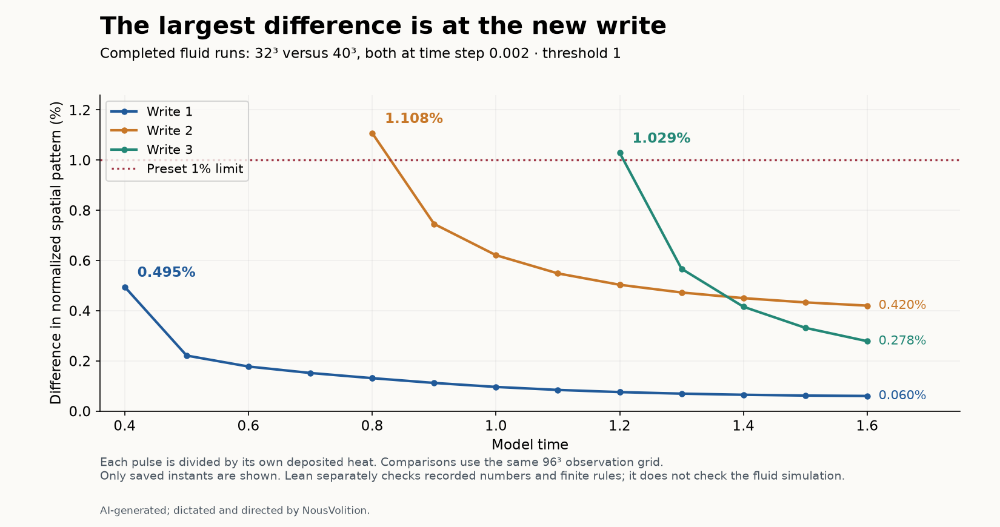
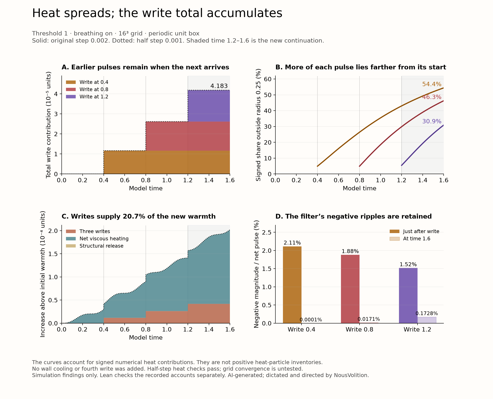
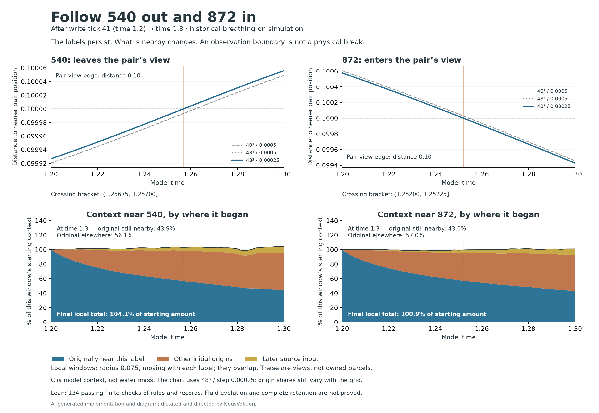
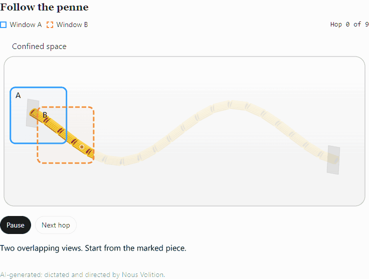
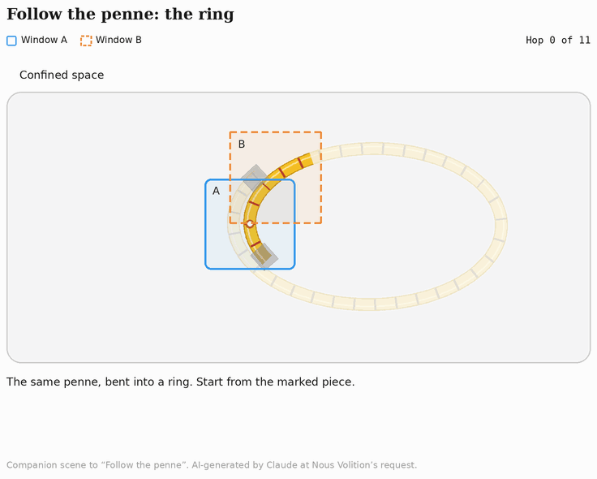
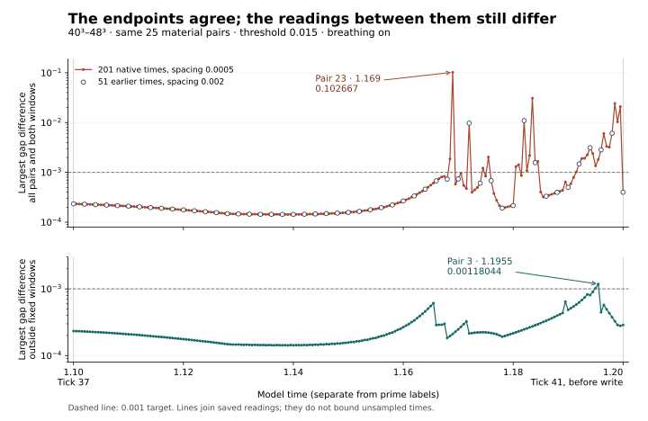
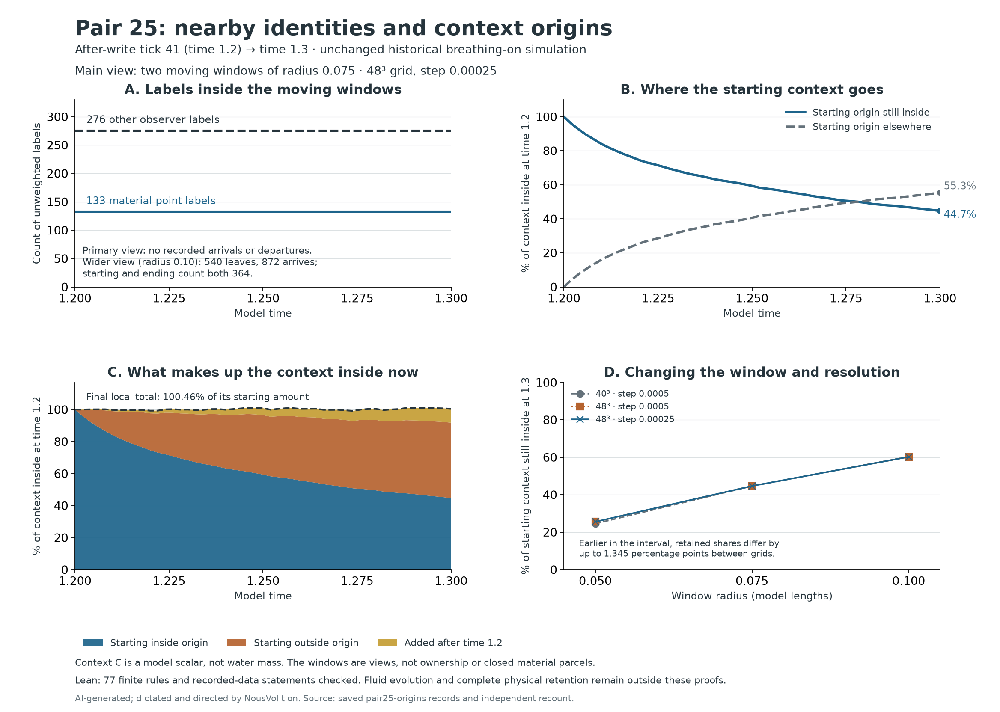

# Hug and SIMS: follow the connection to tick 41

**The question:** how can a record persist while its carrier, surroundings, relationships, and later use change? What can an observer tell from a limited view?

This collection develops that question through numerical studies, language-model encounters, and Lean proofs. It is also called **Correct and Lean**. Each result keeps its own assumptions and limits.

**AI-generated; dictated and directed by NousVolition, an independent researcher.** Individual files retain their source and model credits.

**New readers: start with the [plain-language walkthrough of the 19 core proof packages](lean/README.md#plain-language-walkthrough).** It takes the packages in order and explains what is proved and what remains unfinished. The short route below introduces the question and its recorded examples.

## A short reading route

1. **Start with the question.** Keep two questions in view: what persists, and what can this particular observation tell us about it?
2. **Look at one recorded example.** In [Pair 25's wider observation window](research/hug-v3/pair-origin-study/README.md), the endpoint count is 364, while observer 540 leaves and 872 arrives. The same count can hide changed membership. [Follow 540 and 872 individually](research/hug-v3/observer-follow-study/README.md) to see what stays nearby and what changes. These are recorded simulation observations, with their settings and limits attached.
3. **Use the illustration to understand the viewing limit.** The penne pasta gives a continuing path a visible form. In the open-path scene, the pasta stays still while two overlapping viewing windows advance. Start from the marked piece and notice how the path continues beyond the visible window. Then [view the penne illustrations](docs/penne-leapfrog/README.md). They illustrate the viewing question. The supplied Claude credit is retained.
4. **Read the exact mathematical claims.** The [observation package](research/ambiguous-observation-lean/README.md) starts with a table connecting each observation to the property it cannot determine. Its Tick 41 and Pair 25 proofs concern supplied summaries and numbers; Lean does not establish the simulations or their transcription.

For wider context, the [tick-41 guide](docs/tick-41/README.md) walks through identity, viewing window, checkpoint, and history. In the fluid studies tick 41 labels model time 1.2; the restaurant encounter has its own clock.

## Study updates

Open a study for its observations, diagrams, proof scope and remaining questions.

<strong>Finer-grid heat: time-step checks pass; grid settling still fails — 414 separate Lean checks</strong>

**Simulation:** five runs on 16³–40³ grids retain the same threshold 1, breathing intervention, 384 material points and record encoding. The 40³ time-step halving passes. Between 32³ and 40³, accumulated write heat agrees within 0.20317%, while the second and third new-write patterns differ by 1.1077% and 1.0291%. The declared grid-settling test still fails. Later spreading agrees more closely. Exact byte changes are counted separately and are not a heat-error measure.

**Lean:** 414 passing targets check five finite rules and 409 recorded claims, including recorded numerical failures as exceedances. They do not run or prove the fluid simulation, derive the spatial measurements, or prove convergence. The original 56-check 16³ study, 12-check heat draft and threshold-0.015 studies remain separate historical records.

[Results and four diagrams](research/hug-v3/heat-grid-study/README.md) · [Lean scope](research/hug-v3/heat-grid-lean/README.md) · [GitHub receipt](research/hug-v3/heat-grid-lean/github-lean-receipt.json)

<strong>Following heat after three writes: threshold 1 — 56 Lean checks; finer grids were outside this historical study</strong>

## Following heat after three writes: threshold 1

**Simulation findings:** in the historical breathing-on **16³** run, each write pulse broadens while earlier pulse totals remain when later writes arrive. At time **1.6**, the three writes contribute **4.18336 × 10⁻⁵** heat units. **Time-step checks passed** when changing 0.002 to 0.001: deposited heat differs by at most **0.00610%**. **Finer grids were outside this historical study; see the separate finer-grid result above.** The filtered source labels retain small negative ripples; they are signed accounts, not individual heat parcels. All three record checksums change despite close heat agreement, so identical stored bytes are not established.

**Lean findings:** **56 checks** cover four finite accounting rules and exact recorded accounts/diagnostics from **2,408 rows**. The full package build and target-by-target dependency audit have their own receipt. Lean does not run or verify the fluid simulation, compute the grid-derived spread measures, or prove spatial convergence. These checks are separate from the earlier **12-check heat draft** and the **threshold-0.015 540/872 study**.

[Results and both diagrams](research/hug-v3/heat-follow-study/README.md) · [56 checks and scope](research/hug-v3/heat-follow-lean/README.md) · [GitHub build receipt](research/hug-v3/heat-follow-lean/github-lean-receipt.json) · [What the residual encoding comparison measures](research/hug-v3/heat-follow-study/encoding-example/README.md)

<strong>Heat from writing: threshold 1 — 12 Lean checks; heat spreading remains unproved</strong>

## Heat from writing: a separate threshold-1 result

**Twelve Lean checks pass** for the supplied heat draft: the declared stroke-heat rule, why heat alone cannot recover every signed stroke, work/stored-energy/heat accounting, and viscosity bounds under stated hypotheses. The heat term is charged when a write changes a stored mark; it does not show continuous heating from an unchanged hold.

**Recorded threshold-1 result:** the breathing-on replay at tick 41 (time 1.2, native step 0.002) has a small decrease in stored energy, so recorded heat slightly exceeds supplied work. Lean checks the exact transcribed numbers and their balance tolerance. These numbers and 12 checks are separate from the threshold-0.015 540/872 study below.

**Scope of the 12-check draft:** Lean has not proved heat spreading, fluid evolution, trajectories, the connection from temperature to the bounded `tanh` parameter, or complete retention. [Draft, reading diagram, exact numbers and limits](research/hug-v3/heat-writing-lean/README.md) · [GitHub receipt](research/hug-v3/heat-writing-lean/github-lean-receipt.json)

<strong>Following observers 540 and 872 — 134 finite checks; complete retention remains unknown</strong>

## Follow 540 out and 872 in

**Simulation findings:** following the same after-write tick-41 state from **time 1.2 to 1.3**, each label keeps the same **eight nearby material labels** at every recorded step. In the finest run, **43.94%** of the context originally near 540 and **42.95%** of that originally near 872 remains nearby at the end; the rest is elsewhere in the basin as other context enters. Their radius-0.075 neighborhoods overlap and are views, not private cargo. Context C is not water mass. These remain the historical **threshold-0.015, breathing-on** runs. The smaller time step closely agrees, while origin shares and crossing times still differ by grid.

**Lean findings:** **134 finite checks pass** for rules, recorded neighbor and crossing histories, context accounts, material-field numbers and shared-record bytes. The GitHub recheck matches the exact proof inputs and targets. It does not prove the fluid simulation, physical ownership or complete retention.

**Still unknown: does everything stay with 540 and 872?** Neither has a complete private inventory in this model. A viewing boundary does not establish a break in the continuing connection or a handoff between them.

[Results, crossings and limits](research/hug-v3/observer-follow-study/README.md) · [134 Lean checks](research/hug-v3/observer-follow-lean/README.md) · [GitHub proof receipt](research/hug-v3/observer-follow-study/github-lean-receipt.json)

## Keep these two examples separate

| Example | What is established |
| --- | --- |
| **Real-valued `readJet` projection** | Equal order-zero readings can have different first derivatives. [Source](research/ambiguous-observation-lean/YangMillsInstance.lean) |
| **Abelian field-equation comparison** | Two explicit potentials agree on the slice `x₁ = 0`, while their field-equation residuals are 0 and 2. [Source](research/ambiguous-observation-lean/YangMillsCueTest.lean) |

These are separate results. Neither establishes an admissible Yang–Mills family or a mass-gap theorem. [Their scope, logs, and credits](research/ambiguous-observation-lean/README.md)

**Combined theorem, in its own package:** [values and first derivatives agree; the second transverse derivative reveals residuals 0 and 2](research/combined-yang-mills-lean/README.md). Twelve new named results passed the local Lean and standard-axiom audit. [Proof and logs](research/combined-yang-mills-lean/README.md#files-and-reproduction) · [Corrected attribution](research/combined-yang-mills-lean/CREDITS.md).

The intended HugandNavier system keeps the carrying relationship continuous while configurations change. Its underlying formulation is unforced; breathing is an added intervention in particular experiments. [Retained source meaning](research/comparisons/hug-navier-single-system-scope-correction.md#meaning-to-preserve-across-implementations)

## Find a specific record

[What is proved and still open](PROOF-STATUS.md) · [All studies](hug-sims-proof-index.md) · [Lean packages](lean/README.md) · [Package credits](research/ambiguous-observation-lean/CREDITS.md) · [Reuse terms](LICENSE)

The complete research tour, numerical details, images, and existing section links remain below.

<strong>Expand the full research tour and archive links</strong>

**Start from the marked piece. Follow the connection. Read what has changed at tick 41.**

This work asks how a record can persist while its carrier, context, relationships and later use change. It is still taking shape. The studies develop that question through coupled models, moving views, numerical measurements, language-model trials and Lean 4 proofs.

**AI-generated; dictated and directed by NousVolition, an independent researcher.** The collection is also called **Correct and Lean**. Individual files retain their source and model credits.

## Start at tick 41

Tick 41 is the organizing checkpoint for this reading path. In the fluid studies below, it labels **model time 1.2**. In the continuing Traveller B study, it labels **1.2 simulated seconds after the mentor's last word**. Each study retains its own clock and protocol.

The intended HugandNavier system keeps the carrying relationship continuous while its configuration changes. Flow and participant states affect the guards on their relationships; those guards shape interaction and stress, which feed into later flow and states. The intended underlying system is unforced. Some recorded experiments add breathing as a controlled intervention. [Retained meaning and source correction](research/comparisons/hug-navier-single-system-scope-correction.md#meaning-to-preserve-across-implementations) · [Single-system formulation](lean/hug-navier-single-system-lean/README.md)

[**Read the tick-41 guide**](docs/tick-41/README.md) for the full sequence, definitions and links to the evidence.

| Reading step | What to follow | Open the record |
| --- | --- | --- |
| **1. Keep the starting piece** | Preserve the named starting point or particle while following its history. | [Same water particles](research/hug-v3/threshold-one-follow-up/README.md) |
| **2. Follow the view** | Let overlapping windows reveal more of the continuing path. | [Penne illustrations](docs/penne-leapfrog/README.md) |
| **3. Read at tick 41** | Distinguish distance to another target, the location of a closest point, and a miss on returning to the start. | [Definitions and checkpoint](docs/tick-41/README.md#read-the-checkpoint) |
| **4. Change one part of the observation or run** | Extend the trace, refine the grid or time step, or compare breathing conditions with the settings attached. | [Window rule](research/hug-v3/finite-window-lean/README.md) · [Grid, time-step and sampling audit](research/tick-35-41-audit/README.md) · [Breathing control](research/hug-v3/threshold-one-follow-up/README.md#completed-breathing-off-control) |
| **5. Follow a discrepancy into later flow** | Read the frozen radial scan, then evolve a fine-only difference from the same checkpoint. | [Return-miss scan](research/hug-v3/tick-41-radial-return/README.md) · [Fine-to-broad test](research/hug-v3/tick-41-wave-transfer/README.md) |
| **6. Follow the claim back to its evidence** | Read the observations, exact mathematical statement and remaining question together. | [Proof and verification status](PROOF-STATUS.md) · [Study index](hug-sims-proof-index.md) |

## Two views of the continuing penne

These are illustrations of the question. The windows move along the penne; the marked piece supplies a starting reference.

| Follow along the path | Follow around and inspect the return |
| --- | --- |
|  |  |
| The open-path scene ends at a cover, with the penne continuing out of view. | The ring scene brings the view back near the marked piece and enlarges the miss for inspection. |

The ring companion retains its on-screen credit to Claude at Nous Volition's request. [Illustrations, interactive version and credits](docs/penne-leapfrog/README.md)

## What the published tick-41 records show

The settings travel with each result. The two threshold studies and the language-model encounter are distinct experiments.

| Study | Recorded finding | What remains open |
| --- | --- | --- |
| **Threshold 0.015: extend the finite trace** | Across 25 pairs and 51 saved times, all 1,275 recorded gaps on the 0.75 trace are no larger than on the 0.375 trace. Lean checks the table and the general nested-window rule. | Applying the rule to a complete evolving flow requires the path, target and observation assumptions to hold. [Evidence](research/hug-v3/finite-window-lean/README.md) |
| **Threshold 0.015: grids through tick 41** | At ticks 37 and 41, **all 25 pairs** meet the 0.001 target between 40³ and 48³. Every-step readings between them show **16 pairs** above target; the largest difference is **0.102666868** at time 1.169. | Pair 3 also exceeds the target outside the fixed transition windows. Full-history time refinement at the new extrema, material-quadrature and continuum convergence remain open. [Audit and source readings](research/tick-35-41-audit/README.md) |
| **Threshold 1: same A and original B** | With breathing on, three resolved late closest-point exchanges precede tick 41. The matched off branch has none in those late windows and has five resolved earlier examples. | These are resolved examples; 24 rapid route changes and spatial/full-history convergence remain open. [Study and control](research/hug-v3/threshold-one-follow-up/README.md) |
| **Threshold 1: evolve from the post-write state** | In the breathing-off 32³ continuation from 1.2 to 1.22, a fine-only velocity difference falls 75.97% while a small broad difference develops; time-step and amplitude controls agree. | Its connection to the large frozen-curve return misses remains open. [Result, plots and replay](research/hug-v3/tick-41-wave-transfer/README.md) |
| **SIMS: one continuing Traveller B** | At tick 41, B says: “I’m unsure whether that was the buzz I felt.” The same encounter retains earlier replies through thirteen checkpoints. | The repeated interviews may affect later answers; private experience and recognition after 1.2 seconds remain open. [Verbatim record and protocol](lean/sims-mentor-first-thought-lean/one-traveller/README.md) |

The water particle B, the penne's viewing window B and the restaurant listener B have different roles. The guide keeps those referents visible.

### Fluid-grid and time-step checks

The 48³ time-step halving changes the gap by at most **0.000100423** on the **51 common saved times** and passes its targets. The newer every-step audit finds a larger spatial discrepancy at 1.169 and outside-window failures at 1.195 and 1.1955; those times are absent from that full-history time-control output. Its tracing record also retains one newly exposed failure and the direct-Fourier correction. [Ticks 35–41 audit](research/tick-35-41-audit/README.md) · [Earlier 51-sample results and matched meters](research/hug-v3/finer-grid-study/README.md)

The tick-41 gap sample is taken **before the write at time 1.2**. The write preserves carried positions and velocity at that instant and changes the stored fabric target and heat. The new record feeds the coupled relationship equations; rate changes need their own before/after readings. That gap run ends at the write. The separate pair-25 continuation below measures the following window; it does not establish the write's causal effect against a matched no-write control.

## What stays with pair 25 after tick 41?

**Origin simulation findings:** three continuations follow the saved **after-write tick-41 state (time 1.2) to time 1.3**, retaining threshold **0.015** and breathing on. In the main moving windows (radius 0.075), the same **133 material points and 276 other observer labels** remain inside at every recorded step. In the finest time-step run, **44.65%** of the context contribution initially inside is still inside; **55.35%** is elsewhere in the domain. Incoming and newly added context keep the local total at **100.46%** of its starting amount. This tracks the model's context scalar, not water mass.

**A wider view catches a change the count hides:** at radius 0.10, observer **540 leaves** and **872 arrives** in every run. The starting and ending count is **364**, with different members. Crossing identities agree across runs, but crossing times differ by grid. The retained-context fraction differs by only **0.048812 percentage points** at the endpoint between 40³ and 48³, yet by up to **1.344660 points earlier**. These new fractions are not established as continuum-converged.

**Lean findings:** **77 finite statements pass**, checking recorded identity histories, departing and arriving IDs, material-field change numbers, full shared-memory contents and exact context-origin accounts. The three shared records remain unchanged across **2,409 payload comparisons**. Lean checks the recorded numbers and rules; it does not prove the fluid simulation, geometric interpolation or physical ownership of contents.

**Still unknown: does everything stay with the pair?** A/B have no complete private physical inventory. The windows are views, and context outside a window is not destroyed. This test starts after the tick-41 write and does not recover the earlier encounter's starting inventory.

[Origin results, settings and limits](research/hug-v3/pair-origin-study/README.md) · [77 Lean checks and original receipt](research/hug-v3/pair-origin-lean/README.md) · [GitHub proof receipt](research/hug-v3/pair-origin-study/github-lean-receipt.json)

**Earlier retention study, preserved separately:** its **459 payload comparisons** and **40 Lean statements** remain their own results. Its original 40³ local accounting check failed; a controlled correction at observation-cell crossings closed that account with unchanged simulated states and sampled values. [Earlier results and diagram](research/hug-v3/pair-retention-study/README.md) · [Earlier Lean package](research/hug-v3/pair-retention-lean/README.md) · [Earlier GitHub receipt](research/hug-v3/pair-retention-study/github-lean-receipt.json)

## Proofs and the questions they answer

### What the same observation can hide

The [ambiguous-observation package](research/ambiguous-observation-lean/README.md) contains the Tick 41 and Pair 25 summary instances and two distinct mathematical comparisons. `YangMillsInstance` uses the submission's `readJet` definition in a real-valued projection example: equal order-zero readings can have different first derivatives. `YangMillsCueTest` compares explicit abelian potentials agreeing on `x₁ = 0`, with field-equation residuals 0 and 2. The latter is a field-equation comparison; neither result establishes an admissible Yang–Mills family. [Proof sources, logs and build instructions](research/ambiguous-observation-lean/README.md#verification-and-reproduction) · [Preserved credits](research/ambiguous-observation-lean/CREDITS.md)

### What `green_objective` proves

For a real 3 × 3 deformation matrix `F` and an orthogonal frame change `Q`, Lean proves `green (QF) = green F`. It establishes invariance of this strain measurement under the stated frame change. The 8 November 2026 receipt records Comparator, Lean-kernel and nanoda acceptance of the frozen 20-declaration set containing this theorem. [Statement and proof](https://github.com/NousVolition/hug-sims-lean-proofs/blob/1f6fdc546eaedda451b5e38b6dff957260581023/lean/hug-v3-yang-mills-audit-lean/V3YangMillsAuditProofs.lean#L14-L33) · [Receipt and reproduction](provenance/green-objective-2026-11-08/README.md)

The finite-window package proves a different, directly useful rule for the viewing question: enlarging a nested search window on the same path, at the same time and against the same target, cannot increase its minimum distance. Its recorded-number checks and numerical solver checks have different scopes. [Window proofs and exact inputs](research/hug-v3/finite-window-lean/README.md)

The single-system package contains ten completed theorems and an unfinished full PDE evolution target. The broader Hug v3 all-write continuation question also remains open. [Single-system results](lean/hug-navier-single-system-lean/RESULTS.md) · [Hug v3 continuation work](research/hug-v3/continuation-proof/continuation-proof.md)

## Continue through the other studies

| Question | Record |
| --- | --- |
| How does a witness account change what Traveller B says? | [Memory, witness and cue replay](lean/sims-meeting-thread-lean/README.md) |
| What changes between the first thought and later certainty questions? | [First-thought, fresh-listener and continuing-session studies](lean/sims-mentor-first-thought-lean/README.md) |
| Which of two similar trembles matches the witnessed event? | [Two-tremble study](lean/sims-meeting-thread-lean/observations/two-trembles/README.md) |
| Can a remembered action correct a reversed sound replay? | [Reversed-replay study](lean/sims-meeting-thread-lean/observations/reversed-replay/README.md) |
| What do the completed breathing, history and repetition controls change? | [Recounted results and corrected conclusions](research/review-updates/2026-11-11/README.md) |
| What survives matched-stretch numerical checks? | [48-run report and convergence results](research/matched-stretch/final-matrix/README.md) |
| What do the energy-account and two-memory proofs check? | [Exact scope and receipts in PR #14](https://github.com/NousVolition/hug-sims-lean-proofs/pull/14) |
| Where are the written arguments and comparison audits? | [Corrected Hug v3 proof](research/hug-v3/corrected-proof-revision-2/proof.md) · [Comparison records](research/comparisons/README.md) |

## How to read the evidence

**Illustration** develops the question. **Numerical observation** reports a specified computation and its checks. **Written proof** gives an argument under stated assumptions. **Lean-checked** identifies exact declarations, hypotheses and permitted axioms. Each can support the next step when the connection between them is established.

A `Challenge.lean` file collects reference claims; `solution_module` in `comparator.json` identifies the corresponding proof. Package checks reject proof placeholders in that solution and audit the listed declarations. [Challenges in everyday language](docs/comparator/README.md) · [Sources and credits](docs/comparator/CREDITS.md) · [Full proof status](PROOF-STATUS.md)

Yang–Mills and Navier–Stokes are comparison and audit topics here. The repository makes no claim to solve either Clay Millennium Prize problem.

## Working questions

At tick 41, how much of an observed gap depends on the trace window, where the curve returns, the discretization or the preceding coupled history? Which conclusion survives when the observation changes while the starting identity is retained?

Those questions organize the next reading and measurement. The current results remain attached to their settings, and the developing interpretation remains open to correction.

Words used in the restaurant and basin studies

| Term | Meaning |
| --- | --- |
| **Traveller B** | A language model playing a listener in a fictional restaurant. The continuing-B run records `gpt-6-astra`; the earlier default actor's version was not pinned. [Model record](lean/sims-mentor-first-thought-lean/one-traveller/reports.json) · [Earlier disclosure](lean/sims-mentor-first-thought-lean/reports.json) |
| **Pager** | The restaurant's order buzzer, one candidate source of the pocket vibration. |
| **Witness / mentor** | A character reporting firsthand information about pressing TEST and seeing the pager respond. |
| **Basin refills** | Successive simulation stages, each beginning from the preceding saved ending state. |

## Portfolio index and preservation

[Complete study index](hug-sims-proof-index.md) · [Lean packages and reproduction](lean/README.md) · [Publication notes](provenance/PUBLICATION.md) · [Original collection manifest](provenance/files.json)

Historical receipts retain their source revisions and original outcomes, including failures. Current study pages link the relevant definitions, files, checks and open items.

## Related NousVolition projects

- [Streams and Rocks](https://github.com/NousVolition/Nous-Volition) — fluid dynamics, SIMS and community studies.
- [Semantic Organizer Bot](https://github.com/NousVolition/semantic-organizer-bot) — language discovery, source review, HermiT and lambeq tools.
- [SIMS evolving guard studies](https://github.com/NousVolition/My-Sources-Project-ALL) — original framework, asymmetric interaction tests and source archive.

## License

Copyright © 2026 NousVolition. All rights reserved. See the [copyright notice](LICENSE) for terms applying to reuse of the original work.

