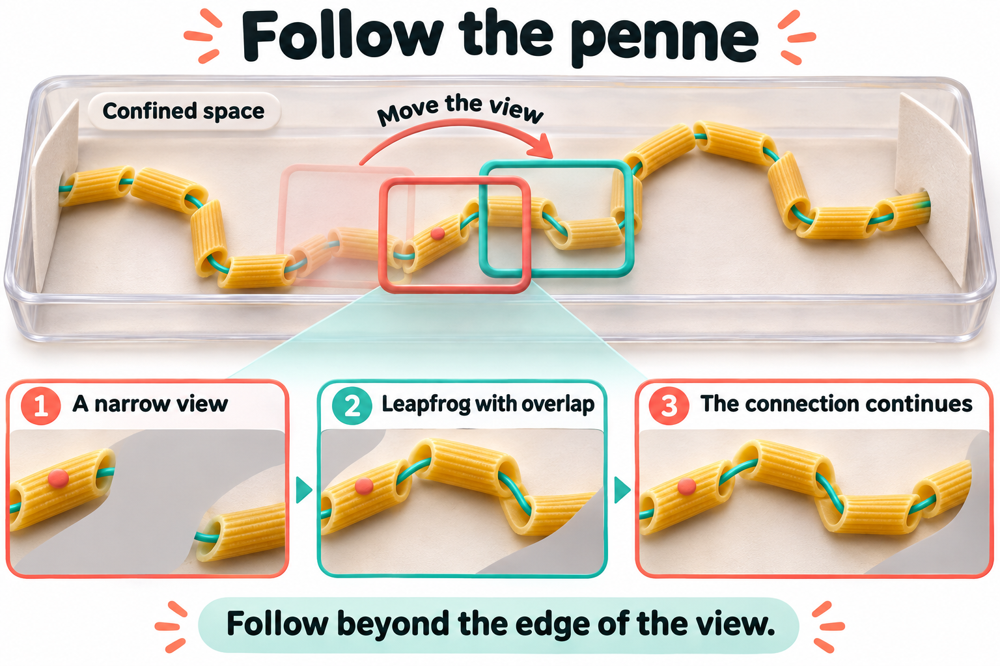
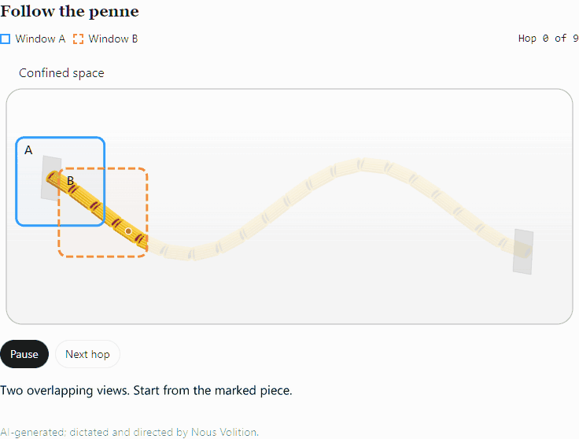
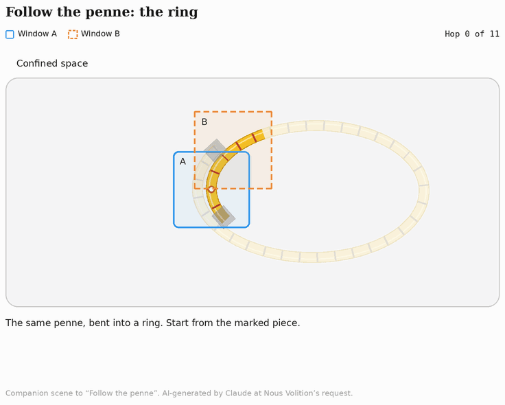

# Follow the penne

**AI-generated; dictated and directed by NousVolition.**

NousVolition's dictated idea is a continuing path within a confined space, without the path closing back on itself. Two viewing windows take turns hopping along the penne, landing with overlapping views. The penne stays still as the view moves beyond the first apparent gap.

## Original illustration

## Open-path animation

The preview plays through once and stops at the far cover. The path continues out of sight; its ends are not joined.

For **Play/Pause** and **Next hop**, download [the interactive version](index.html) using GitHub's **Download raw file** button, then open it in a browser. It is self-contained and also supports a narrow screen and reduced motion. The [editable animation source](penne-leapfrog-source.html) is preserved separately.

## Ring-return companion

The companion's opening reads “The same penne, bent into a ring. Start from the marked piece.” Its final close-up shows the return miss. The supplied GIF is preserved unchanged, including its on-screen credit: “AI-generated by Claude at Nous Volition’s request.” This preview repeats.

## Meaning and scope

The concept, corrections and direction were dictated by NousVolition; AI generated the illustration and implemented the animation. The visible credit appears in the interactive version and the moving preview. The original generated picture is preserved unchanged.

The original open-path scene is an illustration of the stated idea. It contains no Hug trajectory measurements and makes no Lean-checked claim about a water path. Its drawn connection is supplied by construction. Whether a viewing boundary explains a measured experimental gap requires the corresponding experiment.

## Open-path animation checks

The browser checks confirmed that A moves while B stays fixed, then B moves while A stays fixed; the penne positions remain unchanged; landed views overlap; a single hop pauses; playback stops at the end; and manual replay works. The layout was inspected in light and dark themes, including narrow screens. Reduced-motion stepping was checked. The open-path GIF has no repeat-loop instruction.

File hashes and the scope of these checks are recorded in [verification.json](verification.json). These are animation checks, not new simulation or proof results. Existing experiment records and proof receipts retain their own scope.
