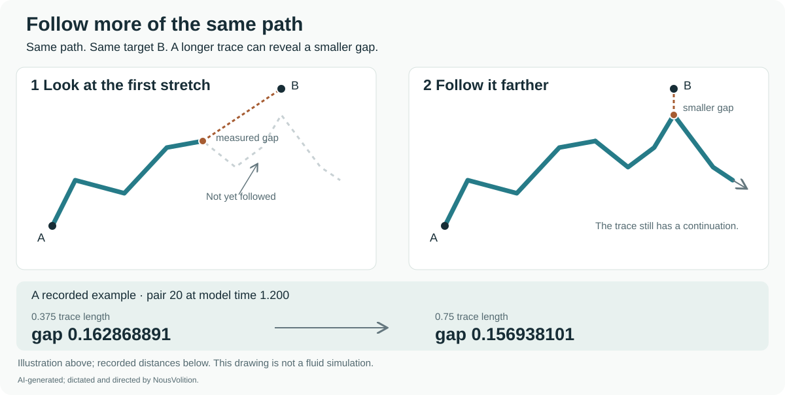

# Tick 41: follow the connection and read what changed

[Project overview](../../README.md) · [All studies](../../hug-sims-proof-index.md) · [Penne scenes](../penne-leapfrog/README.md) · [Ticks 35–41 audit](../../research/tick-35-41-audit/README.md)

**Start from the marked piece. Carry its identity through the reading. At tick 41, inspect the path, the observation and the history that brought them there.**

This guide gives the developing work a reading order. The intended carrying relationship stays continuous while configurations can change. Hug belongs within the intended shared evolution of fluid, material, records and relationships. The [retained source meaning](../../research/comparisons/hug-navier-single-system-scope-correction.md#meaning-to-preserve-across-implementations) is the reference when interpreting a particular implementation.

## Keep the starting identity

The threshold-1 study follows the original water particle A and its original partner B from the same time-zero arrays. The fluid-grid study also reports a comparison with fixed material labels across runs. It reports reselected pairs separately, because reselection can choose different particles even when the selection procedure is the same.

This distinction matters before comparing distances: are we looking again at the same particles, or choosing new particles from each new view?

[Threshold-1 particle history](../../research/hug-v3/threshold-one-follow-up/README.md#what-changed-and-what-stayed-the-same) · [Fixed and reselected pairs](../../research/hug-v3/fluid-grid-study/METHODS.md)

## Follow the view

The first penne scene lets two overlapping windows advance along a continuing path. The marker stays where it is. “Start from the marked piece” supplies a reference from which the view can move.

The ring companion bends the penne around and brings the view back near the start. Its close-up distinguishes the marked piece from where the illustrated lap arrives. The miss is enlarged for visibility. The supplied animation and its Claude credit are retained unchanged.

[Open-path animation and interactive version](../penne-leapfrog/README.md#open-path-animation) · [Ring-return companion](../penne-leapfrog/README.md#ring-return-companion)

In these illustrations, A and B label viewing windows. In the fluid measurements, A and B label particles. The restaurant's Traveller B is a model-generated character. Keep the role with the label.

## Read the checkpoint

In the fluid studies here, **prime tick 37 labels time 1.1 and tick 41 labels time 1.2**. They are the recorded prime labels in the requested 35–41 range; intermediate fluid samples keep their model-time labels. The solver's integration step is specified separately. R35 in the Traveller study is a case label.

At tick 41, tracing farther along a curve uses the field at that fixed model time. Advancing the model to a later time evolves the field and its history. The arclength of a trace and the time on the simulation clock have different units and roles.

| Quantity or operation | What it compares or follows |
| --- | --- |
| **Material-particle history** | The same tagged particle as model time advances. |
| **Vorticity-line trace** | A curve following the vorticity direction through a seed in one fixed-time field. |
| **Finite-window A/B gap** | The minimum periodic distance from the traced segment through A to the specified particle B. |
| **Closest location** | Where along that segment a minimizing point lies. Two competing locations can exchange which one is selected. |
| **Return miss** | The distance from a starting point to where its own prescribed lap ends. The lap rule and distance convention must accompany a numerical value. |
| **Curve-to-curve minimum** | A minimum using points on both curves; both traced extents must be specified. |

The published fluid-grid studies measure a finite-window A/B gap. Its nearest distance and its selected closest location are separate observables. A reading at a later checkpoint, a curve's return toward its seed and the penne illustration's return are different operations.

In the finer-grid study, the tick-41 field and particle reading is on the **before-write side of time 1.2**. The prime meter retains both sides of that write. Read the side as well as the clock label when connecting a gap to the stored record.

[Measurement definitions and tracing controls](../../research/hug-v3/fluid-grid-study/METHODS.md) · [Finer-grid results and write order](../../research/hug-v3/finer-grid-study/README.md)

## Follow farther, then compare

At a fixed model time, enlarge the search over the same path while retaining the same target and distance convention. If the new window contains the old one, its minimum distance cannot be larger. That is the finite-window rule proved in Lean.

In the archived threshold-0.015 tables, all 1,275 comparisons between 0.375 and 0.75 trace lengths satisfy the rule. The final pair-20 gap decreases from approximately 0.162868891 to 0.156938101 cube lengths. These are recorded gaps to a specified target; they are not the return miss illustrated by the ring.

[Theorems, table checks and hypotheses](../../research/hug-v3/finite-window-lean/README.md)

Then ask how that observation responds to a change in numerical resolution or a controlled intervention:

| Comparison | Published result | Reading consequence |
| --- | --- | --- |
| **Time step at 48³: 0.0005 → 0.00025** | Largest fixed-pair gap change across the tested 1.1–1.2 interval: 0.000100422904. The time-step criteria pass. | The gap meets the declared targets under this tested time refinement. |
| **Fluid grid: 40³ → 48³, original 51 saved times** | All 25 pairs meet the 0.001 target at both ticks 37 and 41. The maximum endpoint differences are 0.000233500345 and 0.000399750839, respectively. Eight pairs exceed the target between them; the largest saved difference is 0.0109703224. | Agreement at both checkpoints coexists with differences in the intervening history. |
| **Same grids, 201 every-step readings** | Sixteen pairs exceed 0.001 somewhere between the endpoints. The largest difference is 0.1026668676 at time 1.169, pair 23. Pair 3 also fails outside the frozen transition windows at 1.195 and 1.1955. | Denser output reveals discrepancies that the earlier schedule missed. |
| **Threshold 1, breathing on/off** | Three resolved on examples occur in the matched late windows; the off branch has zero there and five resolved earlier examples. | Breathing changes the observed history. Keep the unresolved changes and each branch's settings attached. |

The first two rows use the threshold-0.015 study's 51 saved times spaced by 0.002. The every-step follow-up uses 201 times spaced by 0.0005 and preserves the original common-time readings. Neither schedule bounds every intervening time. The full-history time-control output does not include the newly exposed extrema. The final row belongs to the separate threshold-1 comparison. [Recount, direct checks and Pair 6 timing](../../research/tick-35-41-audit/README.md)

[Finer-grid results](../../research/hug-v3/finer-grid-study/README.md) · [Earlier six-run results](../../research/hug-v3/fluid-grid-study/RESULTS.md) · [Threshold-1 breathing control](../../research/hug-v3/threshold-one-follow-up/README.md#completed-breathing-off-control)

## Keep the coupled history in view

A checkpoint reading depends on what brought the model to it. The intended shared evolution links flow and participant states, guards, interaction and stress, and later flow and states. A value recorded at a write and the rate computed from the resulting state answer different questions.

The threshold-1 record reports that each accepted write preserved water positions, velocity and context across the write instant. Those preserved values alone do not determine whether every coupled rate is unchanged. Rate claims must be traced through the corresponding equations and state. The source correction and single-system package retain that distinction from reduced implementations.

[Single-system source meaning](../../research/comparisons/hug-navier-single-system-scope-correction.md) · [Shared-flow rate definitions](../../lean/hug-navier-single-system-lean/FullModel.lean) · [Threshold-1 write record](../../research/hug-v3/threshold-one-follow-up/README.md#what-changed-and-what-stayed-the-same)

The finer-grid record adds a concrete ordering check. Its third write occurs after the tick-41 gap sample, so that write cannot cause the earlier differences at 1.169 or 1.182. The matched meter rows keep gap, closest arclength, local spin and strain at the same pair and time. They describe the comparison without yet isolating its cause. [Matched meters and decoded writes](../../research/hug-v3/finer-grid-study/README.md#the-useful-meter-readings)

The prime meter's `memory` value averages the constitutive variables `m`. Decoded event records and the six actors' retrieved evidence have separate representations. The audit traces the new record through retrieval into association, relation and response rates; it does not infer unchanged rates from preserved state values. [Both sides of the write](../../research/tick-35-41-audit/README.md#read-both-sides-of-the-third-write)

The energy-history comparison supplies another bounded observation: on its fixed grid, energy and later threshold-work differences persist under smaller time steps while the accounting-residual separation decreases. Its 401-marker, threshold-0.015 protocol differs from the 801-marker fluid-grid study. [History refinement and settings](../../research/review-updates/2026-11-11/README.md#a-different-history-survives-time-step-refinement)

## Read the continuing encounter too

In the SIMS trial, tick 41 comes 1.2 simulated seconds after the mentor's last word. One Traveller B carries earlier replies through thirteen checkpoints. At the final source question, B says:

> I’m unsure whether that was the buzz I felt.

The full source answer is identical at primes 37 and 41. The open thought changes from a timing question to a tentative pager attribution. In the separate fresh-listener sweep, the identified count changes from 1/5 to 0/5 across different groups; it does not show one listener reversing a judgment. [Late turns and protocol comparison](../../research/tick-35-41-audit/README.md#follow-the-same-traveller-before-comparing-groups)

The encounter keeps a reference to the earlier feeling while the cause remains uncertain. Repeated questions may influence the subsequent answers. The observed text, continuity records and sampling limits each have their own evidence.

This study brings the research question back to records and later use. Its clock and observations remain those of the restaurant protocol.

[One continuing B: all replies and protocol](../../lean/sims-mentor-first-thought-lean/one-traveller/README.md) · [Related first-thought studies](../../lean/sims-mentor-first-thought-lean/README.md)

## Carry the result forward

At this stage, the flow of the work is:

1. Preserve the starting identity and intended relationship.
2. Follow the observed path far enough to state what was actually viewed.
3. Read the chosen quantity at tick 41, with its clock, units and settings.
4. Compare windows, interventions and numerical resolutions under their stated rules.
5. Keep the supported result, its open question and its source together.

A connected illustration motivates a measurement. A measurement supplies a particular record. A proof establishes its stated mathematical claim. The connection between those forms of evidence remains part of the research.

The public records support the results described here. This guide reorganizes their presentation; it adds no simulation, new return-miss measurement or proof run. [Proof status](../../PROOF-STATUS.md) · [Study index](../../hug-sims-proof-index.md)

**AI-generated; dictated and directed by NousVolition.**

