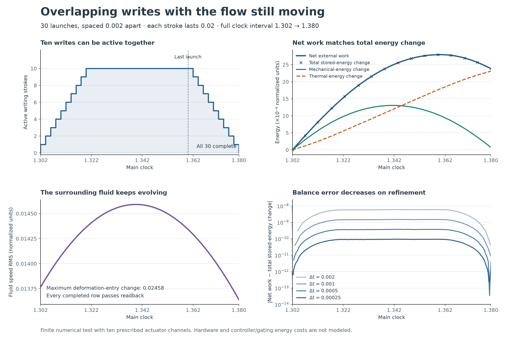

# Lean package index

These packages retain their own model definitions, assumptions and verification histories. **Fresh GitHub recheck: 12 November 2026.** All 19 core packages passed Comparator, Lean-kernel, nanoda, Lake and configured axiom checks. [Fresh results, logs and source fingerprints](../provenance/core-package-recheck-2026-11-12/README.md).

The fresh reports below preserve the original theorem scopes and unfinished-proof lists. Earlier reports remain linked separately. The 306 configured declarations overlap across packages and must not be added as independent discoveries.

The later [A/S suppression comparison](as-suppression-lean/) has its own verification receipt and closes the S-history comparison; the repeated-encounter process remains open.

Newer standalone results are described below: [observation and field-equation checks](#separate-observation-and-field-equation-checks), [Pair-25 origins](#separate-finite-origin-checks), [540/872 histories](#following-540-and-872), and [heat from writing](#heat-from-writing).

[Read the walkthrough](#plain-language-walkthrough) · [Open the detailed package records](#detailed-package-records)

## Plain-language walkthrough

In [the Pair 25 example](../research/hug-v3/pair-origin-study/README.md), the window begins and ends with 364 labels, although 540 leaves and 872 arrives. **The same count does not mean the same membership.** This leads to a precise question: what can an observation determine?

A [separate Lean proof](../research/ambiguous-observation-lean/Pair25Instance.lean) shows that the count alone cannot always recover either label’s membership in the supplied summaries. That proof does not verify the simulator, positions or transcription.

The **19 core packages below explore the wider project’s model questions**: what follows from the rules, whether evolution exists and is unique, and how memory writes and delays behave. Pair 25’s summary and recorded-data checks are separate from this core list. Each entry distinguishes **Proved** from **Unfinished**.

Read **PASS** as: “the precise statements submitted for this package passed the checks, under their stated assumptions.” A package can have passing component proofs while its larger goal remains unfinished. The fresh run covered all 19 packages; its 306 checked declarations overlap across packages.

The **first three packages concern the seven-variable A/S model**. In its interpretation, Smoke and Clay are one agent’s inward speaking and listening positions.

We start here because this smaller model separates three questions that recur later: **what follows from the rules, does a unique evolution exist, and which bounds persist?** Packages 1–3 address them in that order. Pair 25 introduces what observations can reveal; A/S introduces what can be proved about evolution under stated assumptions. The A/S results concern their own equations and do not verify the Pair 25 simulation.

1. **[as-lean](as-lean/) — The basic rules.**

   **Proved:** 30 consequences of the equations, including bounds on opening and reception, how an encounter updates understanding, and how adverse history affects exchange.

   **Unfinished:** Constructing the full repeated-encounter process. The next two packages address evolution and bounds; the [later suppression proof](as-suppression-lean/) compares both S coordinates across complete evolving histories.

2. **[as-existence-lean](as-existence-lean/) — The model has a definite evolution.**

   **Proved:** Under the original assumptions, a solution exists and is unique over any chosen finite period. “Unique” means the same specified starting data and inputs determine the same evolution.

   **Unfinished:** The repeated-encounter process, numerical solver error certification, and empirical validation. The [suppression comparison is now proved](as-suppression-lean/).

3. **[as-invariance-lean](as-invariance-lean/) — Certain quantities stay within their allowed ranges.**

   **Proved:** Both meaning variables remain between 0 and 1, and both adverse-history loads remain nonnegative, under the original assumptions.

   **Unfinished:** The repeated-encounter process and comparisons of meaning, reception and understanding. The [suppression proof](as-suppression-lean/) now compares the two S coordinates throughout each finite interval.

**A/S follow-up — [Suppression across evolving histories](as-suppression-lean/).**

**Proved:** With matched starting data and inputs, both S coordinates remain at or below their values without suppression at every time in each finite interval.

**Unfinished:** The repeated-encounter process and its connection to the continuous state. This theorem does not compare understanding or establish that it improves.

The **next two concern particular reduced Hug models**.

After A/S, we ask the same questions in models involving pressure, shape, guards and energy: **which component rules hold, and can a specified model evolve uniquely while keeping its guards within bounds?** Package 4 checks particular properties and limitations; package 5 answers the evolution question for the specified eight-variable model. These packages have their own equations and assumptions. The full unforced continuum and separate memory-field evolution remain unfinished; the spatial questions follow in packages 6–9.

4. **[hug-squeeze-lean](hug-squeeze-lean/) — Pressure, shape, guards and energy.**

   **Proved:** 51 specified properties, including pressure-response formulas, retention, reversible geometric transformations, guard bounds and energy accounting. It also proves limitations: a numerical “connected” flag can allow a small gap, and the active model can gain energy.

   **Energy-chart connection:** The supplied chart, “Where the extra driving work goes”, illustrates **extra work = extra dissipated energy + stored-energy difference**. At `t = 2`, its labels show about 15 extra units of work, split into 13.5 dissipated and 1.5 stored. More work need not remain as stored energy.

   The [checked energy results](hug-squeeze-lean/ActiveHugSolution.lean#L51) establish an exact energy balance and nonnegative losses for this package’s reduced active Hug model, under their stated assumptions; active power can exceed those losses. **The chart’s curves and numbers have not been verified against these equations or by Lean.**

   **Unfinished:** The full separate memory-field evolution, long-term synchronization and recovery claims. The next package supplies an existence result for a particular reduced model.

5. **[hug-existence-lean](hug-existence-lean/) — The reduced eight-variable Hug model can evolve consistently.**

   **Proved:** Existence, uniqueness and preservation of the allowed guard ranges over any finite forward period, with the specified fixed parameters, continuous prescribed force and admissible initial guards.

   **What “full coupled” means:** The [theorem](hug-existence-lean/HugExistenceSolution.lean) covers all eight equations together: displacement, velocity, two mechanical strains, two participant states and two guards. Under the assumptions above, a solution exists over any finite forward period, and two solutions with the same starting state and prescribed force agree throughout that period. Both guards stay between 0 and 1. **“Full” refers to this specified eight-variable model.** The [full spatial evolution](hug-navier-wellposedness-lean/PROOF-STATUS.md) and [separate memory-field evolution](hug-squeeze-lean/README.md#what-remains-unproved-or-untested) remain unfinished.

   **Unfinished:** The separate memory-field extension and broader long-term claims. This result belongs to that reduced implementation; NousVolition’s intended unforced continuum system retains its own proof obligations.

Packages **6–9 approach the spatial Hug–Navier problem**. Package 5 follows **eight values changing over time**. The spatial formulation follows **values at every location**: how they vary from place to place affects how they evolve through flow, diffusion and stress. The eight-variable theorem does not supply the estimates needed to prove the full spatial evolution.

The numbering follows the investigation. Packages 6–7 preserve an earlier comparison between the reduced model and a field model; packages 8–9 examine the shared spatial equations themselves. NousVolition’s intended Hug–Navier formulation remains **one continuing system**. The earlier comparison’s mathematical results retain their stated scope, while its interpretation was subsequently corrected. Read the [single-system scope correction](../research/comparisons/hug-navier-single-system-scope-correction.md#meaning-to-preserve-across-implementations).

6. **[hug-navier-bridge-lean](hug-navier-bridge-lean/) — Checking a proposed connection.**

   This tests when selected parts of the reduced model and a field model agree under a specified comparison.

   **Proved:** 14 conditional results about matching guard responses and dissipation, including concrete mismatches. For example, spatial diffusion can change a field’s rate even when the local reaction rules match.

   **Unfinished:** A complete evolving spatial solution. Matching some rates or losses does not establish the whole evolution. These results concern the particular comparison’s assumptions; they do not establish that the intended single system lacks a connection.

7. **[hug-navier-full-audit-lean](hug-navier-full-audit-lean/) — Checking what that comparison establishes.**

   This examines the force, energy and state relationships more closely.

   **Proved:** Seven narrower statements about the supplied models. One useful example: **equal instantaneous power does not necessarily mean equal force**. At zero velocity, different forces can have the same power while producing different accelerations.

   **Unfinished:** Full evolution and uniqueness for the earlier proposed construction. Its interface requirements belong to that construction; they do not establish that the intended single continuum lacks a connection.

8. **[hug-navier-single-system-lean](hug-navier-single-system-lean/) — Working directly with the spatial equations.**

   The recorded spatial realization has six evolving fields: two velocity components, two participant-state fields and two directional guards, with pressure enforcing incompressibility.

   **Proved:** Ten checks: seven concerning this formulation and three concerning the separately preserved original A/S branch. They include the starting flow’s zero divergence, the correct expansion of variable stress, and conditions under which guard rates point back into their allowed range. The [detailed results](hug-navier-single-system-lean/RESULTS.md) state each check’s assumptions and limits.

   **Unfinished:** Constructing the full spatial solution, proving uniqueness, showing that guards stay within bounds throughout evolution, and obtaining the estimates needed to continue the solution over the requested time interval. A verified inward-pointing rate is an ingredient in the guard-bound proof.

9. **[hug-navier-wellposedness-lean](hug-navier-wellposedness-lean/) — Tackling the estimates needed for evolution.**

   Spatial variation creates an additional difficulty: **a field can change very little in value while changing sharply across space**. Consequently, the eight-variable existence argument cannot simply be reused without controlling spatial derivatives.

   **Proved:** Four diagnostic results establish this obstacle. Six additional guard-transport theorems provide identities, bounds and a cancellation used when comparing candidate solutions, under their stated assumptions. These ten results have a [separate verification record](hug-navier-wellposedness-lean/evidence-linux/source.json); the 19-package recheck above covered the four diagnostics.

   **Unfinished:** Full spatial existence, continuation to every requested finite horizon, and uniqueness. Parts of a written classical uniqueness argument are now formalized; the complete argument remains uncertified by Lean. The [proof-status page](hug-navier-wellposedness-lean/PROOF-STATUS.md) identifies the remaining work.

Packages **10–17 concern Hug v3’s evolution, memory writes, transfer and delays**. They follow the spatial discussion because **evolution also has to account for what gets recorded, what remains readable, and how earlier events affect later ones**. A write can change the material state abruptly; retrieval can influence another encounter; a delay changes which past state an equation reads.

This is the order of the investigation. The spatial proof remains unfinished, and these packages concern the selected **finite Hug v3 realization and its extensions**. Here, “hybrid” means continuous evolution interrupted by discrete events such as writing a memory.

10. **[hug-v3-proof-attempt](hug-v3-proof-attempt/) — Recognizing that writing is an event.**

    A stored record can change abruptly at a write, so one smooth trajectory across every write would be the wrong mathematical target.

    **Proved:** Six results about probing stored material and the discontinuity caused by a specified write, under the stated event assumptions.

    **Unfinished:** Proving that the complete trajectory exists, reaches those writes and supplies the required conditions, together with full correspondence to program execution. A jump does not itself prevent a valid evolution with events.

11. **[hug-v3-hybrid-lean](hug-v3-hybrid-lean/) — Joining the stretches between writes.**

    This supplies a general way to join continuous evolution with discrete updates.

    **Proved:** Nine conditional results. If each whole stretch is solvable and unique, and each boundary update succeeds deterministically, they assemble into a unique finite history.

    **Unfinished:** Establishing those assumptions for the actual full equations, initial state, captures and writer. Segment solvability and uniqueness are hypotheses here, not achievements for the source model.

12. **[hug-v3-source-lean](hug-v3-source-lean/) — Connecting the mathematics to the selected source.**

    This gives an exact-real transcription of the fixed-grid model, including its coupled state and events.

    **Proved:** Nine component results about those definitions.

    **Unfinished:** Full evolution, successful writing and recovery, and a proof that the transcription corresponds to Python’s floating-point execution. A fixed-grid result also leaves the spatial continuum question open.

13. **[hug-v3-transfer-lean](hug-v3-transfer-lean/) — Tracing influence into another encounter.**

    A record retains its original participants, while its influence can pass through shared state into a later relationship.

    **Proved:** Fourteen local transfer results under stated encounter and comparison assumptions, including comparisons of response and guard rates.

    **Unfinished:** Showing the complete causal transfer unfolds along actual admissible trajectories within finite time, through the required events and writes. A favorable instantaneous rate comparison does not prove a later threshold crossing.

14. **[hug-v3-delay-lean](hug-v3-delay-lean/) — Specifying which time gets read.**

    This introduces a fixed-delay extension: social rates combine present physical information and records with buffered social state.

    **Proved:** Nine timing identities, including that zero delay recovers the original equations.

    **Unfinished:** A complete delayed evolution theorem, preservation of bounds, stability and correct handling of delayed discontinuities.

15. **[hug-v3-full-delay-proof](hug-v3-full-delay-proof/) — Constructing a local delayed solution conditionally.**

    This goes beyond timing identities.

    **Proved:** Fourteen results, including a construction of a local solution—and uniqueness within the stated neighborhood—from explicit regularity, rate-bound and valid-decoding assumptions. The local construction does not assume existence and uniqueness as premises.

    **Unfinished:** Deriving those assumptions for the actual trajectory, establishing memory readability, continuing through every required interval and proving every write succeeds. **“Full” in the filename does not mean the complete target is proved.**

16. **[hug-v3-memory-rules-lean](hug-v3-memory-rules-lean/) — Checking what retrieval actually preserves.**

    This examines attribution, missing or conflicting accounts, weighted records and changing relevance.

    **Proved:** Seventeen results about the existing retrieval and fixed-delay rules.

    **Unfinished:** Several fuller mechanisms still need specification: variable timing, partial or mixed reconstruction with provenance, new solo episodes and anticipation-effort accounting. Full hybrid delayed existence and uniqueness also remain unproved.

17. **[hug-v3-clay-boundary-lean](hug-v3-clay-boundary-lean/) — Keeping records readable while material changes.**

    This examines preservation of encoded records as the material adapts.

    **Proved:** Twelve component and conditional preservation results. The strongest schedule result assumes an existing full solution and an explicit deformation bound; that solution premise includes successful writes.

    **Unfinished:** Proving that solution and bound, together with capacity, encoding, write-budget and continuation requirements. **Preservation under those assumptions does not prove that every required write will succeed.**

### Overlapping writes: a numerical example

**This is a finite numerical check, not a Lean proof.** It makes the question behind packages 10–17 concrete: can writing take time while the surrounding flow continues, and can completed records still be read?

Thirty new **journal rows** launch 0.002 time units apart, each taking 0.02, with up to ten active together. Across all four tested time steps, fresh decoding of the saved final states reads all 30 new rows and preserves the preceding 651 rows and three event records. These are journal samples; the interval does not contain 30 new event-outcome writes.

| Packages | How the example connects | What remains separate |
| --- | --- | --- |
| **10–12: writes and evolution** | Writing overlaps the moving flow. | This prescribed-actuator model differs from the earlier idealized event updates; those Lean results do not certify it. |
| **13: transfer** | The commanded journal bytes are readable from the final material state. | This does not establish the full finite-time transfer theorem. |
| **14–15: delays** | Writes remain pending while the clock advances. | The 0.02 writing duration is different from the fixed social-response delay in those packages. |
| **16–17: readable memory** | Busy rows are withheld; completed rows become readable. | Success here does not guarantee every future write, indefinite retention or the full theorem's assumptions. |

The saved-data review recomputed a maximum energy-balance error decreasing from **6.02 × 10⁻⁹ to 9.44 × 10⁻¹¹** as the time step shrank. The blue curve counts **all external work**, including existing threshold and breathing forces: writing alone supplies about **5.27 × 10⁻⁶** of the final **23.84 × 10⁻⁶** total.

The review checked saved data and final-state readback; it **did not rerun the flow simulation or compile Lean**. This 16³ experiment assumes ten actuator channels and a busy-reader rule; hardware, controller and gating costs are unmodeled. Full spatial and memory-system existence, uniqueness and continuation remain unfinished. [Numerical review, scope and preserved credits](../research/overlapping-writes-chart/README.md).

The **last two examine the wider comparisons and supplied proof arguments**. After the model, spatial and memory packages, they ask how far the proposed connections and existing arguments actually reach. They finish this reading path by identifying what survives those checks and where the claims stop. The full-system existence and uniqueness proof remains unfinished.

18. **[hug-v3-yang-mills-audit-lean](hug-v3-yang-mills-audit-lean/) — Which changes preserve the model's readings?**

    This audit starts from the Hug v3 definitions and examines specified transformations. Rotating the fabric without changing its stretch preserves Green strain, a measure of deformation. Under the stated conditions, that sameness carries through to particular observations, retrieval, responses and memory-write behavior.

    **Proved:** 20 statements about strain, changes of frame and evolution, including a limit: rotating only the fabric while holding the flow fixed need not preserve the deformation evolution. Preserving a reading therefore does not automatically make the transformation a symmetry of the complete dynamics. [Exact comparisons and assumptions](hug-v3-yang-mills-audit-lean/AUDIT.md).

    **Unfinished:** A full Yang–Mills connection, curvature and field-equation structure within Hug; equivalence of the dynamics; and full hybrid or delayed evolution. No quantum mass-gap theorem is established. This audit retains its own scope and verification record, separate from the two observation examples below.

19. **[hug-v3-gemini-review](hug-v3-gemini-review/) — How much do the supplied arguments establish?**

    This review checks four supplied Lean modules, repairing imports and proof steps while retaining their theorem statements. Their results include component bounds, event results and a limited delayed uniqueness argument.

    **Proved:** 77 statements under their stated assumptions. The delayed uniqueness result says that **two already-existing seven-variable A/S solutions**, with the same parameters, inputs and past history, agree over the **first delay interval**. The needed delayed values come from that shared history. This result does not construct either solution or include the full physical state. [Detailed proof review](hug-v3-gemini-review/Lean-review.md).

    **Unfinished:** Full Hug v3 delayed evolution, continuation through all events, successful memory writes and the required state bounds. In particular, equal event outputs are proved assuming equal complete pre-event states; this does not establish that two full evolving paths reach those equal states. The 77 checked statements leave the larger existence and uniqueness problem open.

**The Yang–Mills audit and the two examples answer different questions.**

| Work | What its checked result says | Limit |
| --- | --- | --- |
| Package 18: Hug v3 Yang–Mills audit | Specified transformations preserve strain and related readings under stated conditions; a fabric-only rotation need not preserve the evolution. | It does not establish that Hug v3 is a Yang–Mills system. |
| [YangMillsInstance: real-valued `readJet`](../research/ambiguous-observation-lean/README.md) | Equal order-zero readings can accompany different first-derivative readings. | This is a real projection example, with no result about an admissible Yang–Mills family. |
| [YangMillsCueTest: abelian field-equation comparison](../research/ambiguous-observation-lean/README.md) | Two explicit smooth potentials agree on the slice `x₁ = 0`, while their field-equation residuals at the origin are 0 and 2. | The modified potential fails the equation; these are not two Yang–Mills solutions. |

The two examples concern what an observation fails to determine. Package 18 concerns which transformations preserve aspects of Hug and where that preservation stops. Their sources, assumptions, credits and verification records remain distinct; the [separate checks below](#separate-observation-and-field-equation-checks) retain those details.

For a first reading, follow **1–3, then 4–5, then 6–9**: basic rules, complete evolution results for smaller models, and the remaining difficulty in the spatial system. Continue with **10–17** for memory writes and delays, then **18–19** for the comparisons and reviewed arguments. The [fresh evidence collection](../provenance/core-package-recheck-2026-11-12/README.md) retains each package’s exact scope and unfinished-work list alongside its passing checks.

**Credits:** AI-generated; dictated and directed by NousVolition. Each package retains its original proof and review credits. The [observation-package credits](../research/ambiguous-observation-lean/CREDITS.md) distinguish Claude’s review and drafting from later compilation and preserve the earlier assistant’s field-equation proof authorship.

## Detailed package records

Show the 19-package recheck and the later suppression result

| Package | Checked result and current limits | Evidence |
| --- | --- | --- |
| [as-lean](as-lean/) | 30 scoped A/S claims. Later [existence](as-existence-lean/), [invariance](as-invariance-lean/) and [suppression](as-suppression-lean/) results address evolution, bounds and S-history comparison. Repeated-encounter coupling remains open. | [fresh report](../provenance/core-package-recheck-2026-11-12/as-lean/verification-report.json) · [earlier](as-lean/verification-report.json) |
| [as-existence-lean](as-existence-lean/) | Existence and uniqueness of the seven-coordinate continuous integral evolution on every finite interval, under the original assumptions. | [fresh report](../provenance/core-package-recheck-2026-11-12/as-existence-lean/verification-report.json) · [earlier](as-existence-lean/verification-report.json) |
| [as-invariance-lean](as-invariance-lean/) | Both meaning states remain in [0,1] and both adverse-history loads remain nonnegative on every finite interval, under the original assumptions. | [fresh report](../provenance/core-package-recheck-2026-11-12/as-invariance-lean/verification-report.json) · [earlier](as-invariance-lean/verification-report.json) |
| [as-suppression-lean](as-suppression-lean/) | Both suppressed S coordinates stay at or below their no-suppression counterparts throughout each finite interval, with matched starting data and inputs. Repeated encounters remain open. | [report](as-suppression-lean/verification-report.json) · [logs](as-suppression-lean/evidence-linux/) |
| [hug-squeeze-lean](hug-squeeze-lean/) | 51 specified claims. [Later existence work](hug-existence-lean/) covers the primary eight-state model; the separate memory-field extension remains open. | [fresh report](../provenance/core-package-recheck-2026-11-12/hug-squeeze-lean/verification-report.json) · [earlier](hug-squeeze-lean/verification-report.json) |
| [hug-existence-lean](hug-existence-lean/) | Existence, uniqueness and guard preservation on every finite forward horizon for the reduced eight-state model, with frozen parameters, continuous prescribed force and admissible initial guards. | [fresh report](../provenance/core-package-recheck-2026-11-12/hug-existence-lean/verification-report.json) · [earlier](hug-existence-lean/verification-report.json) |
| [hug-navier-bridge-lean](hug-navier-bridge-lean/) | 14 conditional compatibility statements for the earlier proposed coupling. Read the [single-system scope correction](../research/comparisons/hug-navier-single-system-scope-correction.md#meaning-to-preserve-across-implementations); full PDE evolution remains unproved. | [fresh report](../provenance/core-package-recheck-2026-11-12/hug-navier-bridge-lean/verification-report.json) · [earlier](hug-navier-bridge-lean/verification-report.json) |
| [hug-navier-full-audit-lean](hug-navier-full-audit-lean/) | 7 field/interface audit statements. The [later single-system correction](../research/comparisons/hug-navier-single-system-scope-correction.md#meaning-to-preserve-across-implementations) revises that interpretation; full PDE evolution remains unproved. | [fresh report](../provenance/core-package-recheck-2026-11-12/hug-navier-full-audit-lean/verification-report.json) · [earlier](hug-navier-full-audit-lean/verification-report.json) |
| [hug-navier-single-system-lean](hug-navier-single-system-lean/) | 10 identities and local checks for the six-field formulation. Full PDE existence, uniqueness and global guard invariance remain open. | [fresh report](../provenance/core-package-recheck-2026-11-12/hug-navier-single-system-lean/verification-report.json) · [earlier](hug-navier-single-system-lean/verification-report.json) |
| [hug-navier-wellposedness-lean](hug-navier-wellposedness-lean/) | 4 auxiliary well-posedness statements. Full PDE existence, continuation and uniqueness remain open. | [fresh report](../provenance/core-package-recheck-2026-11-12/hug-navier-wellposedness-lean/verification-report.json) · [earlier](hug-navier-wellposedness-lean/verification-report.json) |
| [hug-v3-proof-attempt](hug-v3-proof-attempt/) | 6 inter-event and write results under explicit event hypotheses. Full hybrid existence/uniqueness and execution correspondence remain open. | [fresh report](../provenance/core-package-recheck-2026-11-12/hug-v3-proof-attempt/verification-report.json) · [earlier](hug-v3-proof-attempt/verification-report.json) |
| [hug-v3-hybrid-lean](hug-v3-hybrid-lean/) | 9 conditional assembly and event results. Actual segment solvability, successful admissible writes and full-rate uniqueness remain obligations. | [fresh report](../provenance/core-package-recheck-2026-11-12/hug-v3-hybrid-lean/verification-report.json) · [earlier](hug-v3-hybrid-lean/verification-report.json) |
| [hug-v3-source-lean](hug-v3-source-lean/) | 9 results for the exact-real fixed-grid transcription. Source-execution equivalence and successful continuation through every write remain open. | [fresh report](../provenance/core-package-recheck-2026-11-12/hug-v3-source-lean/verification-report.json) · [earlier](hug-v3-source-lean/verification-report.json) |
| [hug-v3-transfer-lean](hug-v3-transfer-lean/) | 14 local transfer results under encounter and comparison hypotheses. End-to-end finite-time transfer and full existence/uniqueness remain open. | [fresh report](../provenance/core-package-recheck-2026-11-12/hug-v3-transfer-lean/verification-report.json) · [earlier](hug-v3-transfer-lean/verification-report.json) |
| [hug-v3-delay-lean](hug-v3-delay-lean/) | 9 timing identities. Delay-equation existence, uniqueness, invariance and stability remain open. | [fresh report](../provenance/core-package-recheck-2026-11-12/hug-v3-delay-lean/verification-report.json) · [earlier](hug-v3-delay-lean/verification-report.json) |
| [hug-v3-full-delay-proof](hug-v3-full-delay-proof/) | 14 conditional fixed-delay and hybrid results. Full-rate regularity, readability, successful writes and all-event continuation remain open. | [fresh report](../provenance/core-package-recheck-2026-11-12/hug-v3-full-delay-proof/verification-report.json) · [earlier](hug-v3-full-delay-proof/verification-report.json) |
| [hug-v3-memory-rules-lean](hug-v3-memory-rules-lean/) | 17 retrieval, weighting, partner-identity and fixed-delay results. Variable timing, reconstructed episodes and anticipation accounting remain unspecified. | [fresh report](../provenance/core-package-recheck-2026-11-12/hug-v3-memory-rules-lean/verification-report.json) · [earlier](hug-v3-memory-rules-lean/verification-report.json) |
| [hug-v3-clay-boundary-lean](hug-v3-clay-boundary-lean/) | 12 fabric, local-flow and conditional schedule results. Full-rate existence, continuation, readability and write-success bounds remain open. | [fresh report](../provenance/core-package-recheck-2026-11-12/hug-v3-clay-boundary-lean/verification-report.json) · [earlier](hug-v3-clay-boundary-lean/verification-report.json) |
| [hug-v3-yang-mills-audit-lean](hug-v3-yang-mills-audit-lean/) | 20 strain, frame and evolution comparison statements, including `green_objective`. Full Yang–Mills structure, dynamical equivalence and a mass-gap theorem are not proved. | [fresh report](../provenance/core-package-recheck-2026-11-12/hug-v3-yang-mills-audit-lean/verification-report.json) · [earlier](hug-v3-yang-mills-audit-lean/verification-report.json) · [recheck](../provenance/green-objective-2026-11-08/README.md) |
| [hug-v3-gemini-review](hug-v3-gemini-review/) | 77 repaired supplied statements. Delayed uniqueness covers existing seven-coordinate A/S solutions on one delay interval; full Hug v3 delayed hybrid evolution remains open. | [fresh report](../provenance/core-package-recheck-2026-11-12/hug-v3-gemini-review/verification-report.json) · [earlier](hug-v3-gemini-review/verification-report.json) |

Challenge files can contain intentional placeholders defining a target. An unfinished target is not a proof; use the package’s checked solution modules, permitted-axiom policy and verification report.

## Separate observation and field-equation checks

The [ambiguous-observation package](../research/ambiguous-observation-lean/README.md) has a passing pinned Lean build and axiom audit covering **51 public named theorems and lemmas**, including supporting results and repeated forms of the observation rule. [Successful GitHub run and axiom logs](https://github.com/NousVolition/hug-sims-lean-proofs/actions/runs/43172199579).

Its Tick 41 and Pair 25 instances concern supplied summaries and exact numbers. **YangMillsInstance** uses a real-valued projection with equal order-zero `readJet` readings and different first derivatives. **YangMillsCueTest** separately compares two explicit abelian potentials agreeing on `x₁ = 0`, with field-equation residuals 0 and 2; the modified potential fails the equation. Neither establishes an admissible Yang–Mills family. These are also separate from the 20-statement Hug v3 strain/frame audit above.

Simulator and transcription verification are outside this package; Comparator and nanoda were not run. [Preserved authorship and credits](../research/ambiguous-observation-lean/CREDITS.md).

### Separate combined transverse-derivative theorem

The [combined package](../research/combined-yang-mills-lean/README.md) imports both examples without replacing either. At every point on `x₁ = 0`, all potential components and all first coordinate partial derivatives agree; the second transverse `readJet` readings equal the respective residuals 0 and 2. **Twelve new named results passed local Lean compilation and axiom audit** with only `propext`, `Quot.sound`, and `Classical.choice`; they are not axiom-free. [Local logs](../research/combined-yang-mills-lean/logs/CombinedAxioms.log) · [Corrected attribution](../research/combined-yang-mills-lean/CREDITS.md). No GitHub Lean build, Comparator, nanoda, admissible family, or mass-gap result is claimed for this package.

## Separate finite origin checks

[Pair-25 origin tracking](../research/hug-v3/pair-origin-lean/README.md) has 77 finite statements about recorded identity histories, memory contents, material-field changes and context-origin accounts. Its [dedicated GitHub receipt](../research/hug-v3/pair-origin-study/github-lean-receipt.json) retains the exact inputs, targets and run. This package uses Lean-kernel compilation and a source-data certificate; Comparator and nanoda are not claimed. Fluid evolution and complete physical retention remain unproved.

## Following 540 and 872

[The observer-follow package](../research/hug-v3/observer-follow-lean/README.md) has 134 finite checks of the recorded neighborhood histories, crossings, context-origin accounts and shared bytes. Its [GitHub receipt](../research/hug-v3/observer-follow-study/github-lean-receipt.json) binds the exact proof inputs, targets and run. Fluid evolution and whether everything stays with either label remain unproved. Earlier 77- and 40-statement studies remain separate.

## Finer-grid recorded heat

[The finer-grid package](../research/hug-v3/heat-grid-lean/README.md) has **414 passing checks**: five finite rules and 409 recorded claims, including 4,820 global-account rows and complete saved-word comparisons. [Fresh GitHub build and dependency receipt](../research/hug-v3/heat-grid-lean/github-lean-receipt.json). The separate [numerical study](../research/hug-v3/heat-grid-study/README.md) passes its finest-grid time-step heat control, but the declared grid-settling test still fails. A proved recorded exceedance is not a convergence result. Lean does not verify fluid evolution or derive array measurements. This package does not change the earlier 56-check study, 12-check draft or 540/872 study.

## Following the recorded heat

[The heat follow-up package](../research/hug-v3/heat-follow-lean/README.md) has **56 checks**: four general finite rules and 52 declarations covering 2,408 recorded rows and scalar diagnostics. Its [GitHub receipt](../research/hug-v3/heat-follow-lean/github-lean-receipt.json) records a fresh full Lake build, all dependency lists and exact input/target matching. The separate [numerical study](../research/hug-v3/heat-follow-study/README.md) passes time-step criteria on 16³; finer grids were outside that historical study; see the separate finer-grid package above. Lean does not verify fluid evolution or spatial convergence. The earlier 12-check draft and 134-check observer study retain their separate scopes.

## Heat from writing

[The supplied heat draft](../research/hug-v3/heat-writing-lean/README.md) has 12 passing statements about scalar stroke heat, ambiguous recovery, work accounting, exact threshold-1 replay numbers and viscosity under stated hypotheses. Its [GitHub receipt](../research/hug-v3/heat-writing-lean/github-lean-receipt.json) binds the input fingerprint, targets and run. It is separate from the 134 observer-follow checks; thermal evolution and complete retention remain open.

## Further Lean packages

Each directory below is a separate Lake project. From that directory, use its pinned toolchain and run `lake build`. The Comparator configuration names the challenge, solution, allowed axioms and target declarations. The saved reports and Linux logs record the original checks. The historical scripts accept a configurable verification directory. The current CI instructions follow below.

| Package | Comparator targets | Saved verification |
| --- | ---: | --- |
| [clay-problems-lean-audit](clay-problems-lean-audit/) | 3 | [Verification report](clay-problems-lean-audit/verification-report.json) |
| [fabric-frame-transition-audit](fabric-frame-transition-audit/) | 7 | [Verification report](fabric-frame-transition-audit/verification-report.json) |
| [hearth-wizard-lean](hearth-wizard-lean/) | 22 | [Verification report](hearth-wizard-lean/verification-report.json) |
| [hug-v3-apple-band-lean](hug-v3-apple-band-lean/) | 15 | [Verification report](hug-v3-apple-band-lean/verification-report.json) |
| [hug-v3-apple-existence-lean](hug-v3-apple-existence-lean/) | 13 | [Verification report](hug-v3-apple-existence-lean/verification-report.json) |
| [hug-v3-bridge-return-lean](hug-v3-bridge-return-lean/) | 18 | [Verification report](hug-v3-bridge-return-lean/verification-report.json) |
| [hug-v3-child-access-lean](hug-v3-child-access-lean/) | 13 | [Verification report](hug-v3-child-access-lean/verification-report.json) |
| [hug-v3-child-account-lean](hug-v3-child-account-lean/) | 14 | [Verification report](hug-v3-child-account-lean/verification-report.json) |
| [hug-v3-child-witness-lean](hug-v3-child-witness-lean/) | 20 | [Verification report](hug-v3-child-witness-lean/verification-report.json) |
| [hug-v3-coexistence-lean](hug-v3-coexistence-lean/) | 12 | [Verification report](hug-v3-coexistence-lean/verification-report.json) |
| [hug-v3-courier-weaver-lean](hug-v3-courier-weaver-lean/) | 13 | [Verification report](hug-v3-courier-weaver-lean/verification-report.json) |
| [hug-v3-full-covariance-lean](hug-v3-full-covariance-lean/) | 26 | [Verification report](hug-v3-full-covariance-lean/verification-report.json) |
| [hug-v3-hearth-readout-lean](hug-v3-hearth-readout-lean/) | 12 | [Verification report](hug-v3-hearth-readout-lean/verification-report.json) |
| [hug-v3-joint-frame-lean](hug-v3-joint-frame-lean/) | 31 | [Verification report](hug-v3-joint-frame-lean/verification-report.json) |
| [hug-v3-o-rumination-lean](hug-v3-o-rumination-lean/) | 12 | [Verification report](hug-v3-o-rumination-lean/verification-report.json) |
| [hug-v3-occupied-space-lean](hug-v3-occupied-space-lean/) | 15 | [Verification report](hug-v3-occupied-space-lean/verification-report.json) |
| [hug-v3-paint-value-lean](hug-v3-paint-value-lean/) | 19 | [Verification report](hug-v3-paint-value-lean/verification-report.json) |
| [hug-v3-street-whole-lean](hug-v3-street-whole-lean/) | 22 | [Verification report](hug-v3-street-whole-lean/verification-report.json) |
| [mira-local-paths-lean](mira-local-paths-lean/) | 18 | [Verification report](mira-local-paths-lean/verification-report.json) |
| [person-environment-pnp-lean](person-environment-pnp-lean/) | 21 | [Verification report](person-environment-pnp-lean/verification-report.json) |
| [SIMS two memories and the restaurant meeting](sims-meeting-thread-lean/) | 90 | [Verification report](sims-meeting-thread-lean/verification-report.json) |
| [Traveller B’s first thoughts, fresh listeners and one continuing encounter](sims-mentor-first-thought-lean/) | 20 | [Verification report](sims-mentor-first-thought-lean/verification-report.json) |
| [Fourth write on the Hug prime meter](hug-prime-meter-lean/) | 9 | [Verification report](hug-prime-meter-lean/verification-report.json) |
| [Original two-memory transport and supporting lemmas](original-two-memory-transport-lean/) | 16 | [Verification report](original-two-memory-transport-lean/verification-report.json) |

The apple existence package records a conditional schedule theorem. Unconditional existence and uniqueness through all three memory writes remains open. Files kept in original, portable, references and reference-history directories retain their separate roles.

[Source hashes and publication scope](../provenance/lean-additions-2026-11-07.json).

## Reproduce the checks

From the repository root, run the inexpensive checks with Python 3.11 or later.

~~~sh
python3 -m unittest discover -s scripts/tests
python3 scripts/lean_package_report.py check
python3 scripts/check_public_paths.py
~~~

The source check follows the local imports of each configured solution and rejects standalone occurrences of `sorry`, `axiom`, `native_decide`, `sorryAx` anywhere in those files, including comments. The challenge statement is outside that closure. The independent kernel checks also cover imported dependencies. The policy permits only `propext`, `Classical.choice` and `Quot.sound`.

To replay a package, start with a clean package checkout on Linux with the pinned Lean toolchain, Go, Rust, Landlock and systemd available. Use a non-root user. Run the following commands from the repository root. Choose a package by setting `pkg`.

~~~bash
set -euo pipefail
repo=$PWD
pkg=hug-v3-apple-existence-lean
scratch=$(mktemp -d)
bash scripts/build-comparator-tools.sh "$scratch/tools"
cd "lean/$pkg"
lake exe cache get
bash "$repo/scripts/compare-package.sh" "$scratch/tools" "$scratch/evidence"
lake build 2>&1 | tee "$scratch/evidence/lake-build.log"
echo 0 > "$scratch/evidence/lake-build.exit"
python3 "$repo/scripts/lean_package_report.py" axioms . --output "$scratch/evidence/axioms.json"
python3 "$repo/scripts/lean_package_report.py" ci-report . "$scratch/evidence"
~~~

Comparator runs before the local solution build. It compares the challenge and solution declarations and exports the solution for nanoda and the default Lean kernel. The default Apple build now builds the solution; its reference remains available as an explicit Comparator target. The axiom file lists the dependencies Lean reported for each named theorem. [Pinned Comparator documentation](https://github.com/leanprover/comparator/blob/19e111e2141cf333c7daff0f64c5f24acc91dd2e/README.md)

Each `verification-report.json` contains exactly six fields. `comparator`, `lean_kernel`, `nanoda`, `lean_build` record the outcomes of the four checks. PASS requires explicit successful evidence, FAIL records a reported failure, NOT_RUN means there is no record that the check ran, and UNKNOWN means the available evidence cannot settle its outcome. `scope` describes the result, and `open_items` lists claims outside that result. Each package’s checked-in report reflects its saved Linux run. The 39 packages standardized together archive their prior reports in `evidence-linux/historical-report.json`. The SIMS meeting package keeps its earlier [49-target](sims-meeting-thread-lean/evidence-history/pr-4/), [58-target](sims-meeting-thread-lean/evidence-history/pr-5/), [65-target](sims-meeting-thread-lean/evidence-history/pr-6/) and [76-target](sims-meeting-thread-lean/evidence-history/pr-8/) receipts in its evidence history. Fresh CI reports and their logs are attached to the corresponding workflow run.

## Viscous time reversal

[viscous-time-reversal-lean](viscous-time-reversal-lean/) adds 14 scoped statements for the time-reversal chain rule, scalar Fourier-mode damping and amplification, and the effect of changing both step and viscosity signs. It uses the standard Comparator and two-kernel workflow above. The package README distinguishes these statements from the full coupled solver and points to the live CI evidence.

## Standalone Lean-kernel checks

The [finite-window gap package](../research/hug-v3/finite-window-lean/README.md) is a dependency-free Lake project under `research/`. Its 15 statements check nested-window reasoning and the exact recorded decimals for 25 pairs at 51 times. Its [saved local receipt](../research/hug-v3/finite-window-lean/receipt.json) reports no axiom dependencies. Its [dedicated workflow](../.github/workflows/finite-window-lean.yml) reruns Lean and checks the receipt against the current proof inputs. It does not use Comparator or nanoda and does not verify the underlying fluid simulation.

