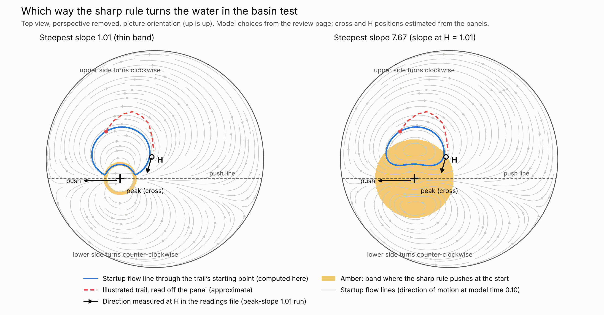

# Two memories and the restaurant meeting

In the two-memory model, returning to the same cue restores the same balance between the two memories. A traveller can return to that cue and answer an old question differently when a witness supplies accurate information about the same event and the traveller accepts it. The theorem `MeetingThread.same_cue_same_episode_new_answer` gives the conditions for both statements to hold together. [Proof](MeetingThread.lean) · [Definitions](MeetingModel.lean)

## What the restaurant recorded

Traveller A first wondered “Was that my order?” and later identified order 31. The five gaps between those reports were 1.642, 1.442, 1.492, 1.542 and 1.592 simulated seconds, averaging **1.542 seconds**. Each last unsure report came 0.250 seconds before the first correct report. Across the five trials those intervals account for 1.250 of the 7.710 seconds. The record leaves the instant of recognition inside each interval open under the model of a single lasting switch. The masked-number control returned `UNKNOWN`. [Trial readings](observations/restaurant.json)

Traveller B felt a pocket tremble. Another traveller had personally tested the pager. In the five paired organic meetings, the well-adjusted, responsible listener heard the same witness account within each pair. One branch included a worried thought. An endpoint required a pager identification grounded in the testimony the listener had already heard.

| Pair | Quiet, seconds from tremble | With anxious noise, seconds from tremble |
| --- | ---: | ---: |
| 1 | Open at 39.178956 | Open at 39.178956 |
| 2 | 24.278956 | Open at 39.278956 |
| 3 | 24.378956 | Open at 39.378956 |
| 4 | Open at 36.978956 | Open at 38.978956 |
| 5 | 24.078956 | 24.078956 |

Three quiet listeners and one worried listener reached the endpoint. All six open branches remained open after the follow-up. Two possible ways the open branches could finish give opposite orderings of the group means. The simulated room clock holds still during private interviews, while the recorder measures the wall time spent generating replies. Both clocks appear in the public trial table. [Trial readings](observations/restaurant.json) · [Lean observations](MeetingObservations.lean)

## Does B need to revisit the feeling?

Five well-adjusted, responsible simulated listeners started with the source of the tremble unresolved. Each checkpoint was used twice. Both versions stayed at the pickup point and kept the identity of the incident, their earlier verdict and the two possible devices. One version received its original sensory description again. The other saw a receipt on the counter. Fresh private sessions kept the original description and the first explanation out of that version's input.

| Observed outcome | Original feeling replayed | No sensory replay supplied |
| --- | ---: | ---: |
| Identified the pager from the identical firsthand witness answer | 5/5 | 5/5 |
| Named the private embroidered motif from the first feeling | 5/5 | 0/5 |
| Identified a source before the witness spoke | 0/5 | 0/5 |
| Identified a source when the witness tested someone else's pager | 0/5 | 0/5 |

All ten positive explanations cited the witness's test or observation at B's own pocket. The witness finished the matching line at 11.976662 simulated seconds. Both versions were asked at 13.171662 seconds. This establishes identification by that probe. The witness's words could themselves bring the event to mind. The trials measure access to the original description and the reported detail. The exact recognition time and any unspoken mental replay remain open. [Frozen protocol](observations/pager-return/protocol.json) · [Reports and wording](observations/pager-return/reports.json) · [Paired readings](observations/pager-return/readings.tsv)

In the **Verify PR** room's “One room, two views” display, each pair's answers and motif reports were placed at the same mark. All five pairs recovered their separate accounts after reload. That check concerns what an observer can compare. Each restaurant listener received only its own private view and the public words.

Lean gives an explicit example in which time passes, the cue moves away without returning, the sensory detail is unavailable, and an accurate accepted witness resolves the original question. Its evidence rule agrees with the earlier `accountAt` theorem. A different claim does require the original cue value in this Gaussian model. The two memory odds are exactly equal at two cues if and only if the cue values are equal. [Model](PagerReturnModel.lean) · [New proofs](PagerReturn.lean)

## What the basin adds



At model time 0.10, the signed circulation around the two sampled contours in each half was clockwise above the push line and counterclockwise below it in both runs, using the picture's orientation. The water at H moved **15.97° left of down** when the steepest slope anywhere was 1.01 and **18.24° left of down** when the slope at H was 1.01. The blue curve follows the velocity field at one instant. The dashed red trail was estimated from the illustration. A single snapshot admits different later parcel paths. [Contour and H readings](observations/basin.json) · [Counterexample](MeetingThread.lean)

Across seven grid and timestep settings, the two branches each ran eight refills. Lean checks that each saved ending digest matches the next starting digest in its branch. At 620 × 620, the eighth-return headings of the two branches differed by about 2.90° and their energies by about 2.60% at both tested timesteps. These are numerical readings. In the separate well-mixed model, a full circuit can return to the same station and volume while the amount of a marker grows or decays according to the incoming concentration. [Refill measurements](observations/basin.json) · [Checkpoint inputs](MeetingObservations.lean)

## The Yang–Mills result

The ratio of the two Gaussian memory weights at cue `s` is `exp(2s)`. Moving from `a` to `b` multiplies it by `exp(2(b − a))`. The product along a closed route is one. For the resulting positive-scaling connection, extended over three passive coordinates, the curvature and the source-free abelian Yang–Mills residual both vanish. This result establishes a flat connection. Physical wave propagation, nonabelian dynamics and a quantum mass gap remain open here. [Transport proofs](TwoMemoryTransport.lean)

## Reproduce the checks

From this directory, with the pinned Lean toolchain available, run

```sh
lake exe cache get
lake build
python3 ../../scripts/lean_package_report.py axioms .
python3 observations/pager-return/check_records.py
```

The default build checks all solution modules and eight expected failures of direct applications. The latter require the specific errors from the pinned compiler, including a wrong field, interval, bound or conclusion. The earlier handoff suite also had two cases without an applicable declaration. [Positive applications](ApplicationControls.lean) · [Expected diagnostics](ApplicationRejections.lean)

Comparator checks 58 named targets against frozen statements. The first 49 cover the original meeting, timing, basin, transport and two-memory results and the three controls or applications. Nine further targets cover the replay question and its paired observations. The repository's Linux workflow checks the exported proofs with Lean's kernel and nanoda. The restaurant observations and basin readings enter as data. Rebuilding the package checks their stated consequences. [Frozen statements](MeetingThreadChallenge.lean) · [Replay targets](PagerReturnChallenge.lean) · [Target list](comparator.json) · [Independent checker instructions](../README.md#reproduce-the-checks)

The original 49 targets passed on GitHub on November 10, 2026 UTC. Their axiom lists matched the Windows check. [Original report](evidence-history/pr-4/verification-report.json) · [Original artifact provenance](evidence-history/pr-4/source.json) · [Original GitHub run](https://github.com/NousVolition/correct-and-lean-/actions/runs/42771970501)
