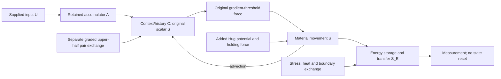

# The Hug holds; S describes energy in transfer

> **Historical comparison, superseded on 23 October:** the current direction is structural memory in existing material, with S transferring through the structure and surroundings. Read [STRUCTURAL_MEMORY.md](STRUCTURAL_MEMORY.md) and [the current overview](README.md). Gravity is now an optional comparison, not the Hug’s defining role.

Working mathematical proposal, 23 October 2026. This develops the user's corrected roles using the corrected corpus and the readable Miro sections. It is a definition and balance-law review, not a new field simulation or a calibrated theory of clay, gravity, or human memory.

**Proposed definition:** the Hug is a force field that influences where material can remain and move. Material moves with velocity **u**. **S_E** is the directional rate at which energy is transported. History is retained in the original accumulated-input and context equations, written **A** and **C** here. The upper-half paired interaction has its own term, **D_C**.

The subscript E makes the proposed new meaning of S visible. C is only a notation change for the corpus's scalar S_c; the original DOCX is unchanged. A scalar context field, velocity, and energy flux have different units and cannot be exchanged just by changing their names.

The working unit Q for C is an **unmeasured context scale**, not a proposed physical substance. Naming it keeps the equations dimensionally explicit without declaring a calibration that does not exist.

| Quantity | Units used here |
|---|---|
| C; A; J | Q; Q·m³; Q·m³/s respectively, with κ in s⁻¹ |
| U and U_b; γ_U | Declared input unit V_U; Q·m³/(V_U·s) |
| K_h; diffusion coefficient | m⁻³ with integral one; m²/s |
| ∇C, Γ, ε, δ; σ_r | Q/m; Pa/Q |
| ρ; μ; G; P and T | kg/m³; Pa·s; Pa; Pa |
| Φ_H; b_H; b_C | J/kg; N/m³; N/m³ |
| u; energy density; S_E | m/s; J/m³; W/m² |
| θ; c_v; k_T; r | K; J/(kg·K); W/(m·K); W/m³ |

## What comes from where

Labels used below: **SOURCE** = supplied equation; **INTENT** = user's clarification; **DERIVED** = algebra under stated assumptions; **ADDED** = proposed closure or interpretation absent from the supplied laws. Added choices are not recorded as user-approved or measured parameters.

| Component | Status | Basis |
|---|---|---|
| Incompressible momentum, constant density and Newtonian viscosity | SOURCE | DOCX paragraphs 230–266 and 546–580 |
| Accumulator A, source J, advected/diffused scalar C | SOURCE; C is a notation change | DOCX 517–539 |
| Fixed-direction threshold force from the gradient of C | SOURCE | DOCX 231, 260, 262–266 |
| Hug as holding influence; S as movement/energy transfer | INTENT | User clarification, 23 October |
| Potential Φ_H and its holding force | ADDED | Conservative realization of that intent, not a force found on the board |
| S_E as total continuum energy flux | ADDED definition; balance DERIVED | Makes transfer directional and measurable in compatible units |
| Heat storage/transport and candidate elastic material branch | ADDED | Needed to account for mechanical energy conversion; not supplied clay calibration |
| Upper-half pair exchange D_C, pairing map and height profile | ADDED, constrained by INTENT | Separate from source J and holding force |
| Environmental exchange and energy-supply bookkeeping | ADDED | Needed for internal/external transfer without hidden energy creation |

The board's [shared field–velocity loop](https://miro.com/app/board/uXjVEXBJz3k=/?moveToWidget=3458764687916065203) supports investigating C→force→u→transport of C. Its [response-law section](https://miro.com/app/board/uXjVEXBJz3k=/?moveToWidget=3458764687912872499) keeps the three activation branches distinct. Neither supplies a Hug gravitational potential, an energy-flux definition, or a Girardian material interaction law. The newer [theory map](https://miro.com/app/board/uXjVEXBJz3k=/?moveToWidget=3458764688184818696) proposes comparisons with decay; those are hypotheses to compare, not instructions to alter the retained-input law.

## 1. Preserve the supplied coupling

**SOURCE**, in each constant-density incompressible region:

\[
\nabla\cdot u=0,\qquad
\rho D_tu=\nabla\cdot T+b_C,
\qquad T=-P I+2\mu D(u),\quad D(u)=\tfrac12(\nabla u+\nabla u^T).
\]

Here \(D_t=\partial_t+u\cdot\nabla\). Identifying the corpus's stress coefficient μ₀ with μ is an explicit coupling choice. P is pressure, not the corpus's actor set. Rewriting μΔu as div(2μD) uses constant μ and div u=0.

\[
\partial_t C+u\cdot\nabla C=D_C^{\rm diff}\Delta C+K_hJ,
\quad \dot A=\gamma_U(U-U_b),\quad A(0)=0,
\quad J=\kappa A,\quad \int K_h\,dV=1.
\]

\[
b_C=-\sigma_r a(q_C)e_k,\qquad q_C=|\nabla C|-\Gamma.
\]

Use the distinct notation \(D_C^{\rm diff}\) for the diffusion coefficient; the paired interaction below is \(\mathcal D_C\). No term −λA, −λC, cap, threshold reset, or periodic restart is added.

**ADDED branch selection for the proposed comparison:** use the corpus's optional smooth exact-off response and cutoff-preserving regularization:

\[
q_C=\sqrt{|\nabla C|^2+\delta^2}-\sqrt{\Gamma^2+\delta^2},\qquad
a(q)=\begin{cases}0&q\leq0,\\q\exp[-(\epsilon/q)^2]&q>0.\end{cases}
\]

This branch is supplied by the corpus, but selecting it here is a proposal. It retains the original activation boundary |∇C|=Γ while changing the positive response. The original norm/sharp response and signed tanh remain comparison branches, not interchangeable implementations. ε and δ have gradient units. Keep e_k a specified fixed unit direction; the earlier +x choice remains an uncalibrated proposal.

**Why this force cannot simply be renamed the Hug:** its direction stays fixed even when ∇C reverses. In a region where a varies transversely to e_k, \(\nabla\times b_C=-\sigma_r\nabla a\times e_k\) can be nonzero. Its mechanical power \(b_C\cdot u\) can have either sign. It is neither automatically a conservative holding force nor automatically drag. This is also stated in DOCX paragraph 266.

## 2. A separate holding law

**ADDED H1: externally prescribed conservative holding field**

\[
\boxed{b_H(x,t)=-\rho\nabla\Phi_H(x,t)}
\]

Φ_H is potential energy per unit mass (J/kg = m²/s²); b_H is force per volume (N/m³). An individual mass m experiences −m∇Φ_H. The word holding means that the chosen field and boundary conditions admit the intended supported or confined configuration. A negative gradient alone does not guarantee that: the potential must have the appropriate geometry, and escape, loading and boundary conditions must be tested.

This uses the conventional relation between a conservative force and potential energy; choosing it as the Hug's realization is new. See [OpenStax's force–potential relation](https://openstax.org/books/university-physics-volume-1/pages/8-2-conservative-and-non-conservative-forces).

Two **fully stated test realizations** distinguish meanings that the gravity analogy can otherwise hide:

| Realization | Formula and boundary | What it does and does not assert |
|---|---|---|
| H1a: standing/support analogy — recommended first holding check | Φ_H=g_H z, g_H>0; material above a stationary support plane z=0. Normal contact is nonpenetrating; support supplies upward reaction. | Pulls downward while support balances weight. Allows tangential motion in the frictionless comparison. It does not hold an arbitrary loop closed or restore every horizontal displacement. |
| H1b: confinement comparison | Φ_H=½(x−c_H)ᵀK_H(x−c_H), fixed c_H, symmetric positive-definite K_H with units s⁻². | Restores a displaced test mass toward c_H. This is an added confining potential, not inverse-square gravity or a derivation of the Hug outline. |

For H1a, quasi-static contact uses gap d≥0, normal reaction λ≥0 and λd=0, with zero tangential traction in the frictionless benchmark. At maintained contact u_n=0; a fixed ideal support supplies zero mechanical power. λ is a reaction to solve for, not a prescribed holding constant. Impact, contact loss/re-entry and friction need extra laws before such runs; the standing check involves maintained contact only. Gravity and the ground's reaction do different jobs.

For H1b, a test mass's potential rises with distance in every direction. If force and potential are static and no other work occurs, kinetic plus potential energy is constant. Damping is an additional mechanism; it is not built into −∇Φ_H. Replacing this with self-gravity would require a mass-generated potential, gravitational boundary conditions and the corresponding field-energy accounting. H1 does not claim self-gravity.

**DERIVED pressure check:** in a fixed, closed, constant-density incompressible fluid,

\[
-\nabla P-\rho\nabla\Phi_H=-\nabla(P+\rho\Phi_H).
\]

A smooth conservative body force can therefore be balanced entirely by pressure. For a static liquid column of height h, \(P(z)=P_{ext}+\rho g_H(h-z)\) is an exact example. Adding b_H to a sealed-fluid code need not change velocity at all. For a deforming body, free surface or interface, the physical traction and boundary conditions must also be enforced; one cannot absorb the field into pressure while discarding its boundary effect. This algebra is a required null test, not a failed Hug result to be hidden.

## 3. Motion and clay response

**SOURCE plus separately identified additions:**

\[
\boxed{\rho D_tu=\nabla\cdot T
\underbrace{-\sigma_r a(q_C)e_k}_{\text{source force}}
\underbrace{-\rho\nabla\Phi_H}_{\text{added holding}}
\underbrace{+b_{ext}}_{\text{declared extra loading}}.}
\]

No separate mimetic force is inserted into this equation. The proposed doubling below changes C; C changes the supplied threshold force. Its mechanical consequences are accounted for through b_C·u. This prevents counting the same interaction twice.

The corpus supplies a Newtonian viscous analogy, not a complete clay law. **ADDED M-E, an explicitly provisional finite-deformation comparison**, retains that viscous term and adds incompressible neo-Hookean elasticity:

\[
T=-PI+2\mu D+G(B-I),\quad
B=FF^T,\quad D_tF=(\nabla u)F,\quad\det F=1,
\quad W=\tfrac G2(\operatorname{tr}B-3).
\]

G≥0 is an elastic modulus and W is elastic energy per current volume. With det F=1, current and reference volume agree. G=0 recovers the source Newtonian stress. The derived identity \(D_tW=G(B-I):D\) means the elastic part stores work rather than silently destroying it. The viscous dissipation is \(\mathcal Q_v=2\mu D:D\geq0\).

M-E supplies an energy-consistent material comparison; it is not established for the user's clay. It does not reproduce Burgers creep, yield, plasticity, hydration, damage or fracture. The earlier one-mode Burgers simulation is not automatically a three-dimensional constitutive law. To use a different clay law, replace both its stress/internal-state evolution and W/dissipation together, and check its energy inequality. F and u describe material, not the identity of the Hug. See [Bower on hyperelastic stress and stored energy](https://solidmechanics.org/Text/Chapter3_5/Chapter3_5.htm).

An initial resting body in the holding field must satisfy div T+b_C+b_H+b_ext=0 with its actual boundary conditions. Setting F=I, C=0 and u=0 does not generally provide that equilibrium under gravity. Either solve for an equilibrated initial deformation/stress or label the initial settling as part of the transient. A visually stationary initial outline is not proof of force balance.

## 4. Define S as energy transfer, and close the balance

**ADDED definition E1:** write \(\boldsymbol S_E\) for a vector energy flux, in W/m². Its direction shows where energy crosses a surface; its normal component integrated over that surface gives watts. Velocity u (m/s) describes movement of material. They are related but are not the same quantity.

For M-E, define mechanical and total energy densities:

\[
\mathcal E_m=\tfrac12\rho|u|^2+W+\rho\Phi_H,\qquad
\mathcal E=\mathcal E_m+\rho e_{th}.
\]

e_th is thermal internal energy per mass, excluding W to avoid counting elastic energy twice. **ADDED thermal closure for comparison:** \(e_{th}=c_v(\theta-\theta_{ref})\), c_v>0, and \(j_T=-k_T\nabla\theta\), k_T≥0. This neglects thermal expansion and temperature dependence of coefficients; it is not a molecular, electromagnetic, evaporation or hydration model. Use a common fixed reference for thermal energy in joined regions.

\[
\boxed{\boldsymbol S_E=\mathcal E u-Tu+j_T
=(\mathcal E+P)u-[2\mu D+G(B-I)]u+j_T.}
\]

The components are energy carried with moving material, mechanical work transmitted by stress (including pressure), and heat transfer. Omitting stress work would miss energy transmitted across a moving clay boundary. This is a proposed use of the user's S symbol, with a conventional continuum-energy definition; see [COMSOL's continuum energy-balance derivation](https://www.comsol.com/multiphysics/heat-transfer-conservation-of-energy?parent=fluid-flow-heat-transfer-and-mass-transport-0402-442).

**DERIVED E2:** dot the momentum equation with u. Use symmetry of T and
\(u\cdot\nabla\cdot T=\nabla\cdot(Tu)-T:\nabla u\), incompressibility, the elastic identity above, and
\(D_t\Phi_H=\partial_t\Phi_H+u\cdot\nabla\Phi_H\). Then

\[
\partial_t\mathcal E_m+
\nabla\cdot(\mathcal E_m u-Tu)
=b_C\cdot u+b_{ext}\cdot u+
\rho\partial_t\Phi_H-\mathcal Q_v.
\]

**ADDED first-law closure E3:**

\[
\partial_t(\rho e_{th})+
\nabla\cdot(\rho e_{th}u+j_T)=\mathcal Q_v+r,
\]

where r is any explicitly supplied heat power per volume. Add E2 and E3:

\[
\boxed{\partial_t\mathcal E+\nabla\cdot\boldsymbol S_E
= b_C\cdot u+b_{ext}\cdot u+\rho\partial_t\Phi_H+r.}
\]

Viscous loss of organized mechanical energy appears as heat. It is not deletion of total energy. A time-varying holding field can supply or extract work; the term ρ∂tΦ_H must then be included. For the static H1a/H1b checks it is zero. Reference level and laboratory frame must be fixed when comparing fluxes; S_E is not an observer-independent scalar essence. Adding a constant to energy shifts its advective flux consistently with mass balance.

**No unlimited energy hidden inside memory:** A and C have context units, not joules. The original b_C can do positive work even after U returns to baseline. The physical interpretation must name the source of that work. **ADDED accounting reservoir:** let \(P_C(t)=\int b_C\cdot u\,dV\), and record \(\dot E_{supply}=-P_C\). This ledger closes the accounting for that channel; it does not explain its actuator or identify A as fuel. A physical finite reservoir requires an initial capacity and a conversion mechanism. Until specified, call this an externally powered comparison. Never silently clamp or reset A or C to make the energy ledger look bounded. If a finite supply is modeled, reaching its limit is a declared model-validity event requiring a force law for exhaustion.

A static holding potential with viscosity and no continuing power does not by itself produce a self-sustained rhythm. A periodic mechanical state must balance its mean dissipation with supplied work. Source-driven repetition is not evidence of a free energy source. Stored history can remain when u=0; heat may still transfer with u=0; conversely zero detected net flux does not establish absence of local movement or stored energy.

## 5. Internal and external transfer

**ADDED interface definition:** distinguish a material body Ω_b(t) from an exterior Ω_e(t); the Hug field can act in both. Each phase obeys its own mass, momentum and energy equations. Use n pointing from body to exterior and interface velocity v_Γ. The energy flux through the moving interface is

\[
\boxed{\mathcal F_{\Gamma,i}=(\boldsymbol S_{E,i}-\mathcal E_i v_\Gamma)\cdot n.}
\]

For an ideal interface with no surface energy or source, \(\mathcal F_{\Gamma,b}=\mathcal F_{\Gamma,e}\). The body loses what the exterior gains. The outer boundary then accounts for energy leaving the combined system. For any moving control volume V(t),

\[
\frac d{dt}\int_{V(t)}\mathcal E\,dV
=-\int_{\partial V(t)}(\boldsymbol S_E-\mathcal E v_{\partial V})\cdot n\,dA
+\int_{V(t)}[b_C\cdot u+b_{ext}\cdot u+\rho\partial_t\Phi_H+r]\,dV.
\]

**Concrete comparison interface:** no mass transfer, continuous velocity \(u_b=u_e=v_\Gamma\), continuous traction \(T_bn=T_en\), continuous temperature, and continuous conductive normal flux. Then the relative energy flux is \((-Tu+j_T)\cdot n\), which matches on both sides. Mechanical work and heat can transfer even though material does not cross. Surface tension, frictional slip, phase change, water loss and chemical transport require corresponding surface/mass/latent-energy terms; they are not represented by this interface.

Keep context transfer separate. One possible retained comparison is
\((Cu-D_C^{diff}\nabla C-Cv_\Gamma)\cdot n=q_C^\Gamma\), matched on both sides, with added closure \(q_C^\Gamma=\Lambda(C_b-C_e)\). Its units are context·m/s, not watts. It must not be used as an energy flux. Apply the normalized source once, in a declared region; do not duplicate K_hJ in the exterior.

## 6. Upper-half doubling stays a separate interaction

**INTENT:** the direct pair interaction operates only at upper physical locations, with graded strength. Define the vertical unit vector e_z in the laboratory frame. **ADDED geometry convention:** use height above the current body volume centroid c_b(t), \(H(x,t)=e_z\cdot(x-c_b)\). The potential anchor c_H, ground plane and body centroid are different objects. This convention must be changed explicitly if the intended dividing plane is different.

**ADDED D-E1:**

\[
w(H)=\begin{cases}0&H\leq0,\\H^2/(H^2+\ell_m^2)&H>0,\end{cases}\qquad\ell_m>0.
\]

Upper strength varies continuously between 0 and 1; these are bounds, not a binary state. This weight is C¹ at the plane but not C². It is not the corpus threshold switch, not a detector and not the holding field.

**ADDED pairing:** start with a reflection R_m of a reflection-symmetric reference body across a vertical plane, for example R_m(X,Y,Z)=(−X,Y,Z). Transport partners with the material map χ:
\(\pi_t=\chi\circ R_m\circ\chi^{-1}\).
For an incompressible one-to-one deformation, this is a volume-preserving involution. A symmetry-plane point pairs with itself and has zero difference. For a nonsymmetric body use a separately specified measure-preserving pairing; nearest-neighbor rematching does not automatically preserve the following identities.

**ADDED D-E2: a concrete pair-alignment comparison on the retained context field**

\[
\boxed{\mathcal D_C(x)=k_m\,w(H_x)w(H_{\pi x})\,B_m
\tanh\!\left(\frac{C(\pi x)-C(x)}{B_m}\right),}
\quad k_m\geq0,\ B_m>0.
\]

Add only this term to the C equation: \(D_tC=D_C^{diff}\Delta C+K_hJ+\mathcal D_C\). k_m has units s⁻¹; B_m has C units. This specifies paired, bounded-rate influence with mutual alignment. It is not a law derived from Girard, not a claim that two states must become identical, and not a model of rivalry or active amplification. Such behaviors need a different, separately powered evolution law.

**DERIVED exact lower exclusion:** if H_x≤0, w(H_x)=0. The same factor occurs in both directed terms; hence \(\mathcal D_C(x)=\mathcal D_C(\pi x)=0\), for arbitrary finite partner states. The same holds if only the partner is lower. For two upper points, oddness of tanh gives equal and opposite contributions. Implementation must return at the height check before doing state arithmetic, to avoid overflow or 0×NaN being mistaken for mathematical zero.

Volume-preserving pairing also yields

\[
\int\mathcal D_C\,dV=0,\qquad
\int C\mathcal D_C\,dV
=-\tfrac12\int \beta_xB_m\Delta C_x\tanh(\Delta C_x/B_m)\,dV\leq0,
\]

where β_x=k_mw_xw_πx and ΔC_x=C(πx)−C(x). This conserves the signed context total and reduces quadratic pair disagreement. **That quadratic quantity is not mechanical energy.** Mechanical work still comes through b_C·u and its supply ledger.

“Off below” describes only this direct pair term. Advection, diffusion, pressure, stress and forces can still transmit effects to lower material. Do not claim that the lower half is dynamically isolated.

## 7. Retention, change and observation

The supplied law gives Ȧ=0 when U=U_b, so A retains its then-current value. It does not reset. J=κA can continue changing C after input stops. With closed boundaries and pair conservation, \(d\int C\,dV/dt=\kappa A\). Retention can therefore coexist with continuing growth; it does not imply a bounded or periodic full state.

Conserving that signed total is weaker than retaining every detail of an experience. Diffusion and pair alignment smooth distinctions; signed contributions may cancel; A does not retain the full temporal order of input. **ADDED data bookkeeping:** keep an append-only, time-stamped input/provenance record and explicitly named state snapshots if the test must distinguish contributors and episodes. The record is not silently fed back into the dynamics and is not a conserved physical energy. A new feedback law would be needed for such use.

Observe u, deformation, boundary traction/work and temperature/heat flux separately. A proposed energy sensor reports \(Y_S=\int_{\Sigma}S_E\cdot n\,dA+\text{noise}\) for a fixed surface, or the relative flux for a moving surface. A sensitivity threshold belongs to that observation, never to a state-reset instruction. Opposing local fluxes can yield zero net reading.

## 8. Checks that distinguish the mechanisms

| Check | Outcome required by this proposal |
|---|---|
| Source threshold: mirrored gradients | Same magnitude response and fixed e_k; do not replace it with inward holding |
| Static hydrostatic column | Gravity balanced by pressure; zero velocity is allowed |
| Displaced mass in H1b | Restoring acceleration; potential-work identity holds |
| Rigid rotation | Newtonian symmetric-gradient dissipation is zero; strain, not speed alone, causes viscous heating |
| Elastic deformation | Stress work equals change in W for the elastic part |
| Energy balance | Mechanical loss becomes heat or recorded export; supplied work counted once |
| Moving interface | Relative flux used; shared interface cancels from body+exterior balance |
| Upper/lower pair and unequal states | Both direct terms exactly zero if either endpoint is lower |
| Two upper partners | Equal/opposite context exchange; graded strength; no mechanical-energy claim from context norms |
| Zero net sensor reading | State retained; local counterflows may remain |
| Zero input after pulse | A retained, J need not stop; no automatic full-state periodicity |

`check_holding_energy.py` runs independent finite algebra/analytic examples for these claims. They do not integrate the field PDE or establish global regularity, numerical convergence or physical validity.

## 9. What is now defined, and what remains unmeasured

The proposed holding force, movement equation, energy density/flux/balance, interface accounting and graded upper-half interaction now have explicit meanings, units and coupling paths. H1a and H1b are distinguishable holding benchmarks. They are proposals, not inferred measurements.

A numerical field run still needs an actual body/exterior geometry, selected holding realization and magnitude, material/thermal constants, selected initial equilibrium or transient state, imposed source and its physical power supply, outer boundary data and discretization. These are input/closure choices rather than gaps to fill with arbitrary numbers. In particular, physical clay tests must decide whether M-E or another constitutive law is appropriate. No numerical recovery-time or orbit conclusion follows from this specification alone.

See [source review](SOURCES.md), [proposal register](decisions.json), and the separate [Fauxmoi case-study evidence audit](FAUXMOI_CASE_STUDY.md). Social access levels do not replace physical height in D-E1.
