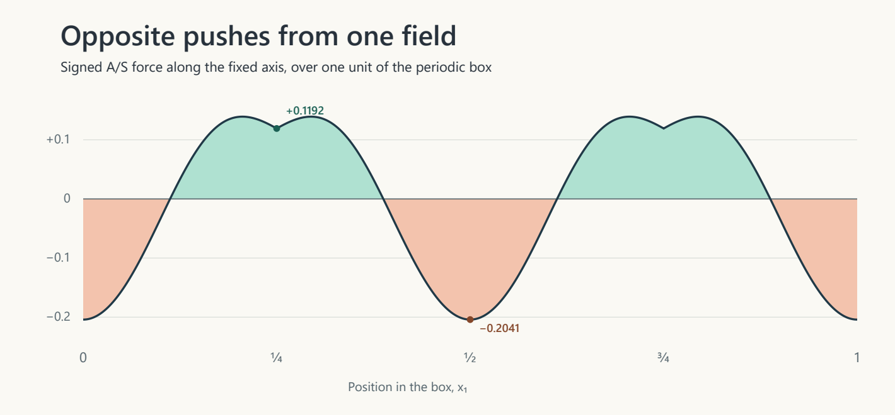

# Can signed A/S pushes make the periodic vortex?

Michele Ziman’s A/S corpus and OpenAI’s fixed construction · Research note · 8 November 2026, Pacific time

**Follow-up verified 9 November UTC.** The two horizontal line identities and the resulting exclusion have since passed Lean and Comparator without a line-identity hypothesis. [Read the follow-up proof and its five-target verification](../as-vortex-hline-lean/RESEARCH-NOTE.md). This dated note records the original 25-target audit.

**The whole-box answer is yes.** One smooth periodic scalar field can generate nonzero pushes of both signs with exactly zero spatial average. **For the particular vortex, the construction has an additional requirement at its outer edge.** A classical momentum calculation finds a transverse force there that a single fixed-axis A/S law cannot supply. The Lean package checks the cancellation, the native exterior field, a nonzero transverse signal, and a conditional exclusion theorem. The last identification with the full three-dimensional momentum residual is stated below so a reviewer can inspect exactly where the computational certificate ends.

## One field, two signs

The signed alternative in paragraphs 230 and 262 of the corrected corpus is

$$
a_\varepsilon(q)=\frac{q}{2}\left(1+\tanh(q/\varepsilon)\right),\qquad
q=|\nabla S|-\Gamma_{\rm crit},\qquad f_{\rm AS}=-c\,a_\varepsilon(q)e_k,\quad c=\sigma/\rho .
$$

The dynamics of the same field still require \(A'=\gamma(U-U_{\rm baseline})\), \(J=\kappa A\), and \(S_t+u\cdot\nabla S=D_{\rm diff}\Delta S+K_h(x-x_0)J\). This comparison uses the signed branch as written, the unit periodic box and periodic pressure, and \(c,\Gamma_{\rm crit},\varepsilon>0\). The fixed coordinate direction \(e_k\) is one of the three Cartesian axes. [Original passages and equation register](https://github.com/NousVolition/Nous-Volition/blob/b4ae2c54cd85bfef282c501ecfca83de274e2070/studies/community-chain-audit/equation_register.csv) · [First periodic comparison, pp. 8–9](https://github.com/NousVolition/correct-and-lean-/blob/ff767334becf669ce141476a400c0e1b834485cb/research/comparisons/OpenAI-Navier-Stokes-and-your-corpus-final-comparison.pdf)

Take \(S_\lambda(x)=\lambda\sin(2\pi x_1)/(2\pi)\). Its gradient magnitude is \(\lambda|\cos(2\pi x_1)|\) for \(\lambda\ge0\). At \(\lambda=\Gamma_{\rm crit}\) the signed activation has negative mean. For large \(\lambda\) its mean is positive because \(a_\varepsilon(q)\ge q/2\). Continuity gives a value \(\lambda>\Gamma_{\rm crit}\) at which the mean is exactly zero. The two unused coordinates each have unit volume, so this is cancellation over the three-dimensional box. Taking \(e_k=e_2\) makes the force transverse to its spatial variation. Its nonzero component on a complete \(x_2\)-loop cannot be the derivative of a periodic pressure.

With all three parameters set to one, midpoint quadrature gives \(\lambda\approx1.31321668\). At \(x_1=0\) the push is approximately \(-0.20411714\,e_2\). At \(x_1=1/4\) the same scalar gives \(+0.11920292\,e_2\). These are point values. The integral cancels because of the whole spatial profile. The existence of an exact zero is a Lean theorem. The decimal is a numerical illustration. Here the loop follows the force. A line at fixed \(x_1\) has a real, nonzero push all the way around it. The example specifies a single instant. Sustaining this profile would also require a history and source satisfying the scalar transport equation. A flat \(S\) at an instant would give a nonzero spatially uniform push for positive threshold, which is already incompatible with the target’s constant zero mean velocity.

There is a regularity detail in comparing this snapshot with OpenAI’s smooth force. The sine field is smooth, but taking the absolute value of its derivative can give the displayed force a corner at a zero of that derivative. One can also get a smooth spatial force by a related pencil-and-paper construction. Choose a nonnegative smooth unit-periodic bump \(h\) supported strictly inside \((0,1/2)\). Take \(S'_\lambda(x)=\lambda[h(x)-h(x-1/2)]\). Its integral over a period is zero, so it has a smooth periodic primitive. The bump supports are disjoint, hence \(|S'_\lambda|=\lambda[h(x)+h(x-1/2)]\) is smooth too. The same negative-at-zero, positive-at-large-amplitude argument gives exact cancellation with both signs. Comparator checks the explicit sine witness. The smooth-bump extension is a separate written argument. Neither example supplies a time history for the scalar transport equation.

If the threshold is zero, the original argument changes. Then the excess is always nonnegative and the signed activation is nonnegative as well. Nontrivial signed cancellation in this example uses a strictly positive threshold.

## A loop through the actual outer edge

OpenAI’s pinned source cuts a vector potential **before** taking its curl. Moving that cutoff onto the finished velocity would drop a derivative term at precisely the edge we need to test. The original selected exterior potential is axial. Its coefficient is a heat primitive \(H(t,s)\) anchored at radial energy \(s=1\), with \(s=(x^2+y^2)/2\). The direct term of the selected decomposition vanishes on this exterior. For \(0<s<1\) the primitive is positive. The raw source and the later rewriting of the local potential are both visible in the repository. [Source selection and rewriting](https://github.com/openai/NavierStokesAndEuler/blob/f9e8bc5b38b6e212696e8a30e3e91517af887bbd/NavierStokes/LocalPotentialRebundle.lean) · [Anchored heat primitive](https://github.com/openai/NavierStokesAndEuler/blob/f9e8bc5b38b6e212696e8a30e3e91517af887bbd/NavierStokes/TailGaugePotential.lean) · [Compact periodic field](https://github.com/openai/NavierStokesAndEuler/blob/f9e8bc5b38b6e212696e8a30e3e91517af887bbd/NavierStokes/R3CompactCandidate.lean)

Use the viscosity-one normalization of the pinned source. Its product cutoff has outer radius \(b=1/4\). Near the horizontal middle plane its height factor is identically one. Fix \(x=b-d\) and follow a complete horizontal line in \(y\) from \(-1/2\) to \(1/2\). For all sufficiently late \(t<1\), the part of this strip with \(1/8\le x\le5/16\) is outside the shrinking pulse annulus. At \(z=0\), the similarity scale is \(1-t\), and the lower bound \(s\ge1/128\) puts every point on those lines into the heat exterior once \(t\) is close enough to one. The Lean statement gives one such time interval for every diagonal schedule. [Native product cutoff and support](https://github.com/openai/NavierStokesAndEuler/blob/f9e8bc5b38b6e212696e8a30e3e91517af887bbd/NavierStokes/SpatialLocalization.lean) · [Exterior conditions](https://github.com/openai/NavierStokesAndEuler/blob/f9e8bc5b38b6e212696e8a30e3e91517af887bbd/NavierStokes/LocalPaperDomain.lean)

Write \(W(t,x,y)=\chi(x,y,0)H(t,s)\) and define the observable
\[
J_{\rm edge}(t,d)=\int_{-1/2}^{1/2} W(t,b-d,y)\,dy .
\]
Here \(J_{\rm edge}\) is a quantity read from OpenAI’s field. The symbol \(J=\kappa A\) in the A/S corpus retains its own definition. The edge observable vanishes outside the cutoff and is strictly positive immediately inside. At each fixed presingular time its time derivative obeys \(|\partial_t J_{\rm edge}|\le B J_{\rm edge}\) throughout the interior strip for some finite \(B\). Indeed \(H>0\) on the compact range of radial energies and \(|H_t|/H\) is bounded there. The spatial weight is nonnegative and time independent.

## What pressure can hide

For the first horizontal orientation the native axial potential has curl \(u=(W_y,-W_x,0)\) on a neighborhood of the middle plane. Choose the \(y\)-line perpendicular to the A/S forcing axis. The integral of the pressure derivative on that closed line is zero for every periodic pressure. The integral of the \(y\)-part of advection is also zero. This fluid turns azimuthally, so its convective acceleration is radial and its \(y\)-component is odd in \(y\). The \(yy\)-diffusion term integrates to zero by periodicity, and the \(zz\)-term vanishes in the height plateau. Since \(-W_x=W_d\), differentiating the smooth compact line integral gives, at viscosity one,
\[
\int_{-1/2}^{1/2} R(u,0)_y(t,b-d,y,0)\,dy
=\partial_d\!\left(\partial_t J_{\rm edge}-\partial_{dd}J_{\rm edge}\right).
\]
Here \(R(u,0)=u_t+(u\cdot\nabla)u-\Delta u\) uses the native pressure-free momentum residual. Interchanging \(x\) and \(y\) changes the orientation sign. For each of the three choices of fixed \(e_k\) there is a horizontal coordinate line perpendicular to it.

If the A/S force made this motion with any periodic pressure, the left side would have to vanish on every such line. The heat defect in parentheses would be constant in \(d\), and zero beyond the edge, hence zero inside as well. That would give \(|\partial_{dd}J_{\rm edge}|\le B J_{\rm edge}\) with \(J_{\rm edge}=\partial_d J_{\rm edge}=0\) at the boundary. The one-dimensional Grönwall inequality then forces \(J_{\rm edge}=0\) into the strip. Its strict positivity gives the contradiction. Lean also locates a nonzero inward derivative of this defect at some offset \(-1/16<d<1/8\).

## What still needs proof

The final Lean exclusion theorem takes **one explicit comparison identity** as a hypothesis. It asks that the line integral of the pinned, pressure-free, three-dimensional residual equals the displayed derivative, with the sign for the chosen horizontal orientation. The handwritten calculation above supplies the reason. The package checks the imported exterior/cutoff identity, the time and space derivatives of the edge observable, the nonzero signal, and the vanishing-loop requirement for the actual A/S force formula. The remaining end-to-end formal step is to translate the Cartesian curl, convection and Laplacian through that specific integral and discharge the comparison identity for both orientations in Lean.

The tested target is the Cartesian, spatially localized viscosity-one field in the pinned source. Transferring this new obstruction through the final paper rescaling and periodization for every viscosity, or to other choices of localization, needs a corresponding argument. The test concerns global equality of this velocity on the box. It leaves open local resemblance, other vortices, and which A/S initial histories sustain nontrivial signed cancellation over time. The full Hug v3 evolution has its own proof obligations. [OpenAI’s localization and scaling, §§10.1 and 10.5](https://cdn.openai.com/pdf/32d9f210-8b73-45e0-91bc-82a30aef8a9a/navier-stokes.pdf#page=117)

## Verification

**PASS for all 25 frozen statements.** The fresh Linux run completed on 9 November 2026 UTC, from 03:39:56 to 03:48:21. Comparator matched the reference statements, both nanoda and Lean’s default kernel accepted the solution, and the independent axiom listing reported exactly `propext`, `Classical.choice`, and `Quot.sound` for each of the 25 named results. The build and Comparator both exited with code zero. The reference questions contain the intentional placeholders. The proofs are in separate modules and the result above preserves the explicit `hline` hypothesis. [Comparator log](evidence/comparator.log) · [Axiom list](evidence/axioms.log) · [Verification report](verification-report.json) · [Conditional exclusion theorem](TargetSolution.lean)
