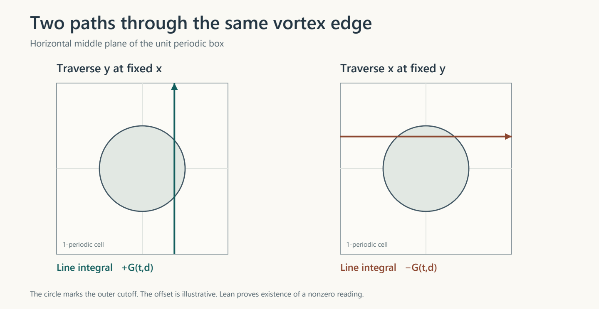

# The two transverse loops through the vortex edge

Research note · 8 November 2026, Pacific time

**Follow-up verified 9 November UTC.** The two loop readings and the fixed-axis A/S exclusion now carry through OpenAI’s rescaling and periodization at every positive viscosity. [Read the twelve-theorem proof and verification record](../as-vortex-rescaling-lean/RESEARCH-NOTE.md).

**The signed A/S force cannot drive this exact periodic vortex.** At viscosity one, the pinned construction requires a nonzero transverse line integral at every sufficiently late presingular time. The two horizontal orientations give opposite signs for the same quantity. For each possible fixed Cartesian forcing axis, at least one of those lines is perpendicular to it. The proof obtains the line identities from the actual velocity and momentum operators.

## What the two loops read

Let \(t=1-\tau\) and let \(d\) measure distance inward from the cutoff radius \(1/4\). Write \(G(t,d)=\partial_d(\partial_t J_{\rm edge}-\partial_{dd}J_{\rm edge})\), with \(J_{\rm edge}\) the integral of the pinned cut heat potential along a horizontal line. Write \(R(u,0)\) for the full pressure-free Navier–Stokes momentum residual at viscosity one. For each diagonal schedule there is an \(\eta>0\) such that the following two equalities hold together whenever \(0<\tau<\eta\) and \(-1/16<d<1/8\).

| Line across the periodic cell | Component read over the line | Exact value |
|---|---|---|
| Hold \(x=1/4-d\), traverse \(y\) | \(\int_{-1/2}^{1/2}R(u,0)_y(t,1/4-d,y,0)\,dy\) | \(+G(t,d)\) |
| Hold \(y=1/4-d\), traverse \(x\) | \(\int_{-1/2}^{1/2}R(u,0)_x(t,x,1/4-d,0)\,dx\) | \(-G(t,d)\) |

The time window and offset range are shared. The earlier audit proves that at every such time there is an offset with \(G(t,d)\ne0\). These are existence statements. They give neither a decimal onset time nor a numerical location for that offset. [Both line statements](HLineProofs.lean) · [Checked nonzero edge signal](../as-signed-vortex-lean/TraceSolution.lean)

## Where the sign comes from

In the tested part of the middle plane the native exterior potential points along the vertical axis, and the native direct term vanishes. The proof first identifies the original velocity on an **open spacetime neighborhood** of every point on both loops. That allows the actual time derivative, advection and Laplacian to be read from the local field. The cutoff multiplies the potential before the curl, so its derivatives enter the velocity and the momentum balance. [Neighborhood proof](HLineGeometry.lean) · [OpenAI’s native cutoff](https://github.com/openai/NavierStokesAndEuler/blob/f9e8bc5b38b6e212696e8a30e3e91517af887bbd/NavierStokes/SpatialLocalization.lean) · [Selected exterior potential](https://github.com/openai/NavierStokesAndEuler/blob/f9e8bc5b38b6e212696e8a30e3e91517af887bbd/NavierStokes/LocalPotentialRebundle.lean)

Write that axial potential as \(F(t,s)\), where \(s=(x^2+y^2)/2\), and put \(V=F_s\). Its curl has horizontal components \(yV\) and \(-xV\). In either loop orientation the transverse nonlinear advection contributes \(-yV^2\) if \(y\) denotes the integration variable. Its integral is zero by oddness. Another term is an exact derivative in the integration variable, with zero endpoint contribution because the cutoff vanishes there. The time derivative and the remaining spatial derivatives integrate to \(G\), and interchanging the two horizontal coordinates reverses the sign. The proof uses OpenAI’s theorem for the complete Cartesian residual, including all three directions of viscous diffusion. [Residual computation](HLineOperator.lean) · [Integration and endpoint cancellation](HLineIntegral.lean) · [OpenAI’s Cartesian operator](https://github.com/openai/NavierStokesAndEuler/blob/f9e8bc5b38b6e212696e8a30e3e91517af887bbd/NavierStokes/AxisymmetricResidual.lean)

For differentiation the proof uses a globally smooth auxiliary radial function. It agrees identically with the cut native potential on an open neighborhood of the tested strip. The equality is proved before derivatives are transferred back to the original field. [Radial identity and mixed derivatives](HLineCalculus.lean)

## What this decides for A/S

The corpus uses
\[
 f_{\rm AS}=-c\,a_\varepsilon(|\nabla S|-\Gamma)e_k,\qquad
 a_\varepsilon(q)=\tfrac12 q\,[1+\tanh(q/\varepsilon)].
\]
The force can reverse direction along \(e_k\). Along a loop perpendicular to \(e_k\), its transverse component is zero at every point. Any \(C^1\) spatial pressure that repeats around the box also contributes zero when integrated along that closed loop. The native vortex gives a nonzero reading on that very loop. [Corpus force and response](https://github.com/NousVolition/Nous-Volition/blob/b4ae2c54cd85bfef282c501ecfca83de274e2070/studies/community-chain-audit/equation_register.csv) · [Signed matching predicate](../as-signed-vortex-lean/TraceDefinitions.lean) · [Periodic pressure calculation](../as-signed-vortex-lean/TargetSolution.lean)

Consequently there is no choice of scalar field and periodic classical pressure giving this velocity with the signed A/S force at those late times. There is also no pair consisting of a time-dependent scalar field and a pressure that matches the velocity throughout \(0<t<1\). The exclusion allows every \(S(t,\cdot)\) in the force formula. A history produced by the prescribed \(A\), source and \(S\)-transport equations is included among those possibilities. Signed local pushes can still have exactly zero box average, as the earlier proof established. [Trajectory exclusion](HLineProofs.lean) · [Original cancellation proof](../as-signed-vortex-lean/SignedSolution.lean)

## Scope

The velocity here is OpenAI’s selected, spatially localized, periodically repeated viscosity-one field in its pinned Cartesian coordinates. The new result concerns exact equality on the box under classical spatial pressure regularity and periodicity. Transferring the new exclusion to every rescaling in the final paper theorem would require a separate formal bridge. Other vortices and the histories that sustain nontrivial signed cancellation over time remain open questions. [Exact source revision](https://github.com/openai/NavierStokesAndEuler/tree/f9e8bc5b38b6e212696e8a30e3e91517af887bbd) · [Paper localization and rescaling](https://cdn.openai.com/pdf/32d9f210-8b73-45e0-91bc-82a30aef8a9a/navier-stokes.pdf#page=117)

## Verification

**PASS for five new targets.** The clean Linux replay ran from 04:13:48 to 04:21:51 UTC on 9 November 2026. Comparator matched all five reference statements. Nanoda and Lean’s default kernel both accepted the exported solution. The default Lean build and axiom check also exited successfully. Each target depends on exactly `propext`, `Classical.choice` and `Quot.sound`. The 25 results in the previous audit are recorded separately. [Comparator log](evidence/comparator.log) · [Five axiom reports](evidence/axioms.log) · [Verification report](verification-report.json)

The first isolated attempt stopped on a denied write to a sibling dependency’s empty build cache. For the successful replay, both caches started empty inside Comparator’s permitted build directory. The same Landrun and systemd socket restrictions applied. The new proof sources, inherited A/S files and all pinned dependency revisions passed the integrity checks before and after the run. [First attempt](evidence/initial-cache-layout/comparator.log) · [Chain of input hashes](evidence/preflight.json) · [Post-run checks](evidence/postflight.json)
