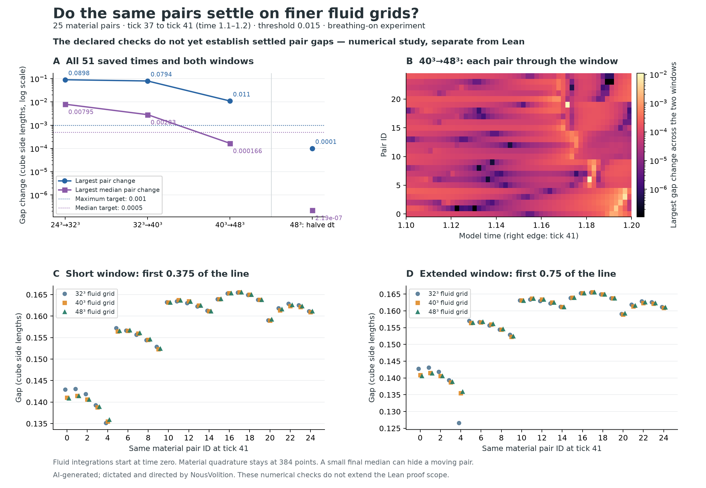
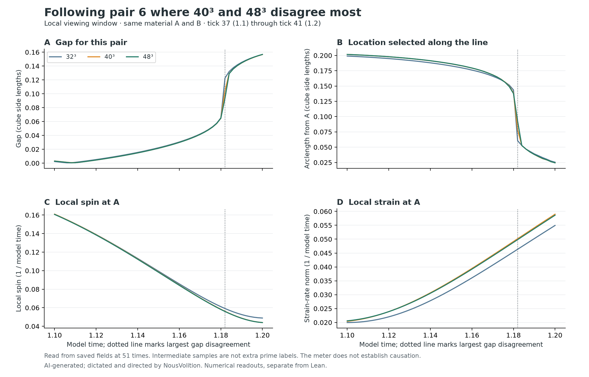

# The same-pair gaps still change on the finer fluid grids

**The 40³ and 48³ grids agree within the 0.001 target at tick 41. At earlier saved times, 8 of the 25 pairs still exceed that target.**

**Prime tick 41 is model time 1.2.** Three new simulations ran from time zero: 40³ at dt 0.0005, 48³ at dt 0.0005, and 48³ at dt 0.00025. Each carries the same 25 initial material A/B labels. The primary comparisons use all 51 common times from tick 37 to tick 41 and both forward windows, 0.375 and 0.75.

| Comparison | Largest same-pair gap change | Largest median absolute pair change | Largest change at tick 41 | Gap-size targets |
| --- | ---: | ---: | ---: | --- |
| 24³ → 32³ (earlier runs) | 0.0898224433 | 0.00795358845 | 0.0498628478 | Not met |
| 32³ → 40³ | 0.0794156706 | 0.00283167265 | 0.00891540409 | Not met |
| 40³ → 48³ | 0.0109703224 | 0.000166081234 | 0.000399750839 | Not met |
| 48³: dt 0.0005 → 0.00025 | 0.000100422904 | 2.18798249e-07 | 1.02878722e-07 | Met |

Distances are in cube side lengths. The unchanged targets are maximum ≤0.001 and maximum-over-time median absolute pair difference ≤0.0005. The median column measures differences within the same pairs; it is not a difference between two group medians.

The reported maxima cover the 51 saved times, spaced by 0.002. They are not continuous-time upper bounds and do not resolve every possible nearest-point exchange between samples.

Separating the two views in the last grid comparison: **local window: maximum change 0.0109703224, targets not met; extended window: maximum change 0.0109703224, targets not met**. The [window table](window-comparisons.csv) retains both outcomes.

In the 40³ → 48³ comparison, **8 of 25 pairs** exceed the 0.001 target somewhere in the interval; **0 of 25** exceed it at tick 41. The largest change is for pair 6 in the local window at model time 1.182. Pair IDs run from 0 to 24.

The last time-step halving changes gaps by at most **0.000100422904**. The maximum across saved times in the 40³ → 48³ comparison is **0.0109703224**. These are measured sensitivities, not rigorous error bounds.

## What was checked

- Final spatial gap-size targets met: **False**.
- Successive spatial maximum differences decreased: **True**.
- Finest-grid time-step gap targets met: **True**.
- Denser tracing and named direct-Fourier spot checks met their 0.00005 target: **True**.
- Divergence/context-mass and positive-temperature checks passed: **True**.
- The finest time-step halving decreased the maximum energy-accounting defect: **True**.

Balance, temperature and energy diagnostics are evaluated at the saved prime instants and before/after scheduled writes. Every integration step is checked for nonfinite state values. These are different levels of coverage; the sampled diagnostics are not a bound at every intermediate time.

The separate final velocity and vorticity differences are 0.207892% and 0.319198%. Their earlier 1% and 5% targets were met. These field averages do not replace the pair-gap checks.

The closest arclength moves by as much as 0.372524264 in the last spatial comparison. At tick 41, 0 pairs have a closest-point shift above 0.02. Gap agreement and closest-point agreement are distinct.

At tick 41 on the 48³ grid, the boundary-minimum counts are local: 2 at the start, 0 at the end; extended: 2 at the start, 0 at the end. The [boundary table](boundary-minima.csv) also reports all times and points within one finer tracing step of a boundary.

The measured gap is the nearest distance from B to a chosen finite segment of the vorticity line through A. A and B keep their carried material identities; the vorticity line is retraced from each saved fluid field. A larger viewing window can select a different nearest point. The tracing follows the path without imposing closure. These finite vorticity-line measurements do not determine the full material connection or complete vortex-tube identity.

The tick-41 field/particle sample is taken on the before-write side at time 1.2. The scheduled write leaves the carried positions and velocity unchanged at that instant, while changing the stored fabric target and heat. This study stops at that endpoint and does not measure the later flow response to that write.

## The useful meter readings

The [prime meter](prime-meter.csv) retains the 13 original labels from 2 to 41, with both sides of writes at 11, 23 and 41. It records energy, work and balance separately for each fluid grid and time step. The [same-pair meter](same-pair-local-meter.csv) adds local spin, strain and vorticity at A and B beside every gap at all 51 late times. Samples between primes remain labelled by model time, not invented prime ticks.

In the 40³ → 48³ comparison, the largest same-particle position difference (shortest periodic displacement) is 0.000142369775 cube lengths; the largest local-spin difference is 0.00145659061 per model-time unit; the largest vorticity-direction difference is 1.00499 degrees. These are diagnostic comparisons across all A/B particles and times, not a causal explanation of the gap change. [Meter comparison table](meter-grid-comparisons.csv)

The [focused meter rows](gap-change-focus-meter.csv) line up both grids at the particular pair and time of their largest gap disagreement. This keeps the changing gap, nearest-point arclength, local spin and strain together instead of substituting an unrelated meter average.

For that pair and time: **40³: gap 0.104532616, closest arclength 0.078125, local spin at A 0.0561513447; 48³: gap 0.0935622937, closest arclength 0.092423486, local spin at A 0.0559676757**. At this particular comparison, both window lengths select the same interior nearest point: extending the window from 0.375 to 0.75 leaves this gap disagreement unchanged.

Local spin is half the vorticity magnitude; strain is the Frobenius norm of the symmetric velocity gradient. The direct-Fourier gradient was checked against an analytic field and its curl independently. These readouts do not reconstruct the separately studied carried tangent map or the scalar slope threshold at A.

The newer prime-59/157 energy records belong to the separate 401-marker experiment, beyond this run. The old fixed-potential Yang–Mills residual is identically zero independently of the evolving fluid, so it is not used as a grid-convergence test. No older meter number was substituted for a new finer-grid measurement. [Meter sources and scope](meter-source-note.md)

## Scope and evidence

This continues the threshold-0.015, breathing-on, 801-marker experiment in a periodic unit cube. The 384 material quadrature points, physical parameters, matched initial fields and event schedule remain fixed. Only the fluid grid and declared integration time step vary. Breathing is an added drive in this experiment; it does not redefine the author’s intended unforced system. The threshold-1 and 401-marker studies remain separate.

**This numerical follow-up is separate from Lean.** The [published Lean checks](../finite-window-lean/README.md) concern the nested-window rule and earlier recorded decimals. No new Lean check was run, and this extension does not prove convergence of the fluid simulation or the continuum model. This publication adds saved numerical records and diagrams. Its automated recount does not rerun the fluid solver or Lean.

The archived runner and solver sources were reused read-only. Its previously documented Fourier-label rounding is retained. The new wrapper changes the output destination and adds passive progress reporting. Initial labels and fields match the earlier archive; event payloads are recomputed from each evolving run.

The three event payload codes match across 32³/40³/48³: **False**. They match across the finest time-step halving: **True**. These checks record agreement or change without assuming it explains a gap change.

A read-only [decoding audit](write-code-audit.json) recovered all 12 stored records and repacked them to their saved checksums. The codes cover the stored event values, with no fluid-grid metadata. For 40³ → 48³, time 0.4: 58 of 2304 stored strain entries differ, by at most 0.0001; time 0.8: 529 of 2304 stored strain entries differ, by at most 0.0003; time 1.2: 519 of 2304 stored strain entries differ, by at most 0.0002. The first two writes differ only in stored strain; the third also differs in stored actions. All three stored records are identical across the finest time-step halving. [Write comparison table](write-code-comparisons.csv)

These comparisons include the model’s response through its own writes. They do not isolate the cause of the gap difference. In particular, the third write occurs after the tick-41 gap sample and cannot cause the earlier difference at time 1.182.

All 21 original input hashes, 163 earlier output hashes and 50 earlier code hashes remain unchanged. Historical receipts were preserved. A separate standard-library recount checks every same-pair comparison.

[Per-pair comparisons](per-pair-comparisons.csv) · [Comparison summary](gap-comparisons.csv) · [Field checks](field-comparisons.csv) · [Tracing checks](tracing-comparisons.csv) · [Direct spot checks](direct-checks.csv) · [Diagnostics](diagnostics-summary.csv) · [Independent recount](independent-recount.json) · [Decision record](analysis-summary.json) · [SVG diagram](finer-grids.svg)

[Earlier six-run study and its original receipts](../fluid-grid-study/README.md) · [Declared extension plan](experiment-plan.md) · [Source and figure reproduction](source/README.md)

## Recount the public records

Run `python -B verify.py` with Python 3.11 or later. The standard-library check recomputes all same-pair comparisons, explicitly checks all 25 endpoint agreements and the eight earlier failures, checks the tracing records and meter joins, and confirms that the saved decision follows from the tables. [Published recount](recount.json) · [Public file fingerprints](publication-manifest.json) · [Publication provenance](provenance.json) · [GitHub workflow](../../../.github/workflows/finer-grid-records.yml)

This compact publication includes the five comparison-run pair tables, the three new run receipts, 80 prime-meter rows and 6,375 local meter rows. The archived CSVs also retain the separate reselected-pair convention; only rows marked `fixed` enter this follow-up's claim. Full fluid fields and other large arrays remain local. Their original hashes are retained in [the local output inventory](local-output-inventory.json). Archived receipts retain their original pre-publication wording and timestamps; they are historical evidence, not GitHub execution receipts. The public recount verifies saved data, not the simulation or full field-dependent readouts.

**AI-generated; dictated and directed by NousVolition.**
