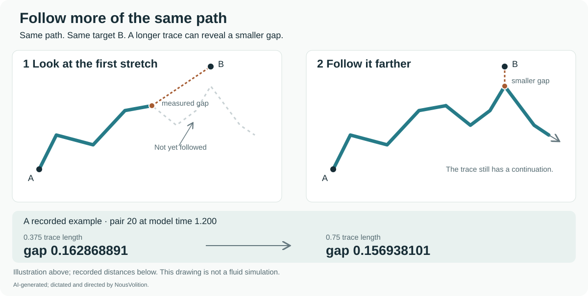
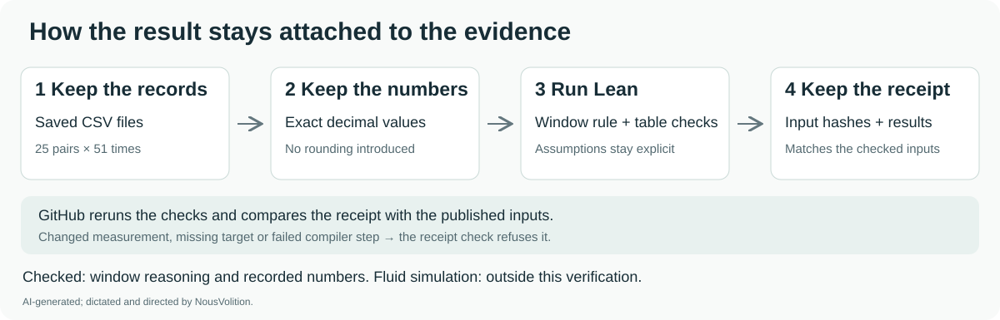

# Lean check of the finite-window gap

**The mathematical rule is small; the checking practice is the point.** The general proofs are short order arguments about looking over a larger set. This package shows how to state their assumptions, preserve the measurements, check the recorded numbers, and publish evidence that can be matched to the inputs and rerun.

The local run passed with Lean 4.34.0-rc2. Its 15 named statements are an inventory of checks, not 15 independent mathematical discoveries. The axiom audit reports no axioms for any of them. The proofs contain no `sorry`, `admit`, added axioms, or `native_decide` shortcut.

The question and interpretation come from NousVolition. **AI-generated; dictated and directed by NousVolition.** The supplied figure was identified by the user as Claude-generated; its original image and numerical records remain unchanged.

## What passed

1. **Following more of the same path cannot increase the nearest gap.** The larger window must contain the smaller window, with the same target, path and distance function. A theorem covers attained nearest points; a second covers infima even without attainment. Existence of the stated minimum or infimum is an explicit hypothesis. The proofs do not compare different model times or changing paths.
2. **A positive gap in the visible samples does not establish a positive gap everywhere.** A concrete two-sample counterexample has gap 1 in its first window and reaches gap 0 after extending it. This is a counterexample about sampled windows, not a new continuous fluid trajectory.
3. **All 1,275 recorded comparisons passed.** For each of 25 original pairs at each of 51 frames, the recorded gap on the 0.75 trace is no larger than on the 0.375 trace.
4. **All 51 sets of medians and ranges passed for both lengths.** Lean checks that each minimum and maximum is attained and bounds all 25 values, and that at least 13 of the 25 values lie on each side of the stated median.
5. **The earlier increase and final differences passed.** The recorded minimum is already positive at nominal time 1.102. At time 1.200, the median and pair 20's gap are strictly smaller on the longer trace.

For pair 20 at the final frame, the saved gap decreases from approximately **0.162868891** to **0.156938101**. The final median decreases from approximately **0.161610807** to **0.161284011**.

## What the data proof means

The useful practice is visible at each step: retain the source CSVs; convert their written decimals exactly; check the full table rather than a selected example; reject a changed input or missing theorem target; and keep the formal result separate from claims about the fluid model. The three refusal tests deliberately change a measurement, omit a target, and mark a compiler step as failed. Each must be rejected by the receipt checker.

The preserved CSV distance strings were converted exactly into natural-number numerators sharing the positive denominator **10²⁴**. Lean checked those exact values by kernel computation. The source frame numbers run from 550 through 600, with 25 seed IDs per frame; the receipt records the input hashes. Source float time strings differ from nominal frame × 0.002 by at most 0.0000000000000001; nominal frame times are used for the labels.

This checks the contents of the recorded tables. It does not prove that the fluid solver or line integrator produced the physically correct distances, or that its floating-point operations correspond to this formal model. The general nested-window theorem applies to a physical or numerical path only when its stated inclusion and fixed-distance assumptions are established.

No new simulation or line integration was run. These proofs do not establish closure, disconnection, reconnection, write/hold/release causation, or the generation history of the supplied figure. The mathematical proofs and data checks have their own Lean-kernel workflow. Comparator and nanoda were not run for this package; their results in other packages do not certify it. The 0.015 study remains separate from threshold-1 results and the illustrative penne animations.

## Files and reproduction

- `WindowGap.lean`: general rules and the sample counterexample.
- `RecordedWindows.lean`: exact preserved values and their finite checks.
- `CheckAxioms.lean`: audit of all 15 theorem dependencies.
- `receipt.json`: tool version, source fingerprints, targets, commands, results and limits.
- `evidence/`: unchanged CSV inputs and the compiler/audit logs.
- `verify.py`: regenerate the data module, compile both modules with warnings treated as errors, and check every axiom report.

Make a working copy of this directory first: `verify.py` regenerates the two generated modules, compiler logs and `receipt.json` in that copy. With the pinned Lean executable on PATH, run `python verify.py`. Alternatively pass its location using `python verify.py --lean PATH_TO_LEAN`. The package uses Lean core and has no external library dependencies. The included Lake targets also build the two proof modules; `verify.py` performs the additional axiom audit and receipt recording.

The original records came from `work/vortex-lines/10-prime37-to-41.csv` in the archived Hug v3 vortex-line study. The statistics input came from this chat's independently recomputed `recomputed-25-pair-statistics.csv`. Both exact input files are included under `evidence/`; the formal check does not depend on the original absolute filesystem paths.

## Published evidence and GitHub checks

The checked-in [receipt](receipt.json) records the original local Windows run. Only its executable home paths were replaced with `lean`; [publication provenance](provenance.json) records the original and public digests. The proof modules, verifier and CSV inputs are byte-identical to the locally checked copies. [Check the saved receipt](check_saved_receipt.py) validates the input fingerprints, target list, successful module exits and empty axiom lists.

The [Finite-window Lean checks workflow](../../../.github/workflows/finite-window-lean.yml) reruns the same verifier in a fresh copy using the repository's pinned Lean release. It compares the new receipt and regenerated modules with the published inputs, then uploads the new evidence. [Workflow runs](https://github.com/NousVolition/hug-sims-lean-proofs/actions/workflows/finite-window-lean.yml). A green repository-only check is not a substitute for this package's run and matching receipt.

To check the preserved local receipt without rerunning Lean, use `python check_saved_receipt.py`. To compare a new run as well, use `python check_saved_receipt.py --fresh PATH_TO_NEW_RECEIPT`. The source data belong to the archived threshold-0.015 Hug study; this publication does not change the separate threshold-1 trajectory or switch claims.
