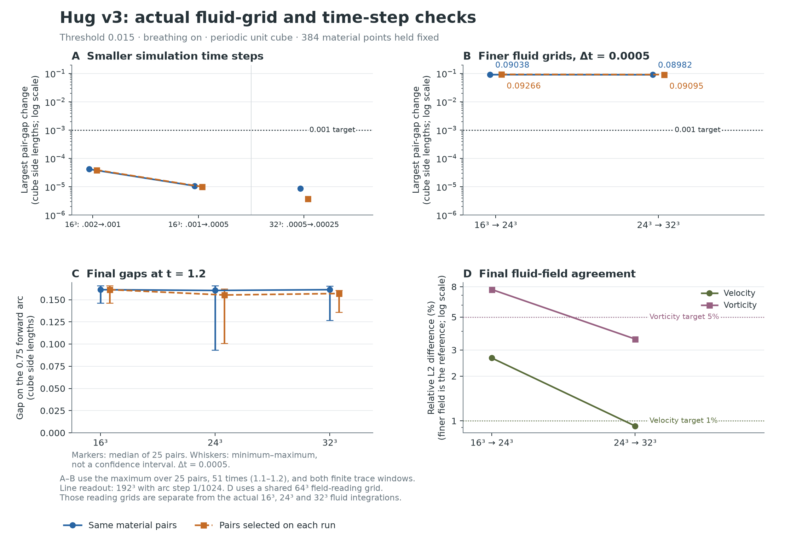

# Smaller time steps pass; pair gaps still change with the grid

**All six runs finished. The time-step gap checks met their declared tolerances. The spatial pair-gap checks did not.**

**Prime tick 41 is model time 1.2**, the endpoint shown in the diagram. The pair-gap comparisons span tick 37 to tick 41 (model time 1.1 to 1.2); all six simulations start at time zero.

| Last comparison | Largest same-particle gap change | Target |
| --- | ---: | ---: |
| Time step 0.0005 → 0.00025 at 32³ | 0.00000858413 | ≤0.001: met |
| Fluid grid 24³ → 32³, time step 0.0005 | 0.0898224 | ≤0.001: not met |

These changes cover 25 pairs, 51 common times and both finite windows, in cube side lengths. Selecting pairs anew on each run also fails the spatial criterion: 0.090951. Similar medians can hide changes to individual pairs.

The separate final fluid-field differences are 0.9234% for velocity and 3.5556% for vorticity, within their 1% and 5% targets. Those field checks do not settle the pair-gap result.

**This is a numerical follow-up, separate from the Lean proofs.** The [Lean package](../finite-window-lean/README.md) checks the nested-window rule and the earlier recorded decimals. It does not certify these simulations, their convergence or physical interpretation. Its inputs and receipts are unchanged.

This study uses the original **threshold-0.015, breathing-on, 801-marker experiment** in a periodic unit cube. It is separate from the [threshold-1 control](../threshold-one-follow-up/README.md) and the [401-marker energy-history comparison](../../review-updates/2026-11-11/README.md). Breathing is an added intervention in this experiment; it does not redefine the author's intended unforced system.

All six integrations start at time zero with matched initial fields, forcing and event schedule. The actual fluid grids are 16³, 24³ and 32³; 384 material quadrature points remain fixed. This does not establish full continuum or material-quadrature convergence, physical calibration, a closed material path or physical vortex-tube identity.

[Detailed results](RESULTS.md) · [Methods and limits](METHODS.md) · [Declared experiment plan](experiment-plan.md) · [Completed-run receipt](completion-receipt.json) · [SVG figure](convergence.svg)

## Recount the published evidence

Run `python -B verify.py` with Python 3.11 or later; it uses only the standard library. It checks file hashes, all 15,300 saved primary pair rows, the finer tracing controls, all ten cross-run gap comparisons and the summary data used in the figure. It confirms that the recorded time-step criteria pass and spatial pair-gap criteria fail. A successful recount means that the publication agrees with its saved data.

The [Fluid-study records workflow](../../../.github/workflows/fluid-study-records.yml) runs this recount and uploads its result. **It does not rerun the fluid solver or Lean.** [Published recount receipt](recount.json) · [Publication provenance](provenance.json) · [Algorithm sources and figure reproduction](source/README.md)

This compact publication includes per-pair tables and numerical receipts. Full field arrays, original checkpoint archives and intermediate integration stages remain local; [their inventory](local-output-inventory.json) preserves their original hashes. Publishing this study made no new simulation or Lean run. Historical source receipts remain intact.

**AI-generated; dictated and directed by NousVolition.**
