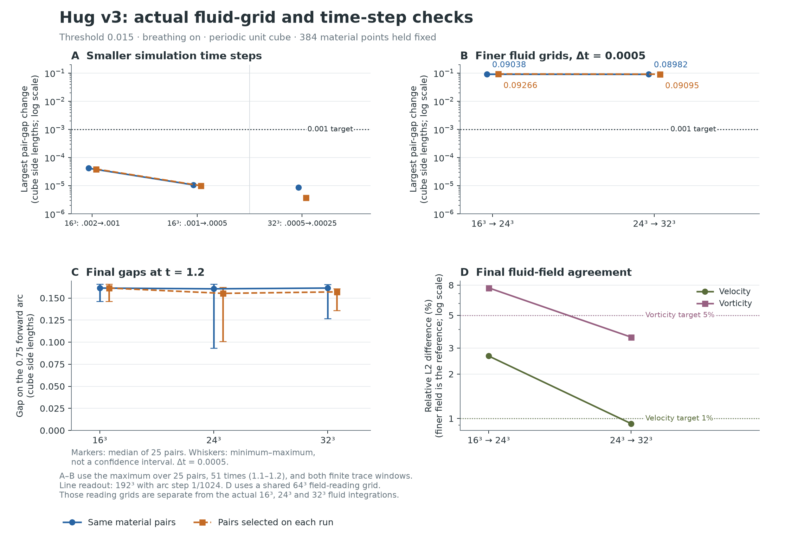

# Hug v3: fluid-grid and time-step checks

The integrations are complete; the full set of declared practical agreement criteria is not met.

Smaller time steps meet the gap criteria and their differences decrease. The last fluid-grid comparison does not establish agreement for all required observables.

**Reading the figure.** A changes the simulation time step. B changes the actual fluid grid. C shows final distances, with the spread of the 25 pairs; similar medians can hide changes to individual pairs. D compares the final fluid fields. The 64³ grid used to compare fields is a readout grid, not another simulation.

| Comparison | Same-particle max gap change | Reselected-pair max gap change |
| --- | --- | --- |
| 16³: Δt .002 → .001 | 4.17107e-05 | 3.92257e-05 |
| 16³: Δt .001 → .0005 | 1.06771e-05 | 1.00032e-05 |
| 16³ → 24³; Δt .0005 | 0.0903809 | 0.0926622 |
| 24³ → 32³; Δt .0005 | 0.0898224 | 0.090951 |
| 32³: Δt .0005 → .00025 | 8.58413e-06 | 3.75764e-06 |

Changes above are in cube side lengths and are the maximum over both finite windows, all 25 pairs, and all 51 common times. The target is 0.001; the separate maximum-over-time median absolute pair change target is 0.0005. Successive differences must decrease.

At t=1.2 alone, the 24³ → 32³ maximum pair differences are 0.0498628 for fixed particles and 0.0428101 after reselection. Over the full window, their largest median absolute pair differences are 0.00795359 and 0.0057675.

Final 24³ → 32³ relative L2 changes: velocity 0.9234%, vorticity 3.556%, context 0.5196%, excess temperature 0.2788%. Velocity and vorticity targets are 1% and 5%. Context and excess temperature are reported without separate thresholds.

**Which particles?** Same-particle comparisons retain common time-zero material labels. Their prime-37 gap can already differ after grid refinement. Reselected comparisons use the same procedure on each run’s prime-37 line through common transported center labels, but their A/B particles differ across runs. Neither convention relocates the neighborhood to a newly detected neck.

| Finest run at t=1.2 | Local median (.375 arc) | Extended median (.75 arc) | Largest paired benefit |
| --- | --- | --- | --- |
| fixed | 0.161286 | 0.161286 | 0.00854629 |
| reselected | 0.156962 | 0.156962 | 0.000542458 |

The longer finite window can only reduce the computed minimum. The difference of the two medians is not the median of individual benefits; both are retained in the detailed tables. At the finest run, fixed: 5/25, reselected: 6/25 benefits exceed both 0.00005 and the sum of the measured time/tracing changes. Those changes are empirical sensitivities, not rigorous error bounds.

**Distances and closest locations are separate.** The largest final tracing-control gap change is 8.07264e-06. The baseline’s selected closest arclength moved about 0.30 in a near tie during the earlier tracing refinement even though its gap changed less than 0.000021; a finer direct trace confirmed the later approach. Stable distance therefore does not imply stable closest-point identity. No complete vortex-tube identity or exchange is established.

**What was run.** Six complete integrations from t=0 to 1.2: the original 16³/.002 baseline, 16³/.001, 16³/.0005, 24³/.0005, 32³/.0005, and 32³/.00025. The initial heat Fourier polynomial, physical forcing, event times, 801 original markers and 384 material quadrature points were held fixed. These are fluid-grid/time checks of that fixed material discretization, not full continuum or physical validation.

The baseline matched all 16 archived states and all 801 marker positions exactly. Across the completed runs the maximum divergence was 2.686e-14, context-balance defect 2.429e-17, and energy-accounting defect 1.139e-09. Original source/input hashes remain unchanged.

The largest spatial gap changes were rechecked with direct Fourier tracing at ds=1/2048; their discrepancies from the primary comparison were at most 4.16e-06. Independent Parseval calculations reproduced the field L2 differences.

[Detailed methods and qualifications](METHODS.md) · [Comparison table](gap-comparisons.csv) · [Final-window details](final-window-summaries.csv)
