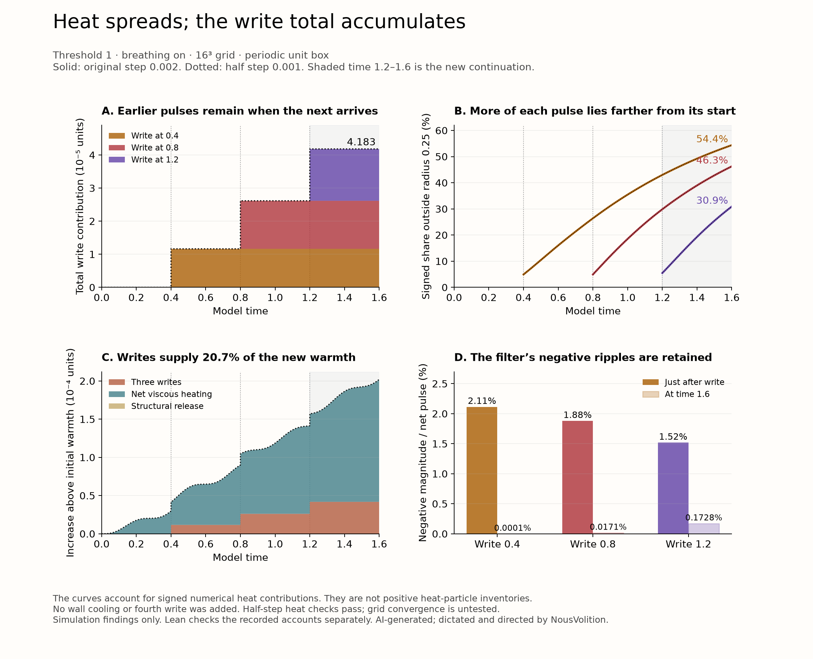
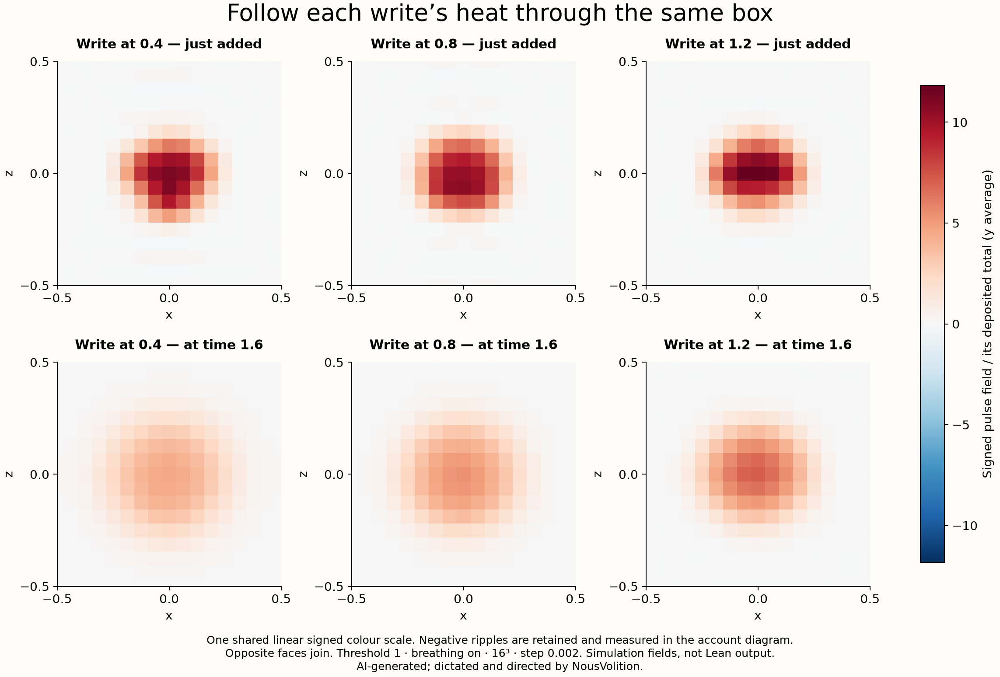

# Following heat after the writes

**The three write pulses spread while their total accumulates in this model.** The earlier pulse is still present when the next write arrives. By model time **1.6**, the three writes together contribute **4.18336211464345 × 10⁻⁵** heat units. Their peaks decrease and their distributions broaden. These are dimensionless numerical heat contributions, with the signs from the solver retained.

This follows the historical **threshold-1, breathing-on, 16³ periodic-box run**. The original step is **0.002**; a second run uses **0.001**. The three writes remain at **0.4, 0.8 and 1.2**. The original saved interval ends at 1.2; **1.2–1.6 is a new continuation with no fourth write**. This is separate from the threshold-0.015 study of observers 540 and 872.

## Where the pulses spread

The maps show the x–z view, averaged through y, with each pulse divided by its own deposited total. All six panels use the same linear signed colour scale and the actual 16³ saved fields. Periodic edge cells are repeated at the opposite face for display. A path closing into a loop is not inferred from this boundary convention.

For a local view, we chose a fixed radius **0.25** around each pulse's starting circular centroid. Distances wrap across the periodic faces. That sphere is an observation window, not a material boundary or a private inventory.

| Write time | Heat added | Signed share outside the chosen sphere just after writing | Signed share outside at 1.6 | Time since this write at 1.6 |
|---|---:|---:|---:|---:|
| 0.4 | 1.1641539007032247 × 10⁻⁵ | 4.93% | **54.37%** | 1.2 |
| 0.8 | 1.4518000335338276 × 10⁻⁵ | 4.93% | **46.25%** | 0.8 |
| 1.2 | 1.5674081804063902 × 10⁻⁵ | 5.46% | **30.89%** | 0.4 |

The numerical spread measure, `(whole-box integral)² / integral(field²)`, grows from **0.0464 to 0.2120**, **0.0474 to 0.1612**, and **0.0473 to 0.1074** respectively. It measures concentration; it is not the boundary of a region containing all the heat. The periodic centroids stay near the write region while the fields broaden.

## What builds up

The cumulative write contribution rises from **1.16415 × 10⁻⁵**, to **2.61595 × 10⁻⁵**, to **4.18336 × 10⁻⁵** at the three writes. Between writes, the whole-box integral of each labelled pulse stays constant within **1.22 × 10⁻¹⁹** across both numerical runs. There is no wall-cooling term in this periodic temperature equation. Spreading lowers a local peak without removing the pulse's whole-box total.

The model already had initial warmth, and motion generates additional heat. At time 1.6 the original-step account is:

| Contribution to the whole-box excess thermal field | Recorded value |
|---|---:|
| Initial warmth, transported onward | 0.0019877602624475874 |
| Net viscous heating, after the model's extraction term | 0.00016025964901078787 |
| Continuous structural release | 0.0000000010624830726953201 |
| All three writes | 0.000041833621146434496 |
| Total excess thermal field | 0.002189854595087882 |

The writes account for **20.7% of the increase above initial warmth**, and **1.91% of the final excess thermal total**. These are different denominators. The rest of the increase is overwhelmingly net viscous heating.

The six labels are an additive source account on the actual coupled trajectory: initial warmth, net viscous heating, structural release, and three write pulses. Each uses the same native two-stage step, velocity and conductivity. The actual temperature keeps its normal feedback into the fluid. The labels do not feed back into the solver. They do not describe a separate no-write simulation or individually identifiable physical heat particles.

## Checks and issues retained

The tracking pilot left all **17 native state arrays bitwise unchanged**. The original-step replay matched all **13 saved checkpoints**, with maximum array error **7.22 × 10⁻¹⁶**. Across both runs, the six fields reconstructed the native temperature to within **8.68 × 10⁻¹⁷** at checked integration stages. An independent read of the saved arrays recounted the integrals, negative parts, concentration measures and sphere accounts. See [analysis and recount evidence](analysis.json), [original-step receipt](n16_dt0p002/receipt.json), and [half-step receipt](n16_dt0p001/receipt.json).

Halving the time step passed the criteria declared before the runs: deposited pulse totals within 1%, normalized pulse fields within 1% in whole-grid L1 at the 20 common saved instants, and outside-sphere shares within 0.5 percentage points. The actual largest differences were **0.00610%** in deposited heat, **0.0568%** in normalized pulse shape, and **0.00152 percentage points** in outside-sphere share. This is agreement for these heat observables. **No finer-grid heat run or continuum-convergence check was performed.** Earlier grid results for threshold 0.015 cannot supply that missing check.

Two details must remain visible:

- **The filtered pulses have negative ripples.** Their negative magnitudes are initially **2.11%, 1.88% and 1.52%** of each pulse's net total. At 1.6 those ratios are about **0.000104%, 0.0171% and 0.1728%**. The raw signed values were never clipped or renormalized. Thus the sphere percentages are signed numerical accounts, not probabilities or a positive inventory. The full temperature `1 + theta` is positive at every recorded instant in both runs.
- **All three record checksums differ at the smaller step**, despite close heat agreement. The model quantizes the written record, so heat agreement does not establish identical written bytes. These checksum differences are retained in the source tables and checked in Lean. Exact record identity is sensitive to the tested step change, while these heat totals closely agree. The separate [residual-write encoding example](encoding-example/README.md) explains why heat depends on the encoded targets and their prior cell states; it does not test the field equation. Neither example establishes heat stability on finer grids.

The original-step heat amounts match the published heat draft's source amounts. Tiny stored-energy rounding differences in this new replay remain in its own receipts; the earlier replay values and the original 12-theorem receipt were not overwritten. The historical breathing-on intervention also remains distinct from the user's intended unforced underlying system.

## What Lean checked

**56 Lean targets pass:** four general accounting rules and 52 claims about recorded data. The data claims include every global source account in **2,408 rows**, coverage of all accepted steps and write sides, positive accumulation of the three recorded pulses, the recorded spread and negative-ripple comparisons, the 20.7% rounding, the declared step-size tests and the differing checksums. Proof blocks group rows; these are not 56 independent fluid experiments.

Lean uses exact integers with **34 decimal places**, preserving the selected saved decimals without rounding. The global account tolerance is 10⁻¹² and each source-tag tolerance is 10⁻¹⁴. All 52 recorded-data targets have no axiom dependencies; the four general rules use only the standard `propext`, `Classical.choice` and `Quot.sound`. No added axioms, `sorry` or `native_decide` were used.

The finite zero-sum transport theorem has explicit zero-sum hypotheses. **Lean does not prove those hypotheses for this solver, run the fluid simulation, calculate the array-derived spread measures, certify the transcription, establish positive heat parcels, or prove spatial/continuum convergence.** Source transcription and array recounts are separate external checks. [Proof package](../heat-follow-lean/README.md) · [exact target list](../heat-follow-lean/targets.json) · [Lean receipt](../heat-follow-lean/receipt.json) · [complete local review receipt](review-receipt.json).

The [GitHub build receipt](../heat-follow-lean/github-lean-receipt.json) records the fresh package build separately from the original local receipt. The earlier published 12-theorem heat draft remains intact. Analysis, diagrams and new proof material are AI-generated; dictated and directed by NousVolition.

## Reproduce the saved evidence

Both runs retain their complete saved `fields.npz`, final native state, dense CSV, and original receipt. The [reproduction tools and 42 frozen inputs](reproduction/work/heat-follow/) preserve the numerical source. [Publication provenance](provenance.json) records path-only substitutions; numerical inputs, arrays, solver and runner are unchanged.

With Python 3.11+, NumPy 2.3.5 and SciPy 1.16.3, `python reproduce.py recount` recomputes the array account into a separate reproduction output directory. `python reproduce.py plot` also needs Matplotlib 3.11.2. `python reproduce.py simulate` reruns both steps in a clean checkout with no reproduction outputs yet. It takes several minutes and creates new receipts. The GitHub Lean workflow checks saved-source binding and exact transcription; it does not rerun the numerical simulation.
