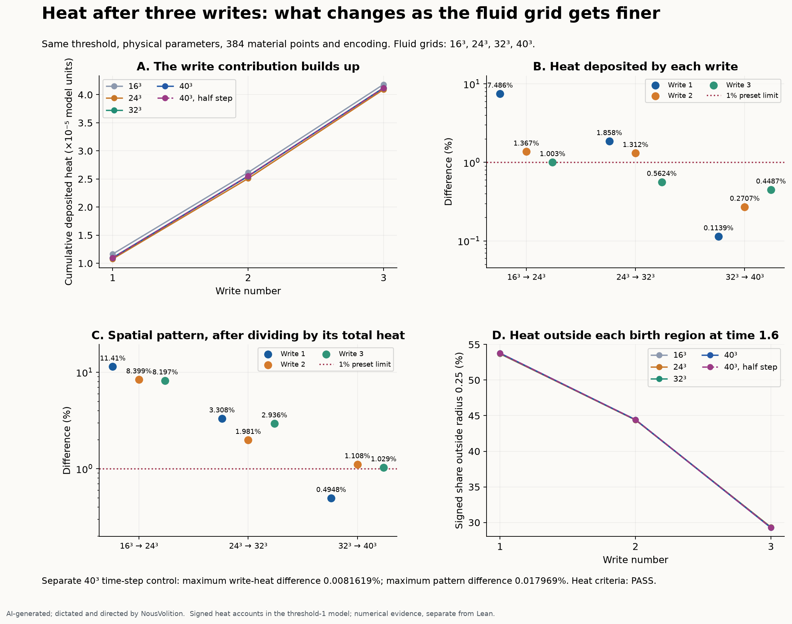
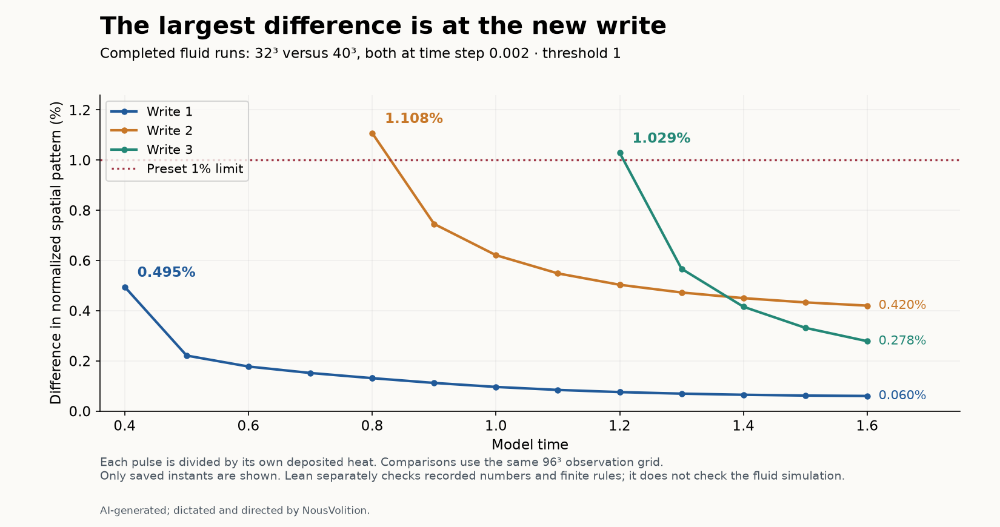
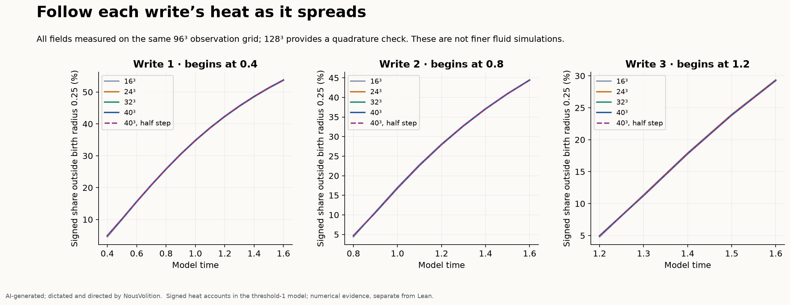
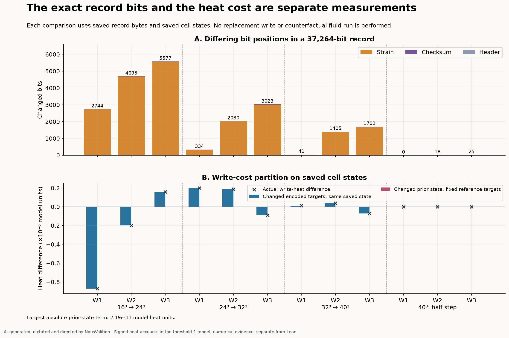

# Threshold-1 heat: finer fluid grids

The reported heat observables have not met the declared finite-grid settling test.

The finest-grid time-step comparison passes the heat criteria. The exact record bits are assessed separately. This numerical follow-up extends the earlier published 16³ heat study. The original local receipts remain unchanged; fresh GitHub proof verification has its own receipt.

AI-generated; dictated and directed by NousVolition.

Four fluid grids (16³, 24³, 32³ and 40³) use time step 0.002. A separate 40³ run uses 0.001. All five continue through model time 1.6, with writes at 0.4, 0.8 and 1.2. Threshold 1, breathing peak 0.5 and period 0.6, the periodic box, 384 material quadrature points, physical parameters and record encoding stay fixed. This is fluid-grid refinement; material quadrature has not been refined.

## Does the heat settle?

Limits were declared before the runs: 1% for deposited heat, cumulative write heat, normalized whole-field L1 difference, concentration volume and peak; 0.5 percentage point for the share outside radius 0.25. The table shows the worst of the three writes and all saved instants, except cumulative heat, which is compared after each write. All relative differences use the coarser/reference run as denominator.

| Comparison | Write heat | Cumulative heat | Normalized spatial pattern | Outside share | Concentration volume | Peak | All heat limits |
|---|---:|---:|---:|---:|---:|---:|---|
| 16³ → 24³ | 7.4859% | 7.4859% | 11.409% | 0.30593 pp | 1.3315% | 8.0613% | FAIL |
| 24³ → 32³ | 1.8578% | 1.8578% | 3.3082% | 0.067468 pp | 0.65895% | 1.7879% | FAIL |
| 32³ → 40³ | 0.44868% | 0.20317% | 1.1077% | 0.048433 pp | 0.39197% | 0.71993% | FAIL |
| 40³: half step | 0.0081619% | 0.0031188% | 0.017969% | 0.0025185 pp | 0.002038% | 0.023144% | PASS |

The declared settling test requires both 24³→32³ and 32³→40³ to pass, no increase in each write’s successive discrepancy, and a passing 40³ time-step control. A failure remains a failure even when the finer comparison improves. The complete per-write and per-instant results are in [analysis.json](analysis.json).

For the finest spatial comparison (32³→40³), the heat differences for writes 1, 2 and 3 are 0.1139%, 0.2707%, 0.4487%. The largest normalized pattern differences are 0.4948%, 1.1077%, 1.0291%; at the final saved instant they are 0.0602%, 0.4202%, 0.2784%. This separates disagreement around a new write from the smaller disagreement later in its spread.

The per-write refinement discrepancies are not uniformly decreasing: write 3 peak: 0.22348 to 0.71993%. This also prevents the declared settling test from passing. Lean checks these recorded trend inequalities alongside the comparisons with the preset limits.

## Spread and buildup

Each write has its own signed source account, carried through the actual coupled run. Its spatial integral remains in that account, while its spatial pattern spreads. The three positive write amounts accumulate. This bookkeeping does not identify positive physical heat particles or prove that material retains everything it carried.

| Fluid grid / step | Heat after all three writes | First-write final outside share | Second-write final outside share | Third-write final outside share | Write share of thermal increase |
|---|---:|---:|---:|---:|---:|
| 16³ | 4.18336211464e-05 | 53.6709% | 44.4518% | 29.3246% | 20.7000% |
| 24³ | 4.09209214055e-05 | 53.7074% | 44.3895% | 29.3484% | 19.8483% |
| 32³ | 4.12198130608e-05 | 53.7604% | 44.4187% | 29.2992% | 19.7777% |
| 40³ | 4.12009431804e-05 | 53.7783% | 44.4331% | 29.2578% | 19.6852% |
| 40³, half step | 4.11996582243e-05 | 53.7781% | 44.4322% | 29.2604% | 19.6862% |

The outside-share measurement uses a fixed radius 0.25 around each pulse’s own birth centroid, with periodic distances. Whole-field L1 uses the same physical coordinates for both runs and divides each pulse by its own deposited total. Concentration volume is mean(field)² / mean(field²); it is a concentration measure, not a literal occupied volume. Peak comparisons use the unnormalized pulse. Signed negative spectral ripples are retained.

All comparison criteria use the predeclared common 96³ observation grid. Evaluating the same retained Fourier modes on 128³ checks observation quadrature; it adds no physical fluid modes. The allowed 96³/128³ changes are 0.05 percentage point for outside share and 0.001 absolute for normalized L1. All four comparison quadrature controls pass.

**A measurement issue found in the review:** on the unchanged 16³ second-pulse field at time 1.6, native-grid counting gives 46.2536%, while the same field evaluated on 128³ gives 44.4634%. This is the effect of sampling the spherical observation region, not fluid-grid refinement. Both readouts are preserved.

## Exact record bits and write cost

Each record has 4,658 bytes: a 46-byte header, 2,304 signed 16-bit strain words, and a four-byte CRC. The comparison recounts the actual bytes and all bit positions, verifies each CRC in Python, and separates header, strain and checksum changes. Different checksums are not a measurement of heat error.

For a saved state b and target T, each cell’s write cost is weight × 0.05 × (T − b)² / 0.02. The recorded heat difference is partitioned as:

`C(right target, right state) − C(left target, left state)`

`= [C(right target, right state) − C(left target, right state)]`

`  + [C(left target, right state) − C(left target, left state)]`

The first part changes encoded targets at one fixed saved state. The second changes the prior cell state with the reference targets fixed. The algebraic identity is exact; the partition of recorded floating-point costs is checked within 10⁻¹⁸ model heat units. Recomputed actual cell costs match the saved arrays exactly. This separates the immediate write cost; it does not evolve a counterfactual flow, remove encoding effects from the fluid trajectory, or identify an independent field-equation cause. The diagnostic uses the left target as reference and is not a unique symmetric causal attribution.

| Comparison / write | Changed strain words | Changed bits | Checksum equal? | Heat difference | Encoded-target part | Prior-state part |
|---|---:|---:|---|---:|---:|---:|
| 16³ → 24³, write 1 | 808 / 2304 | 2744 | no | -8.7147104e-07 | -8.7147105e-07 | 7.5049005e-15 |
| 16³ → 24³, write 2 | 1662 / 2304 | 4695 | no | -1.9845241e-07 | -1.9845144e-07 | -9.6941796e-13 |
| 16³ → 24³, write 3 | 1921 / 2304 | 5577 | no | 1.5722371e-07 | 1.5724558e-07 | -2.1867546e-11 |
| 24³ → 32³, write 1 | 130 / 2304 | 334 | no | 2.0008737e-07 | 2.0008738e-07 | -1.9568654e-15 |
| 24³ → 32³, write 2 | 952 / 2304 | 2030 | no | 1.87846e-07 | 1.8784641e-07 | -4.0603408e-13 |
| 24³ → 32³, write 3 | 1380 / 2304 | 3023 | no | -8.9041718e-08 | -8.9034717e-08 | -7.0007491e-12 |
| 32³ → 40³, write 1 | 18 / 2304 | 41 | no | 1.2492581e-08 | 1.249258e-08 | 1.1264178e-15 |
| 32³ → 40³, write 2 | 639 / 2304 | 1405 | no | 3.927036e-08 | 3.9270486e-08 | -1.2647793e-13 |
| 32³ → 40³, write 3 | 802 / 2304 | 1702 | no | -7.0632821e-08 | -7.0629675e-08 | -3.145919e-12 |
| 40³: half step, write 1 | 0 / 2304 | 0 | yes | 1.3431486e-15 | 0 | 1.3431501e-15 |
| 40³: half step, write 2 | 2 / 2304 | 18 | no | -5.8472804e-12 | -5.8546628e-12 | 7.3823576e-15 |
| 40³: half step, write 3 | 1 / 2304 | 25 | no | -1.2791102e-09 | -1.2791259e-09 | 1.5692094e-14 |

Raw strain differences, decoded strain differences, regional bit counts and cost partitions against the 16³ reference are retained in analysis.json. Changes in the material encoding and changes in the fluid grid are not interchangeable measurements.

## What Lean checks

**PASS: 414 targets** (5 finite accounting rules and 409 recorded claims), using pinned Lean 4.34.0-rc2 and the recorded mathlib revision. The full target list, dependency audit and source fingerprint are in [the Lean receipt](../heat-grid-lean/receipt.json).

Lean checks finite accounting identities; the exact saved decimals for 4,820 global-account rows; coverage of every accepted step and both sides of writes; the recorded comparisons with the declared limits; and complete saved word comparisons and bit counts. Numerical limits that fail are represented as proved exceedances, not turned into successful convergence results. The exact-decimal transcription is independently regenerated in Python.

Lean does not run the fluid solver, derive the grid-array metrics, verify the Python-to-Lean transcription, establish a continuum limit, or prove a physical heat/material inventory. CRC validity is checked in Python; Lean compares the saved CRC integers. No extra axioms, sorry, or native_decide are used. The five general rules use standard mathlib axioms. Of the recorded claims, 346 use no axioms and 63 word-comparison claims use standard propext; the full target-by-target list is retained.

## Verification and remaining scope

The 16³ repeat agrees with all 13 preserved historical checkpoints to 7.22e-16. Every saved field and record is bound to a run receipt. Independent recounts check field reconstruction, source totals, global heat budget, decoded targets and write costs. Per-grid tagged/native pilots preserve all 17 native arrays in their tested steps. Native solver files stay unchanged.

The passive Fourier sampler rounds nearly-integer frequency indices instead of truncating them. This avoids an index error on 24³. Passive observers do not feed back into the native fluid or heat fields; the pilot checks that those arrays remain unchanged. This observer readout correction is recorded separately from the grid change.

Spatial shape comparisons cover the 20 saved field instants per run; global accounts cover every accepted step. Unsaved instants, finer-than-40³ fluid grids, refined material quadrature, longer times and other thresholds remain untested. The periodic computational box is not evidence that a followed material path closes into a loop.

This follow-up is published with its original local evidence and a separate [GitHub Lean receipt](../heat-grid-lean/github-lean-receipt.json). The earlier published [heat study and 56 Lean targets](https://github.com/NousVolition/hug-sims-lean-proofs/pull/34) remain historical evidence; this report adds finer-grid findings without overwriting them.

## Reproducing this record

The five run directories retain complete saved fields, final native states, dense accounts, exact record bytes and original run receipts. The [reproduction sources](reproduction/work/heat-grid/) include the unchanged runner, analyzer and 100 frozen inputs. [Publication provenance](provenance.json) distinguishes historical bytes from a new execution.

With Python 3.11+, NumPy 2.3.5 and SciPy 1.16.3, run **python reproduce.py recount** to recompute the saved-array measurements and compare them with the published analysis. Add **--run n16_dt0p002** to check only that run. Recounting is not a new integration. **python reproduce.py plot** needs Matplotlib 3.11.2. These commands write to a new scratch directory and refuse to overwrite it; use **--scratch PATH** for another location.

**python reproduce.py simulate** performs all pilots and five new integrations in a clean scratch directory. It can take hours. The copied input manifest uses portable path separators; each new run creates a new receipt. The GitHub Lean workflow checks byte binding, exact recorded-number regeneration, a full Lake build and every target's axioms. It does not run the fluid simulations or derive array measurements.

The prescribed breathing intervention belongs to this historical numerical branch. It does not redefine the user's intended unforced underlying formulation. Material quadrature remains fixed at 384 points.
