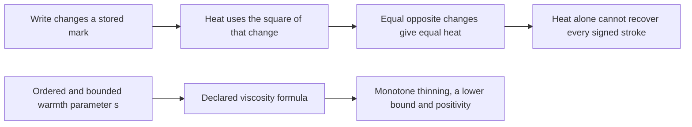

# Heat from writing: 12 finite Lean checks

The supplied [heat draft](HeatFromHolding.lean) compiles unchanged. Its **12 stated theorems pass** with Lean 4.34.0-rc2 and Mathlib `85e3a25e006c35636f0e53b0e9296caca2685bc0`. The [original local evidence](local-evidence/receipt.json) and [GitHub receipt](github-lean-receipt.json) keep their own compiler, revision and run information. The draft's “not compiled when written” note describes its original state, before these checks.

## Read the two parts separately



The source solver connects a write's heat to its temperature field and uses `s = tanh(theta/0.03)` in viscosity. Those source links are inspected separately; the diagram does not claim that Lean proves the resulting fluid evolution.

| Checked statements | What the result means |
|---|---|
| 1–3: stroke heat | For nonnegative drag and positive duration, the declared heat is nonnegative; for positive drag and a nonzero change, it is positive. Equal opposite changes give equal heat. |
| 4–5: ambiguous observation | A reading that is identical for different properties cannot recover every property value. Heat alone cannot recover every signed stroke in this model. |
| 6–7: work account | With work defined as stored-energy change plus heat, heat equals work minus that change. If stored energy does not increase, heat is at least the supplied work. |
| 8–9: recorded third write | The exact supplied integers have negative stored-energy change, heat above work, and balance residual below the stated tolerance. |
| 10–12: viscosity | For the declared exponential formula and hypotheses, increasing `s` does not increase viscosity; `s ≤ 1` gives a floor; positive base viscosity remains positive. |

The formula charges heat when a write **moves a stored mark**. It does not establish ongoing heat production from an unchanged hold; that write term is zero when the mark does not change. The theorem named `third_write_was_all_heat` precisely states that the recorded stored-energy change is negative and the heat exceeds the supplied work. Released stored energy accounts for that excess.

## Threshold 1: the exact recorded numbers

These numbers belong to the **threshold-1, breathing-on replay**, native step **0.002**, at tick **41**, model time **1.2**. They are separate from the threshold-0.015 [540/872 follow-up](../observer-follow-study/README.md) and its 134 checks. Counts across packages must not be added as independent results.

| Quantity | Exact recorded decimal |
|---|---:|
| Supplied work | 1.5672159979486206e−5 |
| Stored-energy change | −1.9218245776950046e−9 |
| Heat | 1.5674081804063902e−5 |

The draft encodes these values as integers in units of 10⁻²⁷. Their exact decimal residual, work − stored − heat, is **−9.954e−22**, whose magnitude is below **1e−21**. This is a bounded residual, not exact equality.

The literals match [the replay record](source-data/tick41-replay-results.json) exactly. The earlier parent run's stored-energy value is −1.921824577694634e−9, differing by −3.706e−22 from the replay; both records are retained and are not silently substituted for one another. The parent JSON is stored as [gzip](source-data/threshold-one-parent-results.json.gz), with only eight local source-path labels shortened for publication. All numerical data and source hashes are unchanged; [provenance](provenance.json) records both the original and published hashes. Other diagnostics in these source records are not additional claims checked by this heat package.

## What Lean has not checked

Lean checks the declared scalar formulas, hypotheses and exact recorded numbers. The external source checker matches their Python/JSON transcription and the local evidence. Lean does not certify that transcription or the simulation that produced those numbers.

The interpretation `s = tanh(theta/0.03)` and its bound/ordering are not proved here. Nor are heat spreading, accumulation across writes, filtered heat being nonnegative at every grid point, fluid trajectories, physical contents or complete retention. No new fluid run was performed for this publication. The historical breathing-on experiment remains distinct from the intended unforced system.

All 12 axiom lists were audited. Eleven use only the standard `propext`, `Classical.choice` and `Quot.sound`; the general ambiguous-reading lemma uses none. There are no added axioms, `sorry` or `native_decide`. Comparator and nanoda were not run.

## Reproduce the checks

With Python 3.11+, the pinned Lean toolchain and its Lake command:

```text
python verify_publication.py --check-only --self-test
lake update
lake exe cache get
python verify_publication.py
```

The dedicated GitHub workflow checks all published inputs, source transcription and historical logs, resolves the pinned Mathlib revision, builds both modules, checks all 12 actual axiom reports, and attaches a receipt for the exact fingerprint, target list and run. See [publication scope and provenance](provenance.json), [the source checker](verify_publication.py), and [the full historical dependency log](local-evidence/all-dependencies.log). The earlier Python subprocess timeout remains recorded beside the successful direct-compiler check.

The supplied Lean draft is retained verbatim. Publication tooling and this explanation are AI-generated; dictated and directed by NousVolition. No additional model authorship is inferred for the supplied draft.
