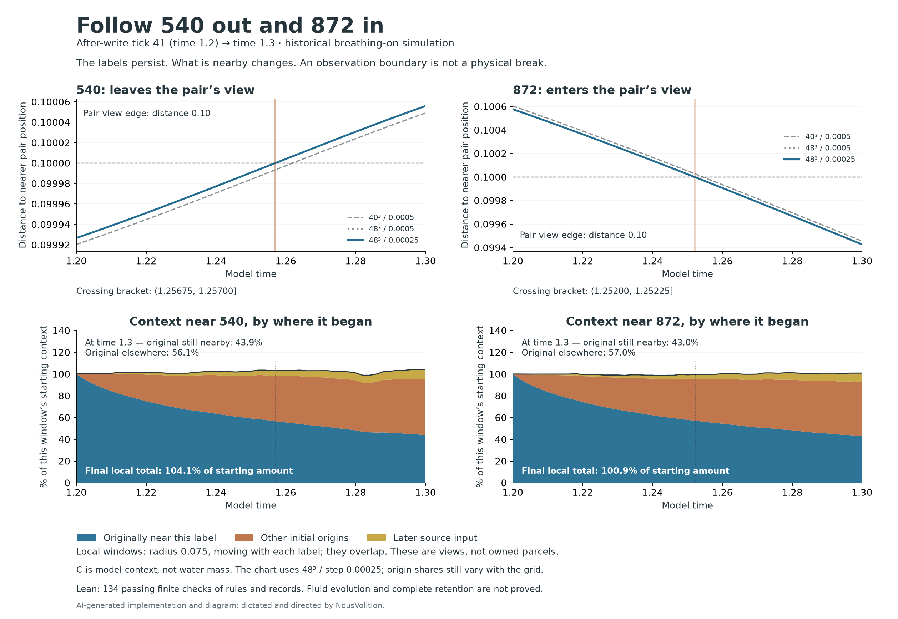

# Following 540 out and 872 in

Both labels keep their identities as they cross the original pair’s viewing boundary. Their local neighborhoods and context change along the way; this does not establish that either one carries a complete, private parcel or hands it to the other.

## What was followed

The same after-write tick-41 state at model time 1.2 was followed to 1.3, using 40³ / step 0.0005, 48³ / step 0.0005 and 48³ / step 0.00025. These are the existing threshold-0.015, breathing-on historical simulations, kept separate from the intended unforced Hug system. No new write or physical force was added.

540 and 872 each have a moving position in the source model. They do not have a separately assigned memory store or complete cargo list. We therefore followed their positions, nearby material and observer labels, point samples of velocity/context/temperature, and the origins of model context in a moving radius-0.075 window around each. Radius 0.05 and 0.10 are neighbor-sensitivity views. The original pair (825/850) uses a separate radius-0.10 union to define these crossings.

The local windows overlap. Initial context was partitioned into four disjoint grid regions: near 540 only, near 872 only, near both, and near neither. A fifth passive component records later source input. “Originally near 540” includes the shared region; so does “originally near 872.” Their two accounts must not be added as disjoint holdings. C is model context, not water mass.

## Crossings and nearby context

| Run | 540 leaves, bracket | 872 arrives, bracket | Original near 540 still nearby at 1.3 | Original near 872 still nearby at 1.3 |
|---|---|---|---:|---:|
| 40³ / 0.0005 | (1.26150, 1.26200] | (1.25400, 1.25450] | 43.611103% | 43.273967% |
| 48³ / 0.0005 | (1.25650, 1.25700] | (1.25200, 1.25250] | 43.938741% | 42.954113% |
| 48³ / 0.00025 | (1.25675, 1.25700] | (1.25200, 1.25225] | 43.938657% | 42.954030% |

The bracket bounds are consecutive recorded steps, not exact continuous crossing times. Both crossings retain the same identities on all three runs, but their timings still differ between grids. Crossing a viewing boundary does not itself cause a change or destroy a label.

| Finest run at time 1.3 | 540 window | 872 window |
|---|---:|---:|
| Original context still nearby | 43.938657% | 42.954030% |
| Original context elsewhere | 56.061343% | 57.045970% |
| Other initial origins now nearby | 51.404040% | 49.932755% |
| Later source now nearby | 8.769942% | 7.985722% |
| Current local total | 104.112639% | 100.872507% |

Every percentage in this table uses that window’s starting amount as its denominator. “Elsewhere” is still in the modeled basin, outside the current local view. It is not destruction or escape from the basin. The incoming amount is a contribution from other initial regions, not proof of transfer from one observer to the other.

At each crossing, the finest run gives the following immediate-after observations. These use the first recorded step on the new side of the original pair’s boundary; the local observation radius remains 0.075.

| Label and crossing | First step after | Original context still locally nearby (% of entry) | Point C before → after | Point temperature before → after |
|---|---:|---:|---:|---:|
| 540 leaves | 1.25700 | 56.576089% | 0.186442722 → 0.186449162 | 0.011285050 → 0.011284070 |
| 872 arrives | 1.25225 | 57.039359% | 0.176128225 → 0.176132426 | 0.011228520 → 0.011227550 |

The point samples are field readings at each moving position, not inventories carried by the label. Both C and temperature change across each recorded bracket; the observation boundary does not establish the cause. The full five-origin readings before and after are retained in [crossing-readouts.csv](crossing-readouts.csv).

## Neighbors and shared records

| Finest run, radius 0.075 | Entry | Exit | Stayed | Left | Returned | Arrived | Visited |
|---|---:|---:|---:|---:|---:|---:|---:|
| Near 540: material labels | 8 | 8 | 8 | 0 | 0 | 0 | 0 |
| Near 540: observer labels | 312 | 314 | 312 | 0 | 0 | 2 | 0 |
| Near 872: material labels | 8 | 8 | 8 | 0 | 0 | 0 | 0 |
| Near 872: observer labels | 270 | 271 | 270 | 0 | 0 | 1 | 0 |

The two initial material neighborhoods share IDs 237, 248, 249, 333, 344, 345. Counts are unweighted labels, not mass. A label can remain nearby while its deformation and directional-memory fields change. Those material-field changes were read from the preserved, hash-checked material trajectory; this new run did not assign those fields to 540 or 872.

The three shared decoded event records remained byte-for-byte unchanged in 2,409 record comparisons across all recorded steps and runs. This is a shared record check, not evidence of private memories carried by either observer.

The full neighbor counts at radii 0.05, 0.075 and 0.10 are in [neighbor-summary.csv](neighbor-summary.csv). Primary histories are retained in the Lean source data. Sparse or empty windows remain visible rather than being treated as a complete material inventory.

## Grid and time-step differences

| Comparison | Label | Endpoint change in retained original (percentage points) | Largest difference at 51 common times |
|---|---:|---:|---:|
| grid40_48 | 540 | +0.32763795 | 1.26393909 |
| grid40_48 | 872 | -0.31985377 | 1.73129696 |
| half_time48 | 540 | -0.00008349 | 0.00183106 |
| half_time48 | 872 | -0.00008325 | 0.00178491 |

These measured differences are sensitivity evidence. No continuum-convergence tolerance was declared or established for the new origin shares. The sharp initial region masks and moving grid-cell windows can also affect those shares. Neighbor differences at common times are recorded separately in [analysis.json](analysis.json).

## What passed, and what Lean checked

The passive-origin runs reproduced all 17 native exit arrays exactly, and all 926 observer positions at every recorded step matched the preceding native trajectories. The new components did not feed back into native dynamics. Each run passed the declared context reconstruction (≤1e−12), original-component global drift (≤1e−12), later-source account (≤1e−10), nonnegativity within 1e−12, and shared-record checks.

A separate numerical recount checked initial-region masks, saved grid sums, periodic memberships, crossings, raw trilinear corners and weights, independently sampled fields, input hashes, and complete shared-record bytes. These are numerical/source checks, separate from Lean.

Lean (version 4.34.0-rc2, x86_64-w64-windows-gnu, commit 6a10ac8c22beadecabdbb0919c2b50214762f91d, Release) passed **134 theorem targets**. It checked general finite rules for identity, overlapping views and origin accounts; the recorded neighbor histories and crossing brackets; exact-decimal point/window balances and endpoint rounding; selected material-field numbers; and every saved shared-record byte. The source checker matched the actual Lean literals to the recorded arrays and tables and rejected eight deliberately altered copies.

Proof-input fingerprint: `cee9a87a7e0044c0b86a69dfa2e24ef27aa80c9056d41954f694eaefe0f45934`. Standard axiom dependencies: Quot.sound, propext. No added axioms, `sorry`, or `native_decide`. [Full Lean receipt](../observer-follow-lean/receipt.json).

**Still unknown:** whether everything stays with either label; all physical or microscopic contents; causal transfer from 540 to 872; origin histories for every changing field; behavior between sampled steps; and continuum fluid convergence. Lean has not proved the fluid evolution, interpolation, geometric membership calculation or complete retention.

## Reproducibility and preservation

The frozen runner, independent analyzer, exact source hashes, raw grids/stencils, tables and proof package are retained locally. Earlier pair-origin and retention studies, their failures and receipts, and the published PR26 evidence remain unchanged. This publication preserves that local audit and adds a dedicated GitHub recheck of the published records and Lean package. Full diagnostic grids and all-observer/material trajectories remain local; GitHub does not rerun the fluid solver. The earlier local-only wording in archived receipts records that earlier stage.

AI-generated implementation, report and diagram; dictated and directed by NousVolition. Numerical observations come from the saved runs, not image generation.

[Publication scope and reproduction](METHODS.md) · [GitHub proof receipt](github-lean-receipt.json) · [Published-record checker](verify_publication.py)
