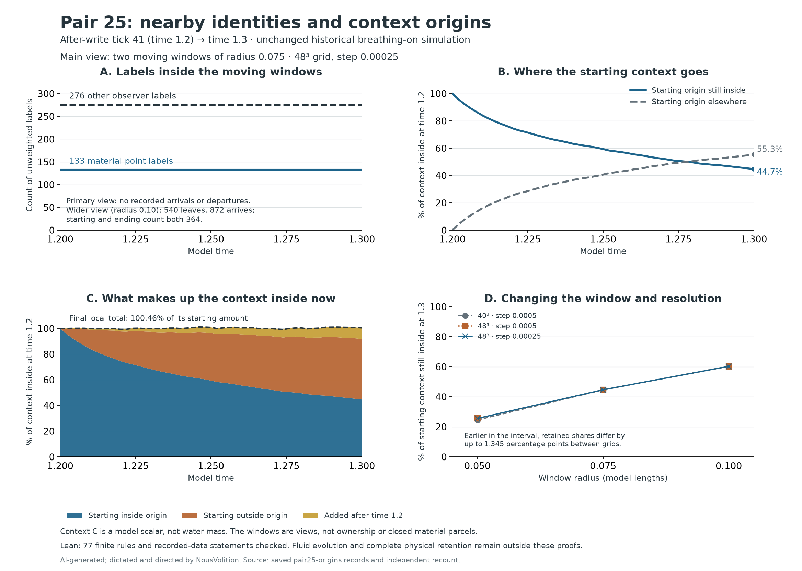

# Pair 25: what stays nearby, and what changes origin

The same **133 material point labels and 276 other observer labels** stay inside the chosen moving windows at every recorded step in all three runs. The context inside those windows changes origin: in the finest time-step run, **44.65% of the starting inside contribution is still inside**, while **55.35% is elsewhere** in the domain. Outside-origin and later-source contributions enter the local account, leaving the total at **100.46%** of its starting amount.

## What “came in with” means here

This follows the saved **after-write tick-41 state, time 1.2, through time 1.3**. Pair 25 is stored ID24, observer slots 825/850. It does not reconstruct the earlier encounter's missing starting inventory at time 1.1. The observation window is the union of two periodic spheres of radius **0.075** centered on the existing A/B trajectories. Radius 0.05, radius 0.10, and each separate sphere are sensitivity views. These are observation boundaries, not physical walls, ownership, or material parcels. Nothing is forced to close into a loop.

The historical threshold-0.015, breathing-on, 384-material-point setup is preserved. This added-drive experiment does not redefine the intended unforced system. Passive diagnostic labels do not feed the fluid, the material, or the shared memory. All 17 native exit arrays and all 51 common pair positions exactly match the earlier unlabelled continuations.

## The labels stay; their fields change

All 384 material IDs and all 924 other observer IDs were followed at each completed native step. A/B are excluded from neighbor counts. These are unweighted labels, not mass. The primary entry windows contain 132 material points near A and only **one** near B; this uneven coverage is not a representative inventory of all fluid.

| Run | Population | At start | Stayed at every sample | Left at exit | Left and returned | New at exit | Visited then left |
| --- | --- | ---: | ---: | ---: | ---: | ---: | ---: |
| n40_dt0p0005 | material | 133 | 133 | 0 | 0 | 0 | 0 |
| n40_dt0p0005 | observer | 276 | 276 | 0 | 0 | 0 | 0 |
| n48_dt0p0005 | material | 133 | 133 | 0 | 0 | 0 | 0 |
| n48_dt0p0005 | observer | 276 | 276 | 0 | 0 | 0 | 0 |
| n48_dt0p00025 | material | 133 | 133 | 0 | 0 | 0 | 0 |
| n48_dt0p00025 | observer | 276 | 276 | 0 | 0 | 0 | 0 |

**A wider view catches a membership change that the total hides.** At radius 0.10, observer **540 leaves** and **872 arrives** in every run. Of the 364 labels present at the start, 363 stay and one leaves; the new arrival restores the ending count to 364. Arrival occurs before departure, so the count briefly reaches 365. This records changing membership, not a tested transfer from one label to the other.

| Run | Observer | Event in the wider union | Recorded crossing bracket (model time) |
| --- | ---: | --- | --- |
| n40_dt0p0005 | 540 | leave | (1.2615, 1.262] |
| n40_dt0p0005 | 872 | arrive | (1.254, 1.2545] |
| n48_dt0p0005 | 540 | leave | (1.2565, 1.257] |
| n48_dt0p0005 | 872 | arrive | (1.252, 1.2525] |
| n48_dt0p00025 | 540 | leave | (1.25675, 1.257] |
| n48_dt0p00025 | 872 | arrive | (1.252, 1.25225] |

The crossing identities agree across runs. The 40³ and 48³ crossing brackets differ, so the crossing times are not established as grid-converged. These brackets locate changes between adjacent saved steps; they are not exact continuous crossing times.

All 384 material points change both their deformation field F and directional-memory field m during the interval; the identity stays while its state changes. On the finest run, the per-point maximum F change ranges from 0.00493143532 to 0.0337066767; the corresponding m change ranges from 0.0020776937 to 0.0710913202. No m component decreases at the recorded steps. This is a finite numerical observation, not a statement that those fields are complete contents.

The original three shared event records remain byte-for-byte unchanged in **2409** comparisons. They are shared system records, not a private inventory belonging to A/B. 9 sensitivity views contain departures, returns, arrivals or visits; see the full [identity summary](identity-summary.csv). The closest recorded label was 2.35996071e-08 model lengths from any tested boundary, outside the declared 1e-8 ambiguity band. Crossings between sampled steps remain untested.

## The context total hides changing origins

At time 1.2, the native context field C is split by its location: initially inside or outside the chosen union. A third component records context added afterward. These passive fields use the native transport/diffusion operator and Heun stages. They reconstruct C within the declared tolerance. **C is the model's signed context scalar, not water mass or a molecular inventory.** Components in these runs remain nonnegative within the declared roundoff allowance.

Every percentage below uses that run's context inside at time 1.2 as denominator. “Starting origin elsewhere” is outside the current window but still in the domain; it is not destroyed. The three current-inside contributions sum to the current local total. This is numerical origin accounting, not identification of which water molecules replace which others.

| Run | Starting origin still inside (%) | Starting origin elsewhere (%) | Outside origin now inside (%) | Added later, now inside (%) | Current local total (%) |
| --- | ---: | ---: | ---: | ---: | ---: |
| n40_dt0p0005 | 44.605205 | 55.394795 | 46.830321 | 8.567509 | 100.003034 |
| n48_dt0p0005 | 44.654017 | 55.345983 | 47.155406 | 8.649760 | 100.459182 |
| n48_dt0p00025 | 44.653936 | 55.346064 | 47.155486 | 8.649760 | 100.459181 |

Changing 40³ to 48³ shifts the endpoint retained-origin fraction by **+0.048812 percentage points**, but its difference reaches **1.344660 percentage points earlier in the interval**. Halving the 48³ time step shifts the endpoint by **-0.000081 percentage points**, with a maximum common-time difference of **0.001978 percentage points**. Primary-window identity memberships agree at all common times. The other context-account differences over all 51 common times are in [origin-comparisons.json](origin-comparisons.json). No convergence tolerance was declared for these new origin fractions, so these comparisons do not establish continuum convergence. Each grid represents the initial spherical boundary with its own cells.

The window choice itself matters:

| Run | Radius | Starting context still inside at time 1.3 |
| --- | ---: | ---: |
| n40_dt0p0005 | 0.05 | 24.544214% |
| n40_dt0p0005 | 0.075 | 44.605205% |
| n40_dt0p0005 | 0.1 | 60.308239% |
| n48_dt0p0005 | 0.05 | 25.538512% |
| n48_dt0p0005 | 0.075 | 44.654017% |
| n48_dt0p0005 | 0.1 | 60.232799% |
| n48_dt0p00025 | 0.05 | 25.538345% |
| n48_dt0p00025 | 0.075 | 44.653936% |
| n48_dt0p00025 | 0.1 | 60.232751% |

## What Lean checked

**77 statements passed locally and are rechecked by the dedicated GitHub workflow.** [The separate Lean package](../pair-origin-lean/README.md) checks finite classification rules, recorded primary and wider-union identity histories (including 540 leaving and 872 arriving), per-material field-change numbers, complete shared-record bytes, and exact decimal context-origin accounts and numerical bounds. It also checks the recorded positive original-origin departure and incoming/later-source contributions in each run. Its [receipt](../pair-origin-lean/receipt.json) records the exact inputs, target list and standard axiom dependencies.

An independent saved-data recount computed membership from positions, compared native endpoints, recomputed origin sums from saved fields, and interpolated A/B components by a separate routine. The data certificate matches Lean's constants to these saved records; it does not prove that the simulator or the recount code is correct. Runtime stage extrema are recorded checks, not an independent replay of every stage. Lean does not prove the fluid equations, numerical trajectory, geometric interpolation, crossings between samples, thermal origins, or complete physical retention. **We still do not know whether everything stays with the pair.**

## Checks and preserved evidence

The largest reconstruction defect is 4.99600361e-16 (limit 1e-12); original-component global drift is 6.74807432e-16 (limit 1e-12); later-source account defect is 7.02563008e-17 (limit 1e-10). The instrumented pilot matched all 17 native one-step arrays; batched transport matched the native scalar operator. The new labels change none of the original fluid state. Six refusal tests reject changed primary or wider membership bits, identities, origin decimals, memory bytes, or material-field numbers.

[Declared plan](local-evidence/PLAN.md) · [Independent recount](analysis.json) · [Complete finite classifications](identity-classification.csv.gz) · [Lean receipt](../pair-origin-lean/receipt.json) · [SVG figure](pair25-origins.svg)

Full trajectories and origin fields remain local. This publication supplies the recorded membership histories, complete shared-record bytes, decimal accounts, crossing table, classifications and original source scripts. GitHub rechecks the published records and Lean statements; it does not rerun the fluid simulation or independently recount geometry from the omitted trajectories. Earlier publications and receipts remain intact.

[GitHub proof receipt](github-lean-receipt.json) · [Publication and reproduction scope](METHODS.md) · [Saved-record checker](verify_publication.py)

**AI-generated; dictated and directed by NousVolition.**
