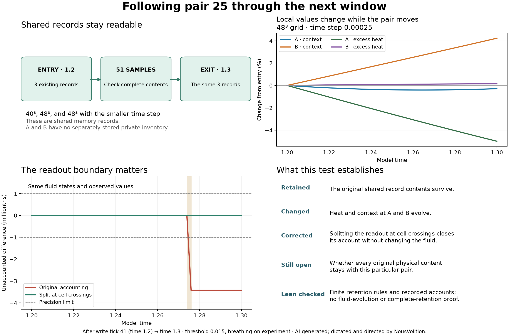

# What leaves with the pair?

The original shared memory records survive this next window. The pair's local fluid values change. This establishes neither that every original physical content stays with the pair nor that a changed value means something was lost.

## The test that ran

“Pair 25” means the 25th A/B pair, stored as ID 24. All three continuations start from their exact saved **after-write state at tick 41, model time 1.2**, and end at **1.3**. The original prime schedule stops at 41, so 1.3 is labelled by model time. This new interval does not reconstruct the missing entry inventory at 1.1 or imply that the pair physically leaves the domain.

The runs use 40³/dt0.0005, 48³/dt0.0005 and 48³/dt0.00025, with 51 common observation times. The historical threshold-0.015, breathing-on, 801-native-observer, 384-material-point settings and solver equations are preserved. This added-drive experiment does not redefine the author's intended unforced system. There is no new write, imposed path closure or reversal.

## What stayed and what changed

All three original event records remain readable at every saved sample in every run: **459 complete payload comparisons** passed, using the full bytes and identities, not just matching names or checksums. Their stored material evolves, but the decoded contents remain the same. No stored directional-memory value decreases beyond the declared roundoff allowance. These records belong to the shared system; they are not a private inventory assigned to A or B.

The finest-time-step run records these point values:

| Point | Readout | At 1.2 | At 1.3 | Change |
| --- | --- | ---: | ---: | ---: |
| A | Context C | 0.294121243 | 0.293276465 | -0.000844777537 |
| A | Excess heat theta | 0.01298942 | 0.0123418024 | -0.000647617568 |
| B | Context C | 0.077699319 | 0.0809793464 | +0.00328002743 |
| B | Excess heat theta | 0.00933468827 | 0.00934883292 | +1.41446522e-05 |

These are concentrations/readouts at moving points, not masses inside a tracked parcel. The [audit record](analysis.json) lists the five local fluid values at entry and exit and checks the inventory of all 17 native state arrays. Full entry and exit snapshots are preserved locally; this publication includes their array and file fingerprints, not those large snapshots. A balanced incoming and outgoing exchange could keep a total unchanged while replacing its original contents. Origin tracking of every physical content is still missing.

## The apparent loss at a readout boundary

The original 40³ accounting failed its predeclared **0.000001** accuracy limit. Its largest jump occurred over model time 1.274–1.276, where A crossed an interpolation-cell boundary.

A controlled repeat split the accounting integral at those crossings. **Every entry and exit state array, all 51 pair positions and all sampled local values remained byte-identical or exactly identical as recorded.** Only the calculation of the accounting integral changed. Its maximum residual fell from **3.42793961e-06** to **2.4437917e-16**. This identifies the original 40³ failure as a numerical readout-integration artifact in this controlled comparison, not physical loss. The original failed receipt is preserved.

| Run | Largest local account residual | Original 1e-6 target | Entry records retained |
| --- | ---: | --- | --- |
| n40_dt0p0005 | 3.42793961e-06 | FAIL | 3 of 3 |
| n48_dt0p0005 | 3.57281655e-11 | PASS | 3 of 3 |
| n48_dt0p00025 | 8.89672396e-12 | PASS | 3 of 3 |
| 40³, cell-aware readout repeat | 2.4437917e-16 | PASS | 3 of 3 |

The whole-system context and energy ledgers pass their separate 1e-10 and 1e-6 bounds. Spatial and time-step differences of the new local readouts are recorded in [analysis.json](analysis.json); no new convergence threshold was declared for these quantities.

## What Lean checked

[Lean package](../pair-retention-lean/README.md): **40 statements checked**, with the exact proof inputs, target list and axiom dependencies in its [receipt](../pair-retention-lean/receipt.json).

The general statements concern complete finite record contents, missing or changed records, chained preservation, and accounting with changing or replaced contents. The data statements check full recorded payloads and exact decimal account numbers, including the original failed 40³ verdict and the corrected readout verdict. **Lean does not prove the numerical fluid trajectory, complete ownership of contents by this pair, continuum convergence or “everything came through.”**

The dedicated [GitHub proof receipt](github-lean-receipt.json) ties the passing run to the exact fingerprint and target list. The original local receipt remains separate.

## Evidence and reproduction

[Declared plan](PLAN.md) · [Controlled readout plan](CELL-READOUT-CHECK.md) · [Independent recount](analysis.json) · [Controlled comparison](cell-aware-check.json) · [SVG diagram](pair-retention.svg)

The instrumented one-step state matched the original solver exactly. An analytic and finite-difference check validated the local interpolation gradient. A synthetic crossing check validated the corrected accounting integral. Four refusal tests detect changed or missing records, duplicate observations and omitted exchange terms. The independent audit checks saved full payloads, entry checkpoint equality, source fingerprints, endpoint interpolation by a separate method, row coverage and the field inventory. Runtime stage extrema were inspected while the simulation ran; the independent audit does not replay every stage.

Full entry and exit arrays remain local. Historical simulations and receipts are preserved. GitHub rechecks the published observation tables and finite Lean statements; it does not rerun the fluid integration or independently replay the withheld full states.

[Publication and reproduction scope](METHODS.md) · [Saved-data and receipt checker](verify_publication.py)

**AI-generated; dictated and directed by NousVolition.**
