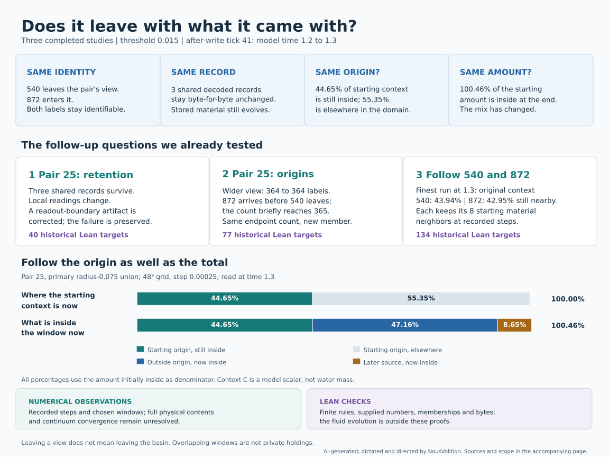

# Does it leave with what it came with?

**Three connected studies followed what stayed and what changed.** Shared event records remained intact, named observers stayed identifiable, and nearby context changed origin.

[Open the scalable diagram](retention-map.svg) · [Figure source](draw_retention_map.py)

## Four things that can stay the same

| What is compared? | What the completed tests found |
| --- | --- |
| **Identity** | 540 and 872 remain identifiable as they cross the original pair's viewing boundary. |
| **Decoded record** | The three original shared event records remain byte-for-byte unchanged at the recorded samples while the material storing them evolves. |
| **Origin** | In the finest run, 44.65% of pair 25's starting local context remains inside its moving observation window at time 1.3; 55.35% is elsewhere in the modeled domain. |
| **Amount** | That window's local context total reaches 100.46% of its starting amount. A nearly unchanged total can contain a changed mix. |

The three studies use **threshold 0.015**, from the saved **after-write tick-41 state at time 1.2 through time 1.3**. They compare 40³/step 0.0005, 48³/step 0.0005 and 48³/step 0.00025. This historical experimental branch adds breathing to the [intended unforced system](../../comparisons/hug-navier-single-system-scope-correction.md#meaning-to-preserve-across-implementations).

## The studies we already ran

| Study | Numerical finding | Separate historical Lean checks |
| --- | --- | --- |
| [Pair 25: retention](../pair-retention-study/README.md) | Three shared records survive in 459 complete payload comparisons while local readings change. Splitting a readout integral at cell crossings resolves the original accounting failure without changing the trajectory or sampled values; the failed receipt is preserved. | [40 targets](../pair-retention-lean/README.md): finite record rules, full recorded bytes and exact decimal accounts, including the original failure and corrected result. |
| [Pair 25: origins](../pair-origin-study/README.md) | The primary window keeps the same 133 material and 276 other observer labels at every recorded step, while context changes origin. In the wider view, 540 leaves and 872 arrives: 364 labels initially, briefly 365, then 364 with different membership. | [77 targets](../pair-origin-lean/README.md): finite classifications, recorded memberships, field-change numbers, shared bytes and context accounts. |
| [Following 540 and 872](../observer-follow-study/README.md) | At time 1.3, 43.94% of the context initially near 540 remains nearby; for 872, 42.95%. Each retains its eight starting nearby material labels at recorded steps; other observer labels arrive. | [134 targets](../observer-follow-lean/README.md): finite identity/overlap rules, recorded crossing brackets, neighbor histories, context accounts and shared bytes. |

The primary pair window is the union of two radius-0.075 spheres. The 364-to-364 example uses the wider radius-0.10 union. The follow-up uses a separate radius-0.075 window around each of 540 and 872. Those views overlap, so their accounts overlap too; they cannot be added as disjoint holdings.

## Follow the origin as well as the total

For pair 25's primary window in the 48³/step-0.00025 run at time 1.3:

| Contribution | Percentage of the amount initially inside at time 1.2 |
| --- | ---: |
| Starting origin still inside | 44.653936% |
| Starting origin elsewhere in the domain | 55.346064% |
| Outside origin now inside | 47.155486% |
| Later source now inside | 8.649760% |
| Current local total | 100.459181% |

The three **now-inside** contributions make up the current local total: 44.65% + 47.16% + 8.65%, subject to rounding. The 55.35% elsewhere completes the starting-origin account. [Source table and sensitivity comparisons](../pair-origin-study/README.md#the-context-total-hides-changing-origins).

These percentages measure the model's context scalar C. The retained fraction differs between 40³ and 48³ by **0.048812 percentage points at the endpoint**, and by up to **1.344660 points earlier**. Halving the 48³ time step changes it by at most **0.001978 points** at common observations.

## Leaving a view is not leaving the system

> “If we can’t see where it comes from or continues, we can mistake the edge of our view for an edge in the connection. The first visible space then gets treated as the important gap before we’ve followed the whole path.”
>
> — NousVolition, framing the observation-window question

The windows select what is observed. “Elsewhere” still means in the modeled domain, where a label or context contribution can continue to be followed. A path can remain open inside a confined space.

## What the evidence covers

**Simulation and numerical recounts** follow the saved trajectories, memberships, shared records and context-origin fields. **Lean** checks the finite rules and supplied recorded numbers, memberships and bytes listed above. The fluid solver, numerical interpolation and continuum convergence are outside those proofs; no continuum-convergence tolerance was set for these origin fractions.

The shared records belong to the system, and C is a context scalar rather than water mass. These accounts cover selected records, labels and fields from time 1.2 to 1.3. The complete incoming physical inventory at time 1.1 is still missing, and no direct transfer from 540 to 872 was established.

The [threshold-1 heat and record-bit studies](../heat-grid-study/README.md) have their own runs and checks.

## Follow the verification record

The documentation source review at [revision ed5858a2](https://github.com/NousVolition/hug-sims-lean-proofs/commit/ed5858a2ec131dde467e97c50559e3a14733a762) confirmed that all 86 listed proof-input files match the historical successful run revisions; fingerprints and target lists match the preserved local receipts. Compilation evidence belongs to the historical GitHub runs below.

| Package | Published receipt | Historical successful GitHub run |
| --- | --- | --- |
| Retention, 40 targets | [Receipt](../pair-retention-study/github-lean-receipt.json) | [43160534955](https://github.com/NousVolition/hug-sims-lean-proofs/actions/runs/43160534955) |
| Origins, 77 targets | [Receipt](../pair-origin-study/github-lean-receipt.json) | [43166728112](https://github.com/NousVolition/hug-sims-lean-proofs/actions/runs/43166728112) |
| Following 540/872, 134 targets | [Receipt](../observer-follow-study/github-lean-receipt.json) | [43173911878](https://github.com/NousVolition/hug-sims-lean-proofs/actions/runs/43173911878) |

**AI-generated; dictated and directed by NousVolition.** The diagram summarizes the recorded numerical results.
