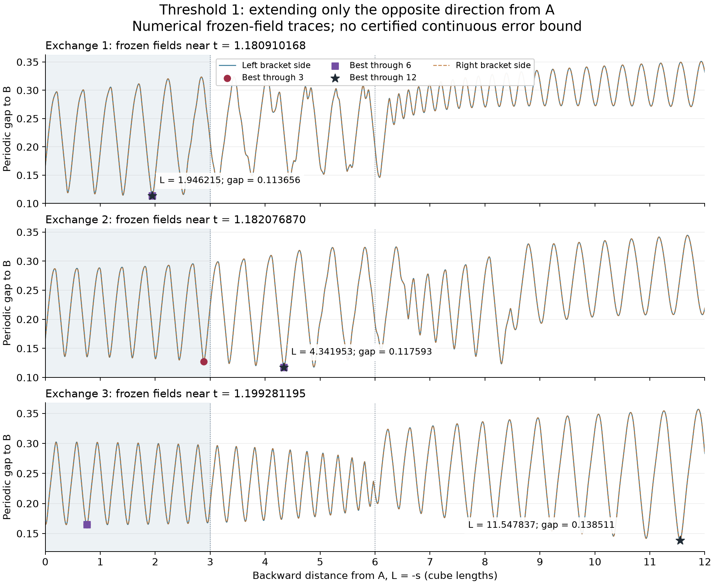

# Threshold 1: extend the opposite direction from A

**Following the frozen trace farther backward finds a closer point for the second and third saved exchanges.** The second improves by backward length 6; the third improves between lengths 6 and 12. The first retains its earlier selection through length 12. This is numerical evidence about the finite viewing window, not a Lean certificate for a continuous trajectory or minimum.

The user's correction was “now expand the trace in the opposite direction from A.” The [earlier viewing-window study](../threshold-one-window-study/README.md) already reached signed arclength −3. This follow-up extends that side to **−6 and −12**, starting at the same A in each of the six archived bracket-side fields. It adds no forward tracing or fluid-time evolution. It follows the question in [PR #14](https://github.com/NousVolition/hug-sims-lean-proofs/pull/14).

## Measured comparisons

All lengths and gaps are in cube-length units. Negative signed arclength follows the opposite direction from A. The table gives the smallest measured gap to the same B on the backward-only windows `[-3,0]`, `[-6,0]`, and `[-12,0]`.

| Exchange / side | Gap through 3 | Gap through 6 | Gap through 12 | Selected s through 12 |
| --- | ---: | ---: | ---: | ---: |
| 1 / left | 0.113655876853 | 0.113655876853 | 0.113655876853 | −1.946215072922 |
| 1 / right | 0.113655888509 | 0.113655888509 | 0.113655888509 | −1.946214296090 |
| 2 / left | 0.127407312162 | 0.117593479587 | 0.117593479587 | −4.341952647136 |
| 2 / right | 0.127407357897 | 0.117593503848 | 0.117593503848 | −4.341950815745 |
| 3 / left | 0.164678228214 | 0.164678228214 | 0.138511266532 | −11.547836579103 |
| 3 / right | 0.164678227556 | 0.164678227556 | 0.138511291735 | −11.547835345563 |

The exact saved time brackets are:

- Exchange 1: `[1.1809101657867431, 1.1809101676940919]`.
- Exchange 2: `[1.1820768680572509, 1.1820768699645996]`.
- Exchange 3: `[1.1992811927795408, 1.1992811946868895]`.

For exchange 2, the additional backward segment reduces the left-side gap by **0.009813832575** relative to the previous length-3 result. For exchange 3, the reduction is **0.026166961682**. Its earlier agreement between lengths 1.5 and 3, and now 6, did not identify the closest point on the longer measured path.

Every listed selection is interior and has negative signed arclength. Appending the unchanged saved forward segment through either `+0.75` or `+3` gives the **same winner in all 18 comparisons for each forward endpoint**. Thus these improvements come from the added backward side. The original forward-only exchange records remain unchanged.

Across the saved left/right sides, the selected points through length 12 move by approximately `7.05e-8`, `1.96e-7`, and `2.60e-8`, respectively, in the periodic metric. This compares the two saved endpoints of each bracket; it does not exclude an unsampled change between them. A finite-window improvement does not establish disconnection, closure, an unlimited-path minimum, or a positive separation everywhere.



The plotted curves are sampled numerical positions. The shaded part was already in the previous length-3 window. The two bracket-side curves nearly overlap at this scale. Coincident winner symbols indicate a retained selection, not three independent minima.

## Inputs and method

The archive and configuration are reused without edits from the earlier study:

- `snapshots.npz` SHA256: `eebd442c11e378ac8115a4bed4efd42d234d596865f38667e2cf02565c2f1a19`.
- `snapshots.json` SHA256: `29c983c63e7a5150970d3f2086a44629f9df60df49b168c5b31916d5d5f3c414`.
- Six field/seed indices: **25, 26, 27, 28, 38, 39**. Both A and the original B are read from those exact archived arrays.
- Historical physical settings: threshold **1**, grid **16³**, inherited step **0.002**, local **64-substep** refinement, breathing peak component **0.5** and period **0.6**. The configuration's `dt=0.005` is not substituted for the actual inherited step. No new simulation, breathing-off control, grid refinement, or full-history refinement is run here.

The breathing drive belongs to this archived implementation. It does not redefine the user's intended unforced single HugandNavier system. [Retained meaning and scope](../../comparisons/hug-navier-single-system-scope-correction.md#meaning-to-preserve-across-implementations).

`trace.py` imports the sealed earlier study's Fourier evaluator and periodic metric. It retains all 1,331 modes with frequencies −5 through 5 in each coordinate, evaluating the real part with floating-point π. No exact Hermitian symmetry is assumed. Each snapshot time stays fixed while solving `dx/ds = omega(x)/norm(omega(x))` from `s=0` toward negative s. Equivalently, for positive backward length `L`, `dx/dL = -omega(x)/norm(omega(x))`.

Integration uses DOP853 in contiguous pieces ending at −0.75, −1.5, −3, −6 and −12. Every window within a pass shares the same curve. The added pieces cannot change the earlier pieces. Positive-arclength candidates are reused from the matching normal or tighter saved pass; no forward segment is extended. Distance-derivative sign changes, Brent root finding, endpoint candidates and dense sampling use the earlier numerical selection method. Periodic seam artifacts are rejected by a stationarity residual. This is not exhaustive interval root isolation.

Normal settings: relative tolerance `2e-12`, absolute tolerance `3e-14`, maximum step `0.004`, root-search spacing `1/4096`. Tighter settings: `2e-13`, `3e-15`, `0.002`, `1/8192`. Both passes start independently at A. Their output samples use common spacing `1/512`; root searches use the finer spacings above.

## Numerical verification

The [retained local receipt](verification.json) records **54 readings per pass**, **162 nested-window comparisons per pass**, all candidate distances, CSV/JSON agreement, fixed archive identity, joins at A, and an analytic constant-field direction/minimum fixture. The 18 earlier bidirectional winners reproduce exactly in each corresponding pass. All eight referenced input files matched their pinned hashes before and after tracing.

Normal versus tighter tracing differs by at most:

| Compared quantity | Largest observed difference |
| --- | ---: |
| Selected gap, across 54 windows | `7.686e-14` |
| Selected signed arclength | `1.156e-11` |
| Selected position | `9.768e-14` |
| Position over all 36,870 common backward samples | `6.538e-10` |

These are disagreements between numerical approximations, **not certified errors against an exact solution**. The smallest vorticity norm observed at either pass's right-hand-side evaluations is approximately `0.003456335954`; this is not a proven lower bound throughout a continuous tube. Sampled comparisons do not prove that every stationary minimum has been found.

The local runs used Python 3.12.14, NumPy 2.5.4 and SciPy 1.16.3 on Windows. Each pass's provenance records its exact input, code and output hashes. The dedicated **Threshold-one backward trace evidence** workflow uses the earlier study's NumPy 2.3.5 / SciPy 1.16.3 pins and performs a fresh Linux trace in both settings, then compares its results to this publication.

The [fresh Linux replay passed](https://github.com/NousVolition/hug-sims-lean-proofs/actions/runs/43548745504) for source head `7c60cc1346736546ec60fe107d59ea0725cfaa7f`, tested as merge `73a33eacb30ec7330e57850e73d192e5506151b4`. Across both settings, Linux-versus-local selected gaps differ by at most `2.832e-15` and sampled positions by at most `2.580e-11`. The original [passing receipt](evidence-linux/receipt.json), [artifact ZIP](evidence-linux/original-artifact.zip), both pass provenance files, and [source/digest record](evidence-linux/source.json) are retained. The ZIP's SHA256 matches GitHub's artifact digest; all nine member hashes, input identities and code identity were checked when retaining it. This is numerical reproducibility evidence, not Lean verification. Local verification and the Linux replay completed on November 13, 2026, in America/Los_Angeles (the receipts use UTC).

## Reproduce without overwriting saved evidence

From this directory in a repository checkout, using Python 3.12:

```sh
python -m pip install -r requirements.txt
export OPENBLAS_NUM_THREADS=1 OMP_NUM_THREADS=1
python -B verify.py --output ../backward-recount.json
python -B trace.py --output ../backward-replay/normal
python -B trace.py --tighter --output ../backward-replay/tight
python -B verify.py --replay ../backward-replay --output ../backward-replay-check.json
```

Use fresh output names. On PowerShell set `$env:OPENBLAS_NUM_THREADS='1'` and `$env:OMP_NUM_THREADS='1'` instead of `export`. The trace script refuses an existing output directory; the verifier refuses an existing receipt filename. Full fluid replay is documented separately in the original study and is unnecessary to retrace these supplied frozen fields.

To regenerate the figure, optionally install `matplotlib==3.11.2` and run `python -B plot.py --output ../backward-figures`. The figure is not used to select a winner. Floating-point replay is compared within the explicit numerical tolerances in `verify.py`; byte identity across platforms is not required.

- [Normal readings](normal/measurements.csv), [full candidates](normal/measurements.json), [trace samples](normal/traces.npz), [provenance](normal/provenance.json).
- [Tighter readings](tight/measurements.csv), [full candidates](tight/measurements.json), [trace samples](tight/traces.npz), [provenance](tight/provenance.json).
- [Numerical recount](verification.json), [file hashes](bundle-sha256.json), [tracing source](trace.py), [verification source](verify.py), [plot source](plot.py).

## Lean status stays separate

**This extension adds no Lean result.** The threshold-0.015 energy proofs concern another experiment. The separate [23-declaration recorded-window package](../threshold-one-window-lean/README.md) checks the earlier supplied decimal comparisons, not these new records or a trajectory.

[PR #54](https://github.com/NousVolition/hug-sims-lean-proofs/pull/54) develops the stronger continuous certificate. Its [171 checked supporting declarations and retained Linux receipt](https://github.com/NousVolition/hug-sims-lean-proofs/blob/2fe4d637629e0b48c52ce4a0a2dd4bc726e9213d/research/hug-v3/threshold-one-continuous-lean/evidence-foundations-linux/source.json) establish general bounds under exact archived-field definitions; 16 component-pilot declarations remain unverified. At that checkpoint **0/12 directional traces and 0/36 original window minima are certified**. The new length-6 and length-12 windows also have no continuous certificate. The full calculation's prior timeout is not resolved by these numerical runs.

Every bound used for a future trajectory/minimum certificate must still be verified inside Lean. Saved coefficients are supplied archived inputs, not a proof of the simulator or continuum fluid history. Numerical tolerance agreement, observed vorticity norms and sampled minima cannot be supplied as rigorous Lean hypotheses. Those obligations remain explicit and open.
