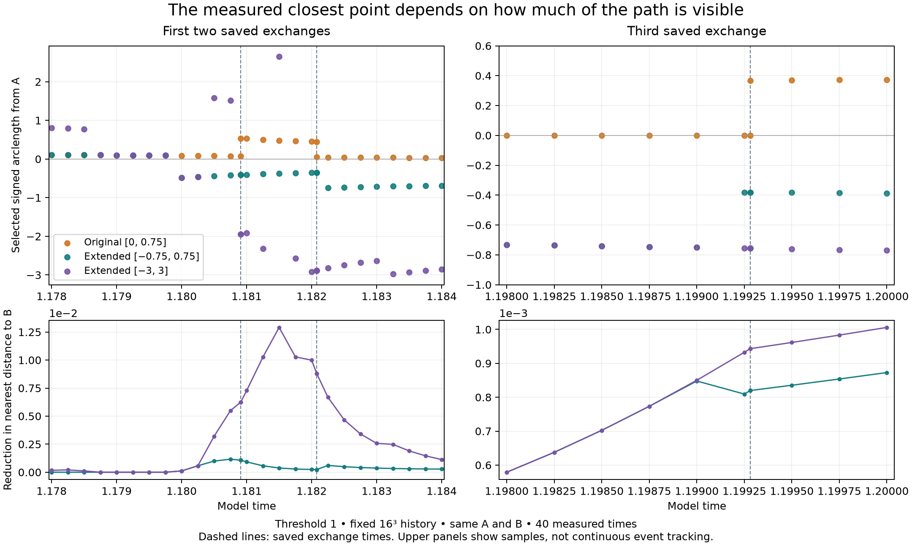

# Threshold 1 viewing window investigation

**The three saved closest-point exchanges depend on the finite viewing window.** Extending the trace 0.75 cube lengths backward from A reveals a closer candidate on both sides of every saved exchange bracket. The original exchanges remain reproducible selections within `[0, 0.75]`; they are no longer the selected nearest-point exchanges in `[-0.75, 0.75]` at those brackets. This is a new numerical finding about the measurement rule, not a Lean-verified trajectory or evidence of vortex disconnection.

The investigation follows the open question in [PR #14](https://github.com/NousVolition/hug-sims-lean-proofs/pull/14) and its [published threshold-1 record](https://github.com/NousVolition/hug-sims-lean-proofs/tree/90d0cc5d9bc27276405cbcad717bb6dcf0c5f58c/research/hug-v3/threshold-one-follow-up). Final verification completed on November 12, 2026, at 6:15 p.m. America/Los_Angeles. The fetched PR description is preserved in `saved/pr14.json`; it was merged when inspected. That snapshot predates this publication. The original local investigation remains preserved separately.

## Comparison at the saved exchanges

Here `s` is signed arclength from A, in cube lengths. Negative values follow the frozen vorticity line in the opposite direction. This is spatial extension of the trace, not backward evolution of the fluid. Distances use the original periodic three-dimensional metric to the same B.

| Saved exchange time | Original `[0, 0.75]`: selected s before → after | Extended `[-0.75, 0.75]`: selected s before → after | Distance before, original → extended |
| --- | --- | --- | --- |
| 1.180910167 | 0.068715165 → 0.538077094 | −0.409047452 → −0.409047301 | 0.119913572 → 0.118839675 |
| 1.182076869 | 0.448369653 → 0.047505821 | −0.354897356 → −0.354897308 | 0.136221199 → 0.135985998 |
| 1.199281194 | 0.000000000 → 0.367991528 | −0.381125914 → −0.381125935 | 0.165621409 → 0.164801678 |

The exact before/after times are the original brackets, each approximately 1.90735 × 10⁻⁹ wide. The negative-arclength candidate stays selected across each bracket; its physical position changes by about 5.84 × 10⁻⁸, 2.49 × 10⁻⁸, and 3.87 × 10⁻⁹ cube lengths, respectively. The original selections instead jump between distinct portions of the restricted trace. These comparisons do not assert an exhaustive absence of other exchanges between sampled times.

Extending **only forward** to `[0, 1.5]` already replaces the first two saved switches with candidates near s = 1.468415 and 1.249660, respectively. The third saved switch remains unchanged even on `[0, 3]`. Its dependence on the A-side boundary is particularly direct: at the left bracket side the measured derivative of distance with respect to signed arclength at A is +0.162327169, so following the smooth numerical curve a short distance in the negative direction decreases the distance. A is a constrained endpoint minimum in the original view, not a local minimum of the two-sided curve.

## Increasing the extension does not establish a whole-path result

| Event | Best s in `[-1.5, 1.5]` | Best distance | Best s in `[-3, 3]` | Best distance |
| --- | ---: | ---: | ---: | ---: |
| 1, before | −1.413366198 | 0.114543253 | −1.946215073 | 0.113655877 |
| 2, before | −1.169033302 | 0.134726859 | −2.882354004 | 0.127407312 |
| 3, before | −0.755981898 | 0.164678228 | −0.755981898 | 0.164678228 |

For events 1 and 2, following more of the path continues to find better candidates through the largest tested window. The third event's selection agrees between the last two tested windows at both bracket sides. Neither observation establishes the global minimum over an unlimited trace.

The surrounding scan covers 1.178–1.184 and 1.198–1.200 every 0.00025, plus the six exact saved bracket endpoints: 40 frozen fields and 240 window readings. Other winner changes occur in the enlarged views. For example, at time 1.199 the `[-0.75, 0.75]` winner is its new left endpoint, s = −0.75; by 1.19925 the selected point is near −0.380783. The longer `[-1.5, 1.5]` window instead follows an interior point from approximately −0.750397 to −0.755357 across those samples. Thus moving a boundary can move or replace a boundary-related selection change. The new change's exact time was not bisected.

`verification.json` retains coarse route-change candidates rather than treating them as resolved event counts. The 24 unresolved route changes in the earlier breathing-control study were not reanalysed here. No new breathing-off run was made.



## Method and checks

The existing threshold-1 declaration, numerical solver, breathing wrapper, marker seeds, original A/B labels, and archived states were copied byte for byte. The publication replaces personal source paths in the configuration and manifest with artifact names, preserving numerical values and recording original and published hashes in `publication-provenance.json`. The physical configuration is unchanged: 16³ grid, threshold 1, breathing peak component 0.5 and period 0.6, the same material and memory rules, and the original writes. The actual inherited integration step is 0.002; the configuration field `dt = 0.005` is not substituted for that actual step.

`replay.py` restarts from saved states at 1.178 and 1.198 and reproduces the historical 64-substep local integration, including the archived bisection decisions. Those choices locate the old event-side states; `measure.py` independently remeasures their closest candidates. At time 1.2 the local continuation reaches the pre-write state. Only velocity, observer positions, material positions and deformation are compared with the archived post-write endpoint, matching the original refinement check. Those quantities were unchanged by that write in the saved study. No memory payload was rewritten or forced to match.

At each observation time, `measure.py` solves dx/ds = ω(x)/|ω(x)| with DOP853, starting at the same A and integrating in both signed directions. It retains the original Fourier modes −5 through 5 in each coordinate and the original periodic distance. It integrates contiguous pieces to 0.75, 1.5 and 3 in each direction and uses their shared dense output for every window restriction. Stationary minima are located by distance-derivative sign changes and Brent root finding; endpoints remain eligible. Root residuals reject periodic-image seam artifacts. A dense sample comparison provides a numerical check on the minimum search, not an interval-certified bound or proof of complete root isolation.

Normal tracing uses relative tolerance 2 × 10⁻¹², absolute tolerance 3 × 10⁻¹⁴, maximum arclength step 0.004, and search spacing 1/4096. All six event-side states were measured again with tolerances 2 × 10⁻¹³ and 3 × 10⁻¹⁵, maximum step 0.002, and search spacing 1/8192.

The original investigation checks are preserved in `verification.json` (historical receipt). The public `verify.py` repeats the numerical comparisons and checks published source hashes without consulting personal paths:

- All 47 copied inputs match their SHA256 hashes, and all 47 original local inputs were rechecked read-only and remained unchanged. Five original configuration/data files match the original-file hashes recorded in the published provenance. The effective physical configuration matches the fetched published configuration.
- A/B positions at all six event sides reproduce exactly. The two local endpoint differences from the native run equal the historical recorded differences exactly. This does not make the locally refined states identical to the native trajectory.
- Original forward distances agree within 8.05 × 10⁻¹⁶ and selected arclengths within 9.44 × 10⁻¹⁶. All three restricted-window exchanges are reproduced.
- Across the six event sides and six windows, tighter tracing changes a distance by at most 2.20 × 10⁻¹³ and an arclength by at most 6.68 × 10⁻¹³. The added-segment advantage is much larger, with the smallest `[-0.75, 0.75]` improvement at a left bracket side equal to 0.000235200746.
- All 480 strict inclusion comparisons have a nonincreasing nearest distance; both directions meet exactly at A. The smallest vorticity norm encountered by any normal-trace right-hand-side evaluation is approximately 0.00359991, above the 10⁻¹⁰ rejection threshold. This is an observed numerical minimum, not a certified lower bound everywhere.
- An independent constant-field fixture checks signed direction, the original endpoint selection, and periodic nearest-distance behavior. The 240 CSV rows exactly reproduce their JSON records.

Before publication, the full local replay and both tracing passes were run again from a portable copy of this directory. All 40 frozen fields and A/B pairs, all 240 normal window readings, and all 36 tighter readings matched the original values exactly in the tested runtime. This is a new reproducibility check of the numerical procedure, separate from the preserved original receipt. [Portable replay comparison](publication-replay-check.json)

## Evidence and reproduction

Run inside this directory with Python 3.12, NumPy 2.3.5 and SciPy 1.16.3. Matplotlib 3.11.2 is optional for the figure. The bundle includes the necessary original numerical sources, accepted declaration and local restart states; replay requires no personal filesystem paths. The added breathing drive belongs to this measured branch; it does not redefine the user’s underlying unforced HugandNavier system. [Retained meaning and scope](../../comparisons/hug-navier-single-system-scope-correction.md#meaning-to-preserve-across-implementations).

```sh
python -m pip install -r requirements.txt
python -B verify.py
```

That verifies the saved results and runs the analytic fixture without changing the preserved receipt. Use `--output PATH_OUTSIDE_THIS_DIRECTORY` to save a fresh receipt. The dedicated **Threshold-one window evidence** workflow runs this numerical check separately from Lean verification. To recreate the local physical replay, all line measurements, and the figure, first make a disposable copy of this directory, because these commands replace generated arrays and measurements:

```sh
python -c "import shutil; shutil.copytree('.', '../threshold-one-window-replay')"
python -B ../threshold-one-window-replay/replay.py
python -B ../threshold-one-window-replay/measure.py
python -B ../threshold-one-window-replay/measure.py --tighter --events-only
python -B compare_replay.py ../threshold-one-window-replay
python -B ../threshold-one-window-replay/plot.py
```

Use a fresh sibling directory for the replay. `compare_replay.py` checks the recreated fields and measurements against the untouched publication, including source/code hashes. The optional figure command writes images; run it in the disposable copy if you want to keep every sealed file unchanged. Set `OPENBLAS_NUM_THREADS=1` and `OMP_NUM_THREADS=1` to match this run's thread settings. Original source versions and platform details are in `verification.json`. The recount uses the current runtime and reports its versions separately. Across platforms, compare within the documented numerical tolerances; byte equality of newly generated floating-point artifacts is not promised.

- `measurements.csv`: all 240 concise window readings.
- `measurements.json`: candidates, endpoints, sampled curves, vorticity diagnostics and original comparisons.
- `measurements-tight.json`: the six independently tighter event-side measurements.
- `snapshots.npz` and `snapshots.json`: the 40 frozen vorticity fields, A/B pairs, time labels and saved forward references.
- `replay-checks.json`: exact A/B agreement and local-versus-native endpoint comparisons.
- `verification.json`: checks, full event table, coarse route-change candidates and limits.
- `source-manifest.json`: descriptive artifact names, original and published SHA256 hashes; `bundle-sha256.json`: published file hashes; `publication-provenance.json`: publication-only edits.
- `saved/` and `sources/`: preserved configuration, reports, refinement records, restart states and numerical source code.

The original local inputs and earlier repository studies are preserved. The original numerical publication changed no Lean proof inputs. A subsequent, separate [Lean package](../threshold-one-window-lean/README.md) now checks finite comparisons of these saved decimal records; the numerical data and historical receipts remain unchanged.

## What remains unproved

These are measurements of the fixed-grid numerical vorticity line, not a traced material trajectory, closed circulation certificate, vortex reconnection proof, or continuum-fluid result. The grid and the time-zero-to-restart integration history were not refined. The trace stops at signed arclength ±3; positive distances there do not prove a positive separation everywhere. Extended-window changes outside the observed times, and the exact times of newly observed route-change candidates, remain unresolved.

No Lean build was run during the original numerical investigation. The subsequent [recorded-number checks](../threshold-one-window-lean/README.md) verify 23 finite statements about its saved decimal inputs, including all 480 nested-window comparisons. No Lean theorem here proves the threshold-1 trajectories or continuous-time exchanges. PR #14's existing Hug proofs concern the threshold-0.015 finite energy accounts; its two-memory proofs concern a separate defined mathematical model. Their historical verification does not transfer to these measurements. The new result settles the narrow numerical question—selection at the three saved brackets changes when the viewing window changes—while the proposed whole-path interpretation remains open.

The separate finite Lean certificate and [actual local proof receipt](../threshold-one-window-lean/receipt.json) check those supplied numbers. They do not verify the solver, tracing, trajectory or whole-path geometry. JSON/CSV transcription and source-file hashes are checked externally in Python; the Lean kernel checks the generated exact integer comparisons. See the [proof scope and reproduction instructions](../threshold-one-window-lean/README.md).
