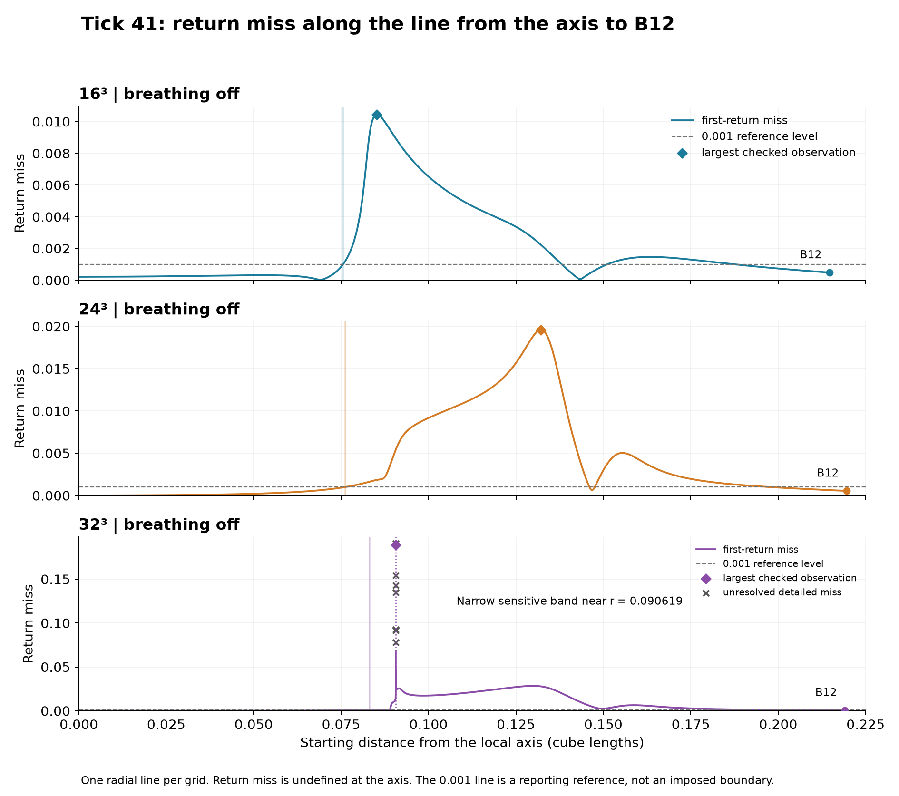
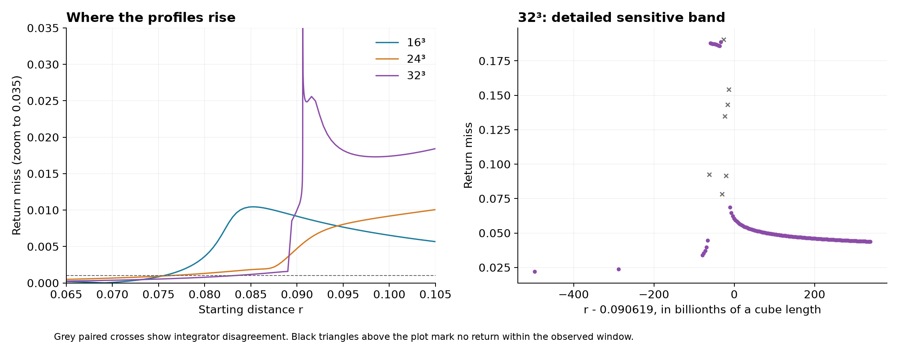

# Tick 41: where return miss rises

[Tick-41 guide](../../../docs/tick-41/README.md#from-a-fixed-field-to-an-evolving-field) · [Next: evolve a fine-wave difference](../tick-41-wave-transfer/README.md)

The user asked where return miss rises on a line from the axis to B's ring. Codex traced one such line on each of the 16^3, 24^3 and 32^3 saved breathing-off fields at model time 1.2. Each line ends at the original B12 material point, with the axis solved in that point's x plane. The coupled flow was not rerun or altered.



| Grid | First miss above 0.001: distance bracket | Largest miss among checked seeds | Distance of that observation | Miss at B12 |
|---|---:|---:|---:|---:|
| 16^3 | 0.07553931 to 0.07556552 | 0.01044735 | 0.0852372825 | 0.00048575 |
| 24^3 | 0.07612799 to 0.07615480 | 0.01960165 | 0.1321517563 | 0.00054927 |
| 32^3 | 0.08306898 to 0.08309573 | 0.18882236 | 0.0906189667 | 0.00048623 |

The profiles rise inside B's ring and fall again toward B. The 0.001 level is only a clearly stated reference for reporting the onset; it is not a material boundary or a threshold used by the tracer.

The 32^3 line has a particularly narrow sensitive band near r = 0.090619, about 41.36% of the axis-to-B distance. Additional radial sampling reveals larger excursions; the extended controls test for returns beyond the original 1.5 observation window. Largest observed values are sample-dependent; the table does not claim a converged supremum.

At 32^3, 7 sampled curves had no qualifying return by arclength 1.5. Sixteen critical seeds were checked at tighter tolerances and extended to arclength 6. All sampled positive-radius curves returned within the extended window, but 7 critical checks fail the declared agreement tolerances. Their individual results and discrepancies remain explicit in the CSV.



## Every curve

[every-seed-return-miss.csv](every-seed-return-miss.csv) contains 2062 unique seed rows, including the three axis points. It gives each starting distance, seed coordinates, return miss, axial and transverse displacement, return arclength, solver controls and any independent check. Blank return misses mean undefined at the axis or no qualifying return, never zero. Rows marked unresolved between integrators are not certified measurements.

## Definition and checks

The curves follow instantaneous vorticity, dx/ds = omega/|omega|, in the saved periodic Fourier field. Distance r is the transverse distance along the chosen straight segment, not the shortest distance to the entire curved axis. A return is the first same-direction recrossing of the seed's transverse section after at least three quarters of a turn about the local x-parallel reference. Its miss is the unwrapped three-dimensional distance from the seed.

The fixed 0.09375 departure cutoff in the earlier audit was removed for this scan: near-axis circuits can be shorter than that, and retaining it would skip their first return. The endpoint B12 misses reproduce the earlier audit within the numerical check tolerance.

The main scan uses 512 equally spaced positive radii per grid, then 90 extra seeds around the onset, peak and steepest rise. The 32^3 narrow band receives 253 additional seeds. Direct Fourier DOP853 is checked with independent direct Fourier RK45 at selected radii, including the rises, maxima and B. The critical 32^3 checks use relative tolerance 2e-13, absolute tolerance 2e-15, maximum arclength step 1/1024 and horizon 6. Checks require return-miss agreement below 2e-7 and return-arclength agreement below 2e-6; failures remain visible.

This locates behavior along one chosen radial line on each finite grid. It does not establish a complete circular boundary, nor convergence across fluid grids. Most of the large miss is axial displacement; the CSV reports both parts rather than inferring closure from the y-z picture.

## Follow the next question

These rows measure sensitivity to the starting point in a **fixed field**. Their return arclength is distance along a curve, not elapsed fluid time. They do not measure error passing between wavelengths.

That suggestion led to the [evolving-field test](../tick-41-wave-transfer/README.md): start from the same post-write 32³ state, introduce only a fine-band velocity difference, and watch the broad modes as both full coupled copies evolve. That test supports a small transfer route; its effect on these return misses remains open.

## Public evidence and checking

This directory publishes the exact merged table, figures, summary and selected-integrator checks from the completed radial scan. `verify_records.py` recounts the 2,062 seed rows, undefined axis entries and seven unresolved checks, and checks each displacement decomposition. It does not rerun the vortex curves or regenerate the saved fluid fields. The original selected-field hashes remain in [checks.json](checks.json); [publication-manifest.json](publication-manifest.json) records the public files.

```sh
python -B verify_records.py
```

No numerical values or unresolved flags were changed for publication. [Project attribution and scope](../../../README.md)
