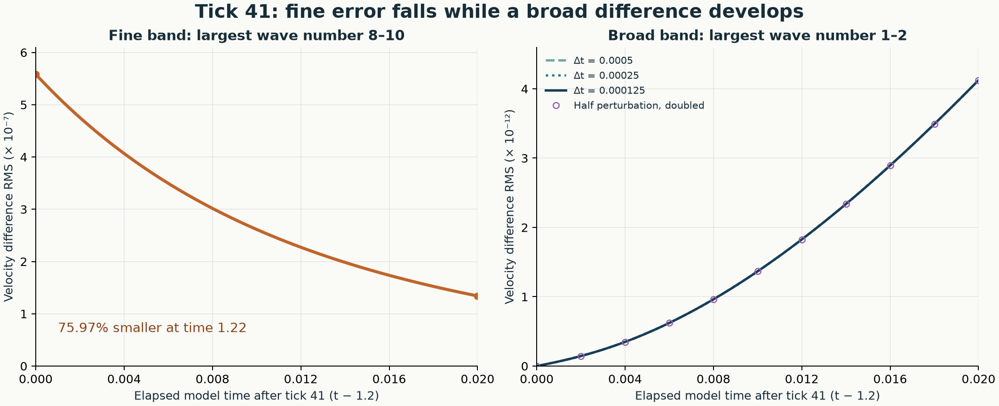
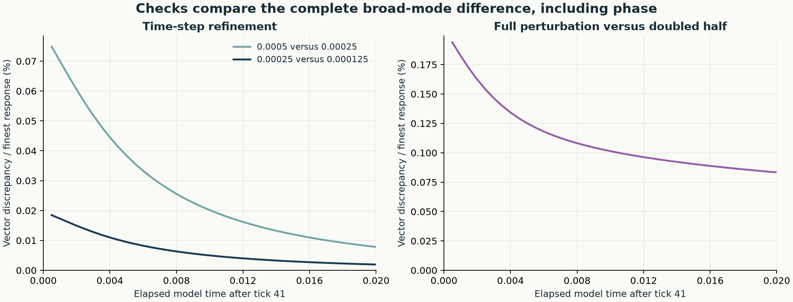

# Tick 41: a fine difference reaches broad waves

[Tick-41 guide](../../../docs/tick-41/README.md#from-a-fixed-field-to-an-evolving-field) · [Previous: radial return miss](../tick-41-radial-return/README.md) · [Evidence status](../../../PROOF-STATUS.md)

**A fine-only velocity difference produces a small broad-wave difference while the fine difference fades.** This test continues the saved threshold-1, breathing-off **32³** state from **time 1.2, after the third write, to 1.22**, with the full coupling active.

The question came from the [frozen-field return scan](../tick-41-radial-return/README.md): could a discrepancy in fine waves reach broad waves as the field evolves? The two copies here begin with identical material, clay, heat, context, position and actor states. One receives a divergence-free velocity perturbation whose RMS is **0.01% of the initial velocity RMS**. No new external input or write is added in this interval.



| Velocity difference, RMS | At 1.2 | At 1.22, finest step |
| --- | ---: | ---: |
| Fine band | 5.582697714 × 10⁻⁷ | 1.341646254 × 10⁻⁷ |
| Broad band | 1.83 × 10⁻²⁰, roundoff | 4.124655001 × 10⁻¹² |

The fine difference falls **75.97%**. The broad difference ends at **8.31 × 10⁻¹⁰ of the baseline broad-wave RMS**. The absolute response is small.

## Follow the checks

The two finest steps, 0.00025 and 0.000125, agree within **0.00193%** in the final broad difference, including its phase. Across the 40 common times after the start, their largest discrepancy is **0.01847%**. Halving the perturbation nearly halves the response; after rescaling, the final vector discrepancy is **0.08333%** and the largest is **0.19401%**.

The first transfer enters mainly through advection, with a temperature-dependent viscosity contribution. Evaluating those initial products on denser work grids changes the result by only **0.0000226%**. This checks the initial calculation; all evolving runs use the saved 32³ state.



The result establishes a transmission route in this numerical state. It does not yet connect that small broad response to the earlier large return-miss changes. The next link would measure the same return rule in the matched evolving fields. One perturbation direction, two amplitudes and a 0.02-time interval were tested; full spatial and independent-integrator convergence were not tested here.

## Definitions and exact records

Wave numbers count cycles across the unit cube. The **fine band** is `8 ≤ max(|kx|,|ky|,|kz|) ≤ 10`; the **broad band** is `1 ≤ max(|kx|,|ky|,|kz|) ≤ 2`, excluding the spatial mean. RMS is the square root of the volume average of the squared velocity-vector difference. It measures differences between two evolving fields, not curve-return distance or energy flux.

| Read | File |
| --- | --- |
| Complete methods and figures, downloadable HTML | [Full report](report/Tick-41-fine-to-broad-test.html) |
| All three time-step histories, 283 rows | [CSV](report/all-time-histories.csv) |
| Complete numerical comparisons | [Results](report/RESULTS.json) |
| Phase-sensitive comparisons at 41 common times | [Vector controls](report/vector-control-comparisons.csv) |
| Initial transfer terms and denser-product checks | [Initial route](outputs/initial-route/initial-route.json) |
| Exact starting state, bands, amplitude and hashes | [Experiment](EXPERIMENT.json) · [Inputs](inputs/) |
| Exact ending states and complex Fourier differences | [Run outputs](outputs/) |
| Saved-state origin and write history | [Source provenance](source-provenance/) |

## Reproduce this continuation

Clone the repository and run from this study directory with Python 3.12 and the dependencies in `requirements.txt`:

```sh
python -m pip install -r requirements.txt
python -B verify_package.py
python -B run_transfer.py prepare
python -B run_transfer.py run --dt 0.0005
python -B run_transfer.py run --dt 0.00025 --half-amplitude
python -B run_transfer.py run --dt 0.000125
python -B initial_route.py
python -B analyze.py
python -B build_report.py
```

`verify_package.py` checks the saved records and replays the first paired step. The complete evolutions take several minutes. All copies start from the same published post-write state; the original time-zero-to-1.2 history is preserved by provenance rather than rerun by these commands.

The sealed numerical model and active declarations retain their original bytes. Wrapper and verification files received portability edits for publication, recorded in [PUBLICATION.json](PUBLICATION.json). The [public verification receipt](PUBLIC-VERIFICATION.json) records the replay using these published copies; [VERIFICATION.json](VERIFICATION.json) preserves the earlier package check. [File hashes](SOURCE-MANIFEST.json) identify the published evidence.

The hypothesis and direction are NousVolition's; the computation and checking were carried out with Codex. [Project attribution and scope](../../../README.md)
