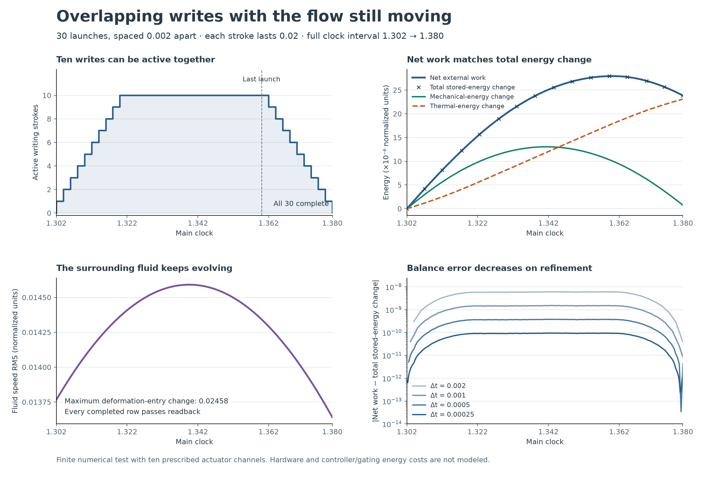

# Overlapping writes beside the memory proofs

AI-generated; dictated and directed by NousVolition.

**Saved numerical evidence supports this finite experiment. No new Lean theorem is claimed.** Thirty journal rows are written while the surrounding flow continues evolving. Each stroke takes 0.02 time units; launches are 0.002 apart, from 1.302 to 1.360, and the last completes at 1.380. Up to ten writing strokes are active together.

[Return to the walkthrough beside packages 10–17](../../lean/README.md#overlapping-writes-a-numerical-example).

## What was checked

The saved-data review covered four writing runs and four matching no-new-write controls. It recomputed the schedule, scalar energy balances and refinement errors; checked command bytes, checksums, heat accounts and source/input hashes; and freshly ran the original physical-probe decoder on all eight saved final states. All four writing runs decode all 30 new journal rows. The previous 651 journal rows and three event records retain their bytes.

The chart is the original image, unchanged. Its decoded pixels also match the image supplied in the conversation. The 113 reviewed source/evidence files were unchanged before publication, including all 40 files checked against the study's inherited-input manifest. The review did not integrate the flow again or compile Lean.

| Time step | Maximum recorded energy-balance error, recomputed from the saved trajectory |
| ---: | ---: |
| 0.002 | 6.018702 × 10⁻⁹ |
| 0.001 | 1.517760 × 10⁻⁹ |
| 0.0005 | 3.782616 × 10⁻¹⁰ |
| 0.00025 | 9.441824 × 10⁻¹¹ |

The maximum balance error falls by about four when the time step halves. All 30 command payloads match across the four resolutions. This supports the recorded time-step balance trend for this finite experiment. It does not establish spatial convergence or the full evolution theorem.

## Reading the energy panel

The work account is signed and includes the writing actuators, the existing threshold force and the existing breathing force. At the finest time step:

| Quantity | Normalized energy |
| --- | ---: |
| Net external work, all sources | 2.383687383849 × 10⁻⁵ |
| Writing-actuator work alone | 5.271136433510 × 10⁻⁶ |
| Mechanical-energy increase | 7.463024420396 × 10⁻⁷ |
| Thermal-energy increase | 2.309057003798 × 10⁻⁵ |
| Final balance residual | 1.358473 × 10⁻¹² |

Within that residual, net external work equals the mechanical-energy increase plus the thermal-energy increase. The late decline of the blue curve is consistent with signed work: the breathing force can remove energy. It does not mean cumulative dissipation decreases.

The final deformation-entry change recomputes to 0.02457903094, matching the chart's 0.02458 label. The finest writing run also differs from its no-write control in fluid velocity by RMS 3.037888 × 10⁻⁷. These are results for the declared numerical model.

## Connection to packages 10–17

| Packages | Related question illustrated here | Proof limit |
| --- | --- | --- |
| 10–12: writes and hybrid/source models | Can writing proceed while the surrounding system changes? | This experiment uses finite prescribed strokes. The earlier formal event-update definitions do not certify this implementation or these trajectories. |
| 13: transfer | Are the commanded bytes present in the evolved material? | Final journal readback does not establish the complete finite-time transfer claim. The new rows are journal samples; the three event-outcome writes occurred earlier. |
| 14–15: delays and continuation | What happens while several writes are pending? | Stroke duration is not the fixed social-response delay analyzed in those packages. Full delayed/hybrid evolution remains unfinished. |
| 16–17: memory rules and readability | Can completed records remain readable as material changes? | Successful finite readback does not establish every future write, unlimited capacity, indefinite retention or the hypotheses of the full conditional theorem. |

The formal packages state conditions and prove scoped implications. This separate numerical experiment checks related requirements for one specified implementation over a short interval. A correspondence proof connecting those formal definitions to this simulator has not been supplied.

## Model assumptions and remaining limits

The experiment uses a 16³ grid, 384 material points, ten prescribed actuator channels and an explicit busy-reader rule. A row's command is sampled at launch and held for its stroke. Busy rows are excluded from the committed reader while the material state continues evolving. Completed cells resume their native relaxation. The prepared earlier history still used instantaneous writes.

Actuator infrastructure, controller logic and gating have no modeled physical energy cost or calibrated hardware limit. These choices belong to this driven experiment and do not redefine the user's intended unforced continuum formulation.

Intermediate full physical states are not saved in the reviewed folder. Completion-time physical checks and stage power checks therefore retain their historical-run status. The review checked their recorded accounts and code, and freshly decoded final states; it did not independently reconstruct every intermediate physical state or rerun the solver. Full spatial existence, uniqueness, all-event continuation and universal write success remain unfinished.

## Source and verification record

This chart comes from the separately retained local `overlapping-writes` numerical experiment. The saved-data review reported PASS after reading its trajectories, schedules, command and completion accounts, source hashes and final-state arrays. The original image's SHA-256 is `2a0ac65a65cbbac69bf1a3698bf76e93ae72758cf2e24c73d6343a4163b88f3b`.

This addition publishes the unchanged chart and its explanation. The full solver/run archive and saved-data review receipt remain in the local research records; they are not included here. This page therefore summarizes that numerical review rather than providing a standalone reproduction package. GitHub checks for this documentation change do not rerun the numerical experiment or establish a new Lean result.

## Credits

Ideas and direction remain credited to **NousVolition**. The numerical study, chart, saved-data review and this documentation are AI-generated work with **Codex (OpenAI)** under that direction. Publication preserves the original chart and the study's numerical scope.

The earlier packages retain their original proof and review credits. [Observation-package credits](../ambiguous-observation-lean/CREDITS.md) preserve Claude's independent review and drafting contributions separately from Lean compilation and preserve the earlier assistant's field-equation proof authorship. No authorship of those earlier proofs is reassigned by this addition.

The Hug v3 Yang–Mills audit, the real-valued `readJet` example and the abelian field-equation comparison retain their separate scopes and records in the [walkthrough](../../lean/README.md#separate-observation-and-field-equation-checks). This numerical writing experiment establishes no Yang–Mills result.
