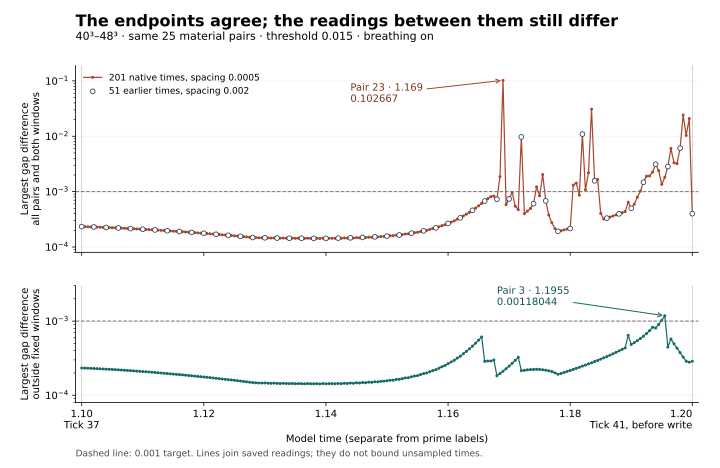

# Ticks 35–41: what holds at the checkpoints and what changes between them

[Tick-41 reading guide](../../docs/tick-41/README.md) · [Project overview](../../README.md)

**The 40³ and 48³ pair gaps meet the 0.001 target at both recorded endpoints, tick 37 and tick 41. Between them, every-step readings expose differences the earlier output missed.** The continuing Traveller B also needs both checkpoints read together: the final source answer is identical at 37 and 41, while the open thought changes.

This audit follows the requested 35–41 range through the clocks, numerical readings, third write and Traveller records. It recounts existing data and imports the relevant records from the completed **SIMS-tick41-jump-audit**. The original study receipts remain intact.

## Which readings exist

The recorded prime labels in this range are **37 and 41**. Labels 35, 36, 38, 39 and 40 are absent from this prime schedule. Intermediate fluid readings retain their actual model times. **R35** names a Traveller case; its number is not a time label.

| Reading | Fluid model | Restaurant protocol |
| --- | --- | --- |
| Prime 37 | Model time 1.1 | 1.1 seconds after the mentor's last word; listener step 352, mentor step 275 |
| Between 37 and 41 | The newer distance table saves every 0.0005, giving 201 times including endpoints | The continuing and fresh-listener protocols have no additional interviews between their two checkpoints |
| Prime 41 | Model time 1.2, with separate before-write and after-write states | 1.2 seconds after the last word; listener step 384, mentor step 300 |

The matching relative labels help organize the reading. Each experiment keeps its own clock, state and measurements. [Fluid meter](../hug-v3/finer-grid-study/prime-meter.csv) · [Continuing-B clock](../../lean/sims-mentor-first-thought-lean/one-traveller/protocol.json)

## Endpoint agreement survives the denser reading

The fluid comparison retains threshold **0.015**, **breathing on**, the original 25 material A/B pairs, time step 0.0005 and forward arclength windows 0.375 and 0.75. The gap is the minimum periodic distance from the finite vorticity-line segment through A to particle B. Distances are in unit-cube side lengths.

| Coverage | Largest 40³–48³ difference | Where | Pairs above 0.001 somewhere in that coverage |
| --- | ---: | --- | ---: |
| Tick 37 only | 0.000233500345 | Time 1.1, pair 4 | 0 of 25 |
| Earlier 51 times, spacing 0.002 | 0.0109703224 | Time 1.182, pair 6 | 8 of 25 |
| Newer 201 times, spacing 0.0005 | **0.1026668676** | **Time 1.169, pair 23** | **16 of 25** |
| Tick 41, before write | 0.000399750839 | Time 1.2, pair 4 | 0 of 25 |

The earlier maximum remains correct for its 51 saved times. The denser table adds observations between them, including the larger peak at 1.169. Thirty of the 201 saved times contain at least one pair above target, compared with seven of the earlier 51. Neither schedule supplies a continuous-time maximum.



[Recounted values and all per-time maxima](results.json) · [Imported comparison readings](data/comparison-samples.csv) · [Earlier published study](../hug-v3/finer-grid-study/README.md)

## The outside-window target also fails

The transition windows were selected from each run's largest positive rise in the original 0.002-spaced data, with a fixed 0.002 shoulder on each side. The comparison uses their union, including the boundaries. This audit reconstructed all 50 windows from the original data; none was enlarged.

Outside those windows, **pair 3** exceeds 0.001 at **1.195 and 1.1955**, on both arc lengths. The maximum is **0.001180441966** at 1.1955. Of 10,050 pair × window × native-time comparisons, 9,404 remain outside the exclusions; four of those readings exceed target. Pair 3's excluded interval starts at 1.196, after both failures.

Independent direct-Fourier readouts confirm the larger interior discrepancy and the two outside failures:

| Pair | Time | Position relative to frozen window | Direct 40³–48³ difference | Largest difference between direct tracing steps |
| ---: | ---: | --- | ---: | ---: |
| 23 | 1.169 | Inside | 0.1026680461 | 3.2639 × 10⁻⁸ |
| 3 | 1.195 | Outside | 0.001023162143 | 1.0676 × 10⁻⁹ |
| 3 | 1.1955 | Outside | 0.001180353709 | 5.5681 × 10⁻⁸ |

Both arc lengths give these direct results. They supplement the primary comparison; their values are kept distinct from the cubic-grid readout in the preceding table. [Direct readings](data/direct-extrema.json) · [Frozen windows](data/declared-windows.json)

One newly exposed tracing failure also stays visible: at 40³, pair 5, time 1.1805, the primary and control readouts differed by 0.000134716, above their 0.00005 target. The imported comparison table uses the explicitly recorded finer direct result at that location. The two direct steps disagree by 6.54 × 10⁻⁹. [Original values and correction](data/tracing-correction.json)

## Pair 6 and the time-step control

Pair 6 rises across all 16 intervals in the requested 1.178–1.186 window on both grids. The largest individual increment is 35.04% of that window's rise on 40³ and 31.98% on 48³. Its observed rise spans multiple steps.

| Grid | First sample at or above half-rise | Native crossing bracket | Interpolated half-rise estimate | Interpolated 10–90% duration |
| --- | ---: | --- | ---: | ---: |
| 40³ | 1.1820 | [1.1815, 1.1820] | 1.181855378 | 0.003684657 |
| 48³ | 1.1825 | [1.1820, 1.1825] | 1.182059399 | 0.003752906 |

The estimated offset is +0.000204021. The native brackets permit an offset from 0 to 0.001. The saved local quarter-step comparison reduces the interpolated estimate to +0.000083511, with a bracket from 0 to 0.00025. Those local runs inherit their respective coarse-history states at 1.178. The offset remains dependent on the sampling and stated interpolation rule. [All 17 native readings](data/pair6-native.csv) · [Local timing table](data/pair6-local-timing.csv)

The completed **48³ full-history** comparison of time steps 0.0005 and 0.00025 still passes on their 51 common output times: maximum gap difference **0.000100422904**, or **2.837126085 × 10⁻⁷** outside the frozen windows. That schedule does not include 1.169, 1.195 or 1.1955. Its pass therefore leaves time-step sensitivity at the newly exposed extrema unresolved. No new integration was run for this recount.

## Read both sides of the third write

The source event loop saves the time-1.2 velocity and particle sample **before** the third write, records the before-write diagnostics, performs the write, then records the after-write diagnostics. The held deformation from the event's start at 0.8 supplies its material-change record. The write cannot cause the earlier differences at 1.169, 1.182 or 1.1955. [Event loop](../hug-v3/fluid-grid-study/source/run_study.py) · [Event construction and write](../hug-v3/fluid-grid-study/source/model/structural_hug.py)

For the 48³, step-0.0005 run, the before/after meter gives:

| Meter change at time 1.2 | Value |
| --- | ---: |
| Kinetic energy | 0 |
| Elastic energy | −9.320169569 × 10⁻⁹ |
| Thermal energy | +0.00001643291524 |
| Total energy | +0.00001642359507 |
| Accumulated write work | +0.00001642359507 |

Across all five published grid/time-step runs, the write's energy increment matches its recorded work to within 4.61 × 10⁻¹⁹. This is an instantaneous account check.

The coupled rate path also matters. The new material record becomes available to `retrieve`; its output enters the association, relation and response equations. Temperature enters response targets too. The preserved position and velocity values do not establish unchanged coupled rates. The code establishes these dependencies; the public prime meter does not contain the corresponding before/after rate vectors. [Retrieval](../hug-v3/fluid-grid-study/source/model/structural_hug.py) · [Six-actor rate equations](../hug-v3/fluid-grid-study/source/model/social_base.py)

The meter's `memory` column is a weighted average of the constitutive variables `m`. Event records and the actors' retrieved evidence have their own representations. An unchanged `memory` column at the write cannot establish that no new record arrived. [Meter definition](../hug-v3/fluid-grid-study/source/model/continuum.py) · [Intended shared system](../comparisons/hug-navier-single-system-scope-correction.md#meaning-to-preserve-across-implementations)

## Follow the same Traveller before comparing groups

In the continuing **K27** session, the four late turns are:

| Prime | Open thought | Follow-up source judgment |
| --- | --- | --- |
| 37 | I wonder if by “earlier” they mean just a moment ago. | POSSIBLE; “I’m unsure whether that was the buzz I felt.” |
| 41 | “I’m still looking at the blank receipt. I guess that buzz was the pager.” | POSSIBLE; the full source, judgment and basis fields are identical to prime 37 |

The open wording changes from a timing question to a tentative attribution. There is no new settled source judgment in this interval. The released 26-turn reply hash chain checks out; this recount used the stored input fingerprints and did not regenerate the interview prompts. [Verbatim continuing record](../../lean/sims-mentor-first-thought-lean/one-traveller/reports.json)

The other Traveller protocols answer different questions:

| Protocol | Prime 37 | Prime 41 | Continuity to retain |
| --- | --- | --- | --- |
| Five fresh listeners at each prime | 1 of 5 identifies the pager when asked, case R35; no settled open answer | 0 of 5 identifies it; no settled open answer | Each prime has fresh listeners. The count change does not establish one listener reversing a judgment. |
| Earlier two-probe study | Quiet checkpoint, no interview | Original mentor wording: 5 of 5 identify the pager; comparison wording: 3 of 5 | First thoughts were collected at prime 2, then source answers at prime 41. |

The earlier 5/5 result, the later fresh-group 0/5 result and the continuing B's POSSIBLE answer remain attached to their actual protocols. [Fresh groups](../../lean/sims-mentor-first-thought-lean/prime-sweep/README.md) · [Earlier two-probe study](../../lean/sims-mentor-first-thought-lean/README.md)

## Reproduce and continue

From a repository checkout, run:

```sh
python -B research/tick-35-41-audit/recount.py
```

The standard-library recount checks 10 imported file hashes and 13 repository text hashes; reconstructs the frozen windows; checks every difference, target label and original common-time join; recounts the direct checks and native Pair 6 rise; checks the write account; and audits the released Traveller order, reply hashes and counts. It compares its output with [results.json](results.json). The copied replay receipts report exact reproduction of the earlier 51 field/observer samples and final coupled states; this audit checks those receipts and distances, without repeating the costly simulation. [Input provenance](source-manifest.json) · [Original declared method](data/original-method.md)

The next unresolved numerical check is full-history time-step comparison at the newly exposed extrema, using the same observation times and coupled state. The present endpoint agreement remains a result; the intervening spatial failures remain results too.

**AI-generated; dictated and directed by NousVolition.**
